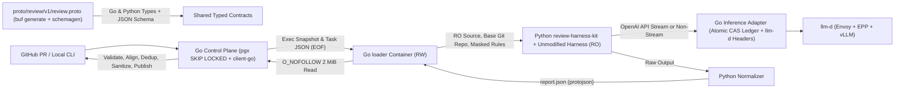

# review-agent-infra

A **100% self-hosted, end-to-end pluggable coding review agent** for `llm-d`.

It uses **Protobuf (`proto/review/v1/review.proto`)** as the single source of truth for cross-language contracts, **Go (`cmd/*`, `internal/*`)** for all control-plane, PostgreSQL queue, Kubernetes gVisor/Docker/local sandbox, streaming proxy, and CLI infrastructure, and **Python (`python/review-harness-kit`)** strictly inside the isolated sandbox to wrap **existing open-source coding harnesses** (`OpenHands`, `PR-Agent`, `Codex CLI`, `mini-SWE-agent`, `OpenCode`, `Goose`, `Aider`) unmodified. Inference runs on a self-hosted `llm-d` cluster with fallback to standalone vLLM or Ollama.

## How It Fits Together



## Five Plugin Boundaries

| Boundary | Language | Default | Alternatives |
| :--- | :--- | :--- | :--- |
| VCS Trigger & Publisher | Go (`VCSPlugin`) | `github-app`, `local-cli` | `gitlab`, `gitea` |
| Sandbox Runner | Go (`SandboxRunner`) | `k8s-gvisor-pod` | `k8s-kata`, local `docker`, `local` |
| Agent Harness Adapter | Python (`HarnessAdapter`) | `openhands`, `pr-agent` | `codex`, `mini-swe-agent`, `opencode`, `goose`, `aider`, `single-shot`, `mock-llm` |
| Context & Tooling | Go + Container `PATH` | `base_sha` rules, `diff.patch`, `rg` / `git` / `ast-grep` / `ctags` | `FetchCheckLogs`, isolated `run_scoped_test` Pod |
| Inference Endpoint Adapter | Go (`UpstreamProvider`) | `llmd-gateway` | `vllm-direct`, `sglang`, `ollama` |

## Build, Test, CLI, and Control-Plane Usage

### 1. Build Static Binaries & Regenerate Contracts

```bash
# Build bin/{loader,controller,adapter,reviewctl,schemagen}
make build

# Regenerate Go/Python Protobuf bindings and strict ReviewReport JSON Schema
make proto
make schema
```

### 2. Run Unit & End-to-End Integration Suites

```bash
# Run all Go unit + PostgreSQL + full-stack controller/CLI E2E tests (-race) and Python adapter/normalizer tests
make test

# Or run Go and Python suites individually
GO111MODULE=on go test -race ./...
cd python && uv run pytest -v && uv run ruff check
```

### 3. Local Review & Multi-Harness Comparison (`reviewctl`)

```bash
# Side-by-side multi-harness comparison against any local git repo (self-contained mock llm-d SSE upstream)
./bin/reviewctl compare \
  --repo /path/to/llm-d-router \
  --commit HEAD \
  --harnesses single-shot,mock-llm \
  --mock-upstream

# Single-profile review against a live llm-d gateway or vLLM endpoint
./bin/reviewctl review \
  --repo /path/to/llm-d-router \
  --base main --head HEAD \
  --harness openhands \
  --upstream-kind llmd-gateway \
  --upstream-url http://127.0.0.1:8000 \
  --upstream-model Qwen/Qwen3-Coder-30B-A3B-Instruct
```

### 4. Production Control Plane & Kubernetes Deployment (`controller` + `adapter`)

```bash
# Run the streaming Inference Adapter locally (:8080 sandbox API, :9090 internal usage & /metrics)
./bin/adapter \
  --listen-addr :8080 \
  --internal-addr :9090 \
  --upstream-kind llmd-gateway \
  --upstream-url http://llmd-gateway.llm-d.svc:8000 \
  --token-key "$ADAPTER_TOKEN_KEY"

# Run the Webhook & Queue Controller against PostgreSQL and Kubernetes gVisor sandboxes
./bin/controller \
  --listen-addr :8081 \
  --database-url "$DATABASE_URL" \
  --sandbox-runner k8s \
  --sandbox-namespace review-sandbox \
  --runtime-class gvisor \
  --adapter-sandbox-url http://inference-adapter.review-system.svc.cluster.local:8080 \
  --adapter-internal-url http://inference-adapter.review-system.svc.cluster.local:9090 \
  --token-key "$ADAPTER_TOKEN_KEY" \
  --github-app-id "$GITHUB_APP_ID" \
  --github-private-key-file /etc/review/github-app.pem \
  --github-webhook-secret "$GITHUB_WEBHOOK_SECRET"

# Build images and apply dual-namespace hardened Kubernetes manifests (Namespaces, RBAC, NetworkPolicy, Adapter, Controller)
make docker-build docker-build-control-plane
make k8s-apply
```

## Documentation

* [Architecture Overview](docs/architecture.md): High-level pipeline, component inputs and outputs, standalone binaries, end-to-end sequence with Protobuf wire formats, and trust zones.
* [Agent & Contributor Rules (AGENTS.md)](AGENTS.md): Strict contract-only commenting policy, Go `map[string]...` documentation rule, language boundaries, security invariants, and verification commands.
* [High-Level Design (HLD)](docs/design/hld.md): Architecture and trust zones, Protobuf codegen boundary, five plugin boundaries, off-the-shelf harness sandboxing, output normalization, prefix-cache matrix, `llm-d` EPP checklist, hybrid stack rationale, and rollout plan.
* [Concrete Implementation Plan](docs/design/implementation-plan.md): Repository layout, complete `review.proto` walkthrough, `schemagen`, Go interfaces and Python `HarnessAdapter` protocol, PostgreSQL DDL and `pgx` concurrency, gVisor Pod/NetworkPolicy manifests, `client-go` Exec runner and `cmd/loader`, Python adapters and Normalizer, Go streaming `cmd/adapter` with `atomic` CAS ledger, denoising/publishing pipeline, A/B scorecard, and M1-M4 milestones.

## Repository Layout

```text
review-agent-infra/
├── AGENTS.md                         # Repository engineering & commenting rules
├── Makefile                          # Build, test, schema codegen, Docker, K8s, and smoke targets
├── migrations/                       # SQL schema migrations for PostgreSQL queue, fingerprints & scorecard
├── proto/review/v1/review.proto      # Single source of truth for all cross-boundary contracts
├── scripts/gen-proto.sh              # Deterministic Go & Python Protobuf codegen script
├── gen/                              # Generated Go bindings and LLM ReviewReport JSON Schema
├── go.mod                            # Single Go module (controller, adapter, loader, reviewctl, schemagen)
├── cmd/                              # Go binary entrypoints (controller, adapter, loader, reviewctl, schemagen)
├── pkg/contract/                     # Go plugin interfaces and report bounds validator
├── internal/                         # Acyclic Go packages (store, telemetry, token, loader, inference, vcs, sandbox, publisher, orchestrator)
├── python/                           # Standalone uv package strictly for in-sandbox review-harness-kit
│   ├── pyproject.toml
│   ├── src/review_harness_kit/       # Entrypoint, 7 HarnessAdapters, Normalizer, generated proto classes
│   └── tests/                        # Contract, adapter, normalizer, and CLI E2E pytest suites
├── deploy/                           # Dockerfiles (sandbox, controller, adapter) & hardened K8s YAML manifests
└── docs/design/                      # Architecture and engineering design docs
```
