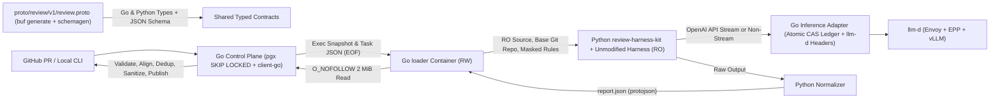

# review-agent-infra

A **100% self-hosted, end-to-end pluggable coding review agent** for `llm-d`.

It uses **Protobuf (`proto/review/v1/review.proto`)** as the single source of truth for cross-language contracts, **Go (`cmd/*`, `internal/*`)** for all control-plane, Kubernetes sandbox, streaming proxy, and CLI infrastructure, and **Python (`python/review-harness-kit`)** strictly inside the isolated sandbox to wrap **existing open-source coding harnesses** (`OpenHands`, `PR-Agent`, `Codex CLI`, `mini-SWE-agent`, `OpenCode`, `Goose`, `Aider`) unmodified. Inference runs on a self-hosted `llm-d` cluster with fallback to standalone vLLM or Ollama.

## How It Fits Together



## Five Plugin Boundaries

| Boundary | Language | Default | Alternatives |
| :--- | :--- | :--- | :--- |
| VCS Trigger & Publisher | Go (`VCSPlugin`) | `github-app`, `local-cli` | `gitlab`, `gitea` |
| Sandbox Runner | Go (`SandboxRunner`) | `k8s-gvisor-pod` | `k8s-kata`, local `docker` |
| Agent Harness Adapter | Python (`HarnessAdapter`) | `openhands`, `pr-agent` | `codex`, `mini-swe-agent`, `opencode`, `goose`, `aider` |
| Context & Tooling | Go + Container `PATH` | `base_sha` rules, `diff.patch`, `rg` / `git` / `ast-grep` / `ctags` | `FetchCheckLogs`, isolated `run_scoped_test` Pod |
| Inference Endpoint Adapter | Go (`UpstreamProvider`) | `llmd-gateway` | `vllm-direct`, `sglang`, `ollama` |

## Tech Stack

* **Contracts (`proto/review/v1/review.proto` + `buf`)**: Generates Go structs (`gen/go/...`), Python classes (`python/src/review_harness_kit/gen/...`), and the strict LLM JSON Schema (`gen/schema/llm_review_report.schema.json`) so `protojson` serialization never drifts.
* **Go Infrastructure (`go.mod`, `cmd/*`)**: `cmd/controller` (webhooks, PostgreSQL `pgx/v5` queue/leases/scorecard, `k8s.io/client-go` Exec sandboxes, hunk denoiser, publisher), `cmd/adapter` (`net/http` SSE/non-stream reverse proxy with `atomic` CAS budgets), `cmd/loader` (`CGO_ENABLED=0` static sandbox preparer using `os.OpenRoot` and `O_NOFOLLOW`), and `cmd/reviewctl` (static local review & offline A/B CLI).
* **Python Harness Kit (`python/`, Python 3.12 + `uv`)**: `review-harness-kit` runs only inside the `harness` container to invoke unmodified third-party agent CLIs and normalize output to `ReviewReport`.

## Documentation

* [High-Level Design (HLD)](docs/design/hld.md): Architecture and trust zones, Protobuf codegen boundary, five plugin boundaries, off-the-shelf harness sandboxing, output normalization, prefix-cache matrix, `llm-d` EPP checklist, hybrid stack rationale, and rollout plan.
* [Concrete Implementation Plan](docs/design/implementation-plan.md): Repository layout, complete `review.proto` walkthrough, `schemagen`, Go interfaces and Python `HarnessAdapter` protocol, PostgreSQL DDL and `pgx` concurrency, gVisor Pod/NetworkPolicy manifests, `client-go` Exec runner and `cmd/loader`, Python adapters and Normalizer, Go streaming `cmd/adapter` with `atomic` CAS ledger, denoising/publishing pipeline, A/B scorecard, and M1-M4 milestones.

## Planned Repository Layout

```text
review-agent-infra/
├── proto/review/v1/review.proto      # Single source of truth for all cross-boundary contracts
├── buf.yaml                          # Buf v2 module and lint configuration
├── buf.gen.yaml                      # Generates Go, Python, and type stubs from .proto
├── gen/                              # Generated Go bindings and LLM ReviewReport JSON Schema
├── go.mod                            # Single Go module (controller, adapter, loader, reviewctl, schemagen)
├── cmd/                              # Go binary entrypoints (controller, adapter, loader, reviewctl, schemagen)
├── pkg/contract/                     # Go plugin interfaces wrapping generated reviewv1 types
├── internal/                         # Acyclic Go packages (store, vcs, sandbox, inference, publisher, orchestrator)
├── python/                           # Standalone uv package strictly for in-sandbox review-harness-kit
│   ├── pyproject.toml
│   └── src/review_harness_kit/       # Entrypoint, HarnessAdapters, Normalizer, generated proto classes
├── prompts/                          # Shared review_task.md prompt for prompt-driven harnesses
├── migrations/                       # Plain SQL schema migrations for PostgreSQL
├── deploy/                           # Dockerfiles (loader & per-harness), Pod/NetworkPolicy specs
└── docs/design/                      # Architecture and engineering design docs
```
