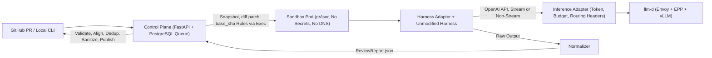

# review-agent-infra

A **100% self-hosted, end-to-end pluggable coding review agent** for `llm-d`.

It reviews pull requests with an **existing open-source agent harness** (OpenHands, PR-Agent, Codex CLI, mini-SWE-agent, OpenCode, Goose, Aider) running unmodified inside a secret-less, network-restricted gVisor sandbox, and serves its own inference through a self-hosted `llm-d` cluster. There is no custom agent loop in this repository. Switching or A/B testing harnesses is a configuration change.

## How It Fits Together



## Five Plugin Boundaries

| Boundary | Default | Alternatives |
| :--- | :--- | :--- |
| VCS Trigger & Publisher | `github-app`, `local-cli` | `gitlab`, `gitea` |
| Sandbox Runner | `k8s-gvisor-pod` | `k8s-kata`, local `docker` |
| Agent Harness Adapter | `openhands`, `pr-agent` | `codex`, `mini-swe-agent`, `opencode`, `goose`, `aider` |
| Context & Tooling | `base_sha` rules, `diff.patch`, `ripgrep` / `git` / `ast-grep` / `universal-ctags` | CI failure logs, isolated scoped-test runner |
| Inference Endpoint Adapter | `llmd-gateway` | `vllm-direct`, `sglang`, `ollama` |

## Tech Stack

One Python 3.12 package managed by `uv`: FastAPI, `httpx`, Pydantic, `psycopg` 3 on PostgreSQL (`SKIP LOCKED`), the official `kubernetes` client, `githubkit`, and `unidiff`. See the HLD for why each piece was chosen and what was rejected.

## Documentation

* [High-Level Design (HLD)](docs/design/hld.md): Goals, trust boundaries, five pluggable interfaces, how off-the-shelf harnesses run in the sandbox, output normalization, prefix-cache behavior per harness, self-hosted `llm-d` integration checklist, tech stack selection, and rollout plan.
* [Concrete Implementation Plan](docs/design/implementation-plan.md): Repository layout, Pydantic contracts and plugin `Protocol` definitions, PostgreSQL concurrent state machine and DDL, gVisor Exec sandbox, loader and harness adapters (PR-Agent, OpenHands, Codex CLI), Normalizer, streaming Inference Adapter, deduplication/publishing pipeline, harness A/B evaluation, and M1-M4 milestones.

## Planned Repository Layout

```text
review-agent-infra/
├── docs/design/              # High-level design (hld.md) and implementation plan (implementation-plan.md)
├── pyproject.toml            # One package, optional extras per deliverable
├── src/review_agent/
│   ├── contract/             # Shared Pydantic models and the five plugin Protocols
│   ├── controller/           # Webhooks, PG scheduler, harness routing, K8s sandbox runner, denoiser, publisher
│   ├── adapter/              # Inference Adapter (task tokens, budget, SSE relay, llm-d routing headers)
│   ├── kit/                  # In-sandbox loader, harness adapters, Normalizer, optional review-tools
│   └── cli/                  # reviewctl: local review, offline replay, harness comparison
├── prompts/                  # The one review task prompt shared by prompt-driven harnesses
├── migrations/               # Plain SQL migrations
└── deploy/                   # Harness image Dockerfiles, Pod template, NetworkPolicy, manifests
```
