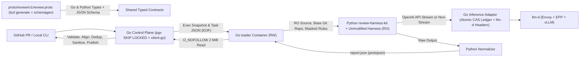

# review-agent-infra

A **100% self-hosted, end-to-end pluggable coding review agent** for `llm-d`.

It uses **Protobuf (`proto/review/v1/review.proto`)** as the single source of truth for cross-language contracts, **Go (`cmd/*`, `internal/*`)** for all control-plane, Kubernetes/Docker/local sandbox, streaming proxy, and CLI infrastructure, and **Python (`python/review-harness-kit`)** strictly inside the isolated sandbox to wrap **existing open-source coding harnesses** (`OpenHands`, `PR-Agent`, `Codex CLI`, `mini-SWE-agent`, `OpenCode`, `Goose`, `Aider`) unmodified. Inference runs on a self-hosted `llm-d` cluster with fallback to standalone vLLM or Ollama.

## How It Fits Together



## Five Plugin Boundaries

| Boundary | Language | Default | Alternatives |
| :--- | :--- | :--- | :--- |
| VCS Trigger & Publisher | Go (`VCSPlugin`) | `github-app`, `local-cli` | `gitlab`, `gitea` |
| Sandbox Runner | Go (`SandboxRunner`) | `k8s-gvisor-pod` | `k8s-kata`, local `docker`, `local` |
| Agent Harness Adapter | Python (`HarnessAdapter`) | `openhands`, `pr-agent` | `codex`, `single-shot`, `mock-llm`, `command` |
| Context & Tooling | Go + Container `PATH` | `base_sha` rules, `diff.patch`, `rg` / `git` / `ast-grep` / `ctags` | `FetchCheckLogs`, isolated `run_scoped_test` Pod |
| Inference Endpoint Adapter | Go (`UpstreamProvider`) | `llmd-gateway` | `vllm-direct`, `sglang`, `ollama` |

## Quickstart (PoC Build, Test, and CLI Usage)

### 1. Build Static Binaries & Regenerate Contracts

```bash
# Build bin/loader (CGO_ENABLED=0), bin/adapter, bin/reviewctl, and bin/schemagen
make build

# Regenerate Go/Python Protobuf bindings and strict ReviewReport JSON Schema
make proto
make schema
```

### 2. Run Unit & End-to-End Tests

```bash
# Run all Go unit + E2E integration tests (-race) and Python contract/normalizer tests
make test

# Or run Go and Python suites individually
GO111MODULE=on go test -race ./...
cd python && uv run pytest -v && uv run ruff check
```

### 3. Review Commits and Compare Harnesses Locally (`reviewctl`)

`reviewctl` runs the full pipeline end-to-end: `localgit` snapshot/diff/base-rule extraction -> static `cmd/loader` safe tar unpack & untrusted instruction masking -> read-only (`0555`/`0444`) workspace -> ephemeral Go `cmd/adapter` with HS256 JWT & atomic CAS token ledger -> Python `review-kit` harness execution & 2-step `Normalizer` -> verbatim diff-hunk line alignment, SHA-256 fingerprinting, and Prow Markdown sanitization.

```bash
# Side-by-side multi-harness comparison against any local git repo (self-contained mock llm-d SSE upstream)
./bin/reviewctl compare \
  --repo /path/to/llm-d-router \
  --commit HEAD \
  --harnesses single-shot,mock-llm \
  --mock-upstream

# Single-profile review against a live llm-d gateway or vLLM endpoint
./bin/reviewctl review \
  --repo /path/to/llm-d-router \
  --base main --head HEAD \
  --harness pr-agent \
  --upstream-kind llmd-gateway \
  --upstream-url http://127.0.0.1:8000 \
  --upstream-model Qwen/Qwen3-Coder-30B-A3B-Instruct

# Run inside the isolated 2-step Docker sandbox container (deploy/docker/Dockerfile.poc-sandbox)
make docker-build
./bin/reviewctl compare \
  --repo /path/to/llm-d-router \
  --commit HEAD \
  --runner docker \
  --harnesses single-shot,mock-llm \
  --mock-upstream
```

## Tech Stack

* **Contracts (`proto/review/v1/review.proto` + `buf`/`protoc`)**: Generates Go structs (`gen/go/...`), Python classes (`python/src/review_harness_kit/gen/...`), and the strict LLM JSON Schema (`gen/schema/llm_review_report.schema.json`) so `protojson` serialization never drifts.
* **Go Infrastructure (`go.mod`, `cmd/*`, `internal/*`)**: `cmd/adapter` (`net/http` SSE/non-stream reverse proxy with `atomic` CAS budgets and `llm-d` routing headers), `cmd/loader` (`CGO_ENABLED=0` static sandbox preparer using `os.OpenRoot` and `O_NOFOLLOW`), `internal/publisher` (unified diff parser, verbatim hunk alignment, SHA-256 fingerprinting, Prow sanitizer), and `cmd/reviewctl` (developer review & multi-harness scorecard CLI).
* **Python Harness Kit (`python/`, Python 3.12 + `uv`)**: `review-harness-kit` runs only inside the `harness` sandbox to invoke unmodified third-party agent CLIs and normalize output to `ReviewReport`.

## Documentation

* [Agent & Contributor Rules (AGENTS.md)](AGENTS.md): Strict contract-only commenting policy, Go `map[string]...` documentation rule, language boundaries, security invariants, and verification commands.
* [High-Level Design (HLD)](docs/design/hld.md): Architecture and trust zones, Protobuf codegen boundary, five plugin boundaries, off-the-shelf harness sandboxing, output normalization, prefix-cache matrix, `llm-d` EPP checklist, hybrid stack rationale, and rollout plan.
* [Concrete Implementation Plan](docs/design/implementation-plan.md): Repository layout, complete `review.proto` walkthrough, `schemagen`, Go interfaces and Python `HarnessAdapter` protocol, PostgreSQL DDL and `pgx` concurrency, gVisor Pod/NetworkPolicy manifests, `client-go` Exec runner and `cmd/loader`, Python adapters and Normalizer, Go streaming `cmd/adapter` with `atomic` CAS ledger, denoising/publishing pipeline, A/B scorecard, and M1-M4 milestones.

## Repository Layout

```text
review-agent-infra/
├── AGENTS.md                         # Repository engineering & commenting rules
├── Makefile                          # Build, test, schema codegen, Docker, and smoke targets
├── proto/review/v1/review.proto      # Single source of truth for all cross-boundary contracts
├── scripts/gen-proto.sh              # Deterministic Go & Python Protobuf codegen script
├── gen/                              # Generated Go bindings and LLM ReviewReport JSON Schema
├── go.mod                            # Single Go module (adapter, loader, reviewctl, schemagen)
├── cmd/                              # Go binary entrypoints (adapter, loader, reviewctl, schemagen)
├── pkg/contract/                     # Go plugin interfaces and report bounds validator
├── internal/                         # Acyclic Go packages (token, loader, inference, vcs, sandbox, publisher)
├── python/                           # Standalone uv package strictly for in-sandbox review-harness-kit
│   ├── pyproject.toml
│   ├── src/review_harness_kit/       # Entrypoint, HarnessAdapters, Normalizer, generated proto classes
│   └── tests/                        # Contract, adapter, normalizer, and CLI E2E pytest suites
├── deploy/docker/                    # PoC isolated sandbox Dockerfile
└── docs/design/                      # Architecture and engineering design docs
```
