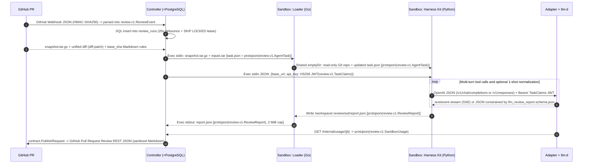
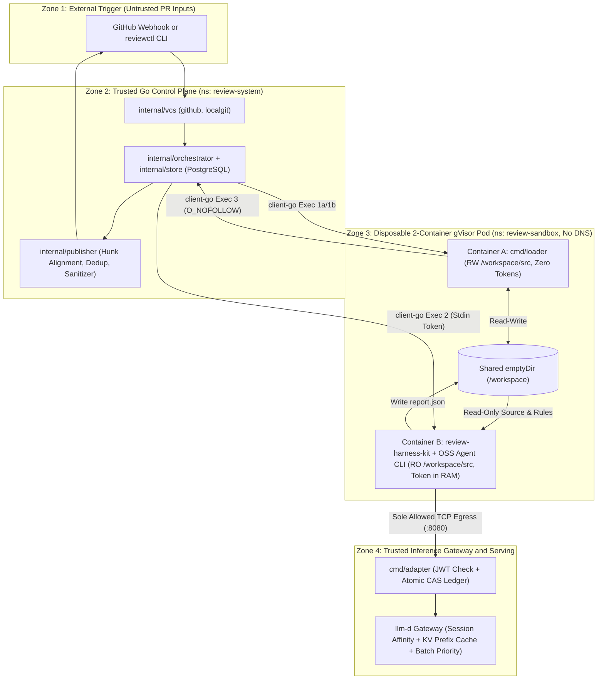

# Architecture Overview

`review-agent-infra` turns untrusted pull request diffs into aligned, deduplicated review comments on self-hosted infrastructure. One Protobuf file (`proto/review/v1/review.proto`) defines the contracts across the Go control plane, the Go inference proxy, and the in-sandbox Python harness kit.

## 1. High-Level Pipeline and Component I/O

Four runtime components move a pull request from a webhook trigger to published review comments.

```mermaid
flowchart LR
    GH["GitHub PR or Local CLI"]
    Ctrl["1. Controller (Go Control Plane + PostgreSQL)"]
    Loader["2. Loader (Go Sandbox Preparer)"]
    Kit["3. Harness Kit (Python Wrapper Around OSS Agents)"]
    Adapter["4. Inference Adapter (Go Budget and Routing Proxy)"]
    LLM["llm-d or vLLM (Model Serving)"]

    GH -->|"1. PR event, source archive, diff"| Ctrl
    Ctrl -->|"2. snapshot.tar.gz + task.json"| Loader
    Loader -->|"3. Read-only local Git repo"| Kit
    Kit <-->|"4. OpenAI requests and streamed replies"| Adapter
    Adapter <-->|"5. Routed inference traffic"| LLM
    Kit -->|"6. Normalized report.json"| Ctrl
    Ctrl -->|"7. Aligned, deduplicated PR comments"| GH
```

| Component | Entrypoint | Primary Responsibility | Inputs | Outputs |
| :--- | :--- | :--- | :--- | :--- |
| **1. Controller** | `cmd/controller` (or `cmd/reviewctl` locally) | Queues runs in PostgreSQL, launches sandboxes, denoises findings, and posts reviews | Signed GitHub webhooks (`ReviewEvent`), source tarball, `diff.patch`, `base_sha` rules, `report.json`, `SandboxUsage` | `task.json` (`AgentTask`), short-lived `TaskClaims` JWT, atomic GitHub PR `COMMENT` review |
| **2. Loader** | `cmd/loader` | Unpacks untrusted archives safely, masks repo agent instructions, and builds a two-branch Git tree | `snapshot.tar.gz` and `inputs.tar` (`task.json`, `diff.patch`, `rules/*`) over Exec stdin | Local Git repo with `base` and `pr` branches in `/workspace/src`, updated `task.json`, and safe readback of `report.json` |
| **3. Harness Kit** | `review-kit` (`python/src/review_harness_kit`) | Runs an unmodified open-source coding agent against read-only source and normalizes its output | Read-only `/workspace/src`, `task.json`, and in-memory `{base_url, api_key}` over Exec stdin | Canonical `protojson` `report.json` (`ReviewReport`) in `/workspace/.review/out` |
| **4. Inference Adapter** | `cmd/adapter` | Verifies task JWTs, enforces atomic request and uncached-token caps, and injects `llm-d` routing headers | OpenAI `/v1/chat/completions`, `/v1/responses`, or `/v1/models` requests with Bearer `TaskClaims` JWT | Streamed SSE or JSON model responses, plus `SandboxUsage` at `/internal/usage/{jti}` |

---

## 2. Binaries and Runtime Deployment

The repository builds five standalone Go binaries (`make build`) and one in-sandbox Python CLI (`review-kit`).

| Binary or CLI | Language | Execution Context | Role |
| :--- | :--- | :--- | :--- |
| `bin/controller` | Go (`CGO_ENABLED=0`) | Long-running Kubernetes `Deployment` (`review-system`) | Webhook receiver, PostgreSQL `SKIP LOCKED` worker pool, Kubernetes Pod orchestrator, and review publisher |
| `bin/adapter` | Go (`CGO_ENABLED=0`) | Long-running Kubernetes `Deployment` (`review-system`) | Streaming OpenAI proxy (`:8080` for sandboxes, `:9090` for internal usage and `/metrics`) with lock-free CAS budgets |
| `bin/loader` | Go (`CGO_ENABLED=0`) | Ephemeral sandbox Pod (`loader` container, `review-sandbox`) | Trusted filesystem helper using `os.OpenRoot` extraction and `O_NOFOLLOW` report readback with zero credentials |
| `bin/reviewctl` | Go | Developer workstation or CI job | Standalone CLI for single-commit reviews (`review`) and side-by-side multi-harness evaluation (`compare`) |
| `bin/schemagen` | Go | Build-time code generator (`make schema`) | Reflects over `review.v1.ReviewReport` to generate `gen/schema/llm_review_report.schema.json` |
| `review-kit` | Python 3.12 (`uv`) | Ephemeral sandbox Pod (`harness` container, `review-sandbox`) | Thin `prepare` / `collect` / `extract` wrapper around `openhands`, `pr-agent`, `codex`, `mini-swe-agent`, `opencode`, `goose`, and `aider` |

---

## 3. End-to-End Sequence and Wire Formats

Every cross-process step uses an explicit Protobuf message from `proto/review/v1/review.proto` or a standard archive/HTTP payload.

### Protobuf Contract Summary

| Step | Protobuf Message | Serialization and Transport | Security or Validation Invariant |
| :--- | :--- | :--- | :--- |
| **1. Trigger** | `review.v1.ReviewEvent` | In-memory Go struct parsed from verified GitHub Webhook JSON or CLI flags | Deduplicated via `webhook_deliveries` and gated for untrusted first-time forks |
| **4-5. Task Input** | `review.v1.AgentTask` | `protojson` file at `/workspace/.review/in/task.json` (`int64` fields encoded as strings) | Never stores API keys, GitHub tokens, or task JWTs on disk |
| **6-7. Auth Token** | `review.v1.TaskClaims` | Standard JSON payload signed as an HS256 JWT (`exp` as numeric Unix seconds) | Passed over Exec stdin into process RAM only and accepted solely by `cmd/adapter` |
| **8-9. Sandbox Output** | `review.v1.ReviewReport` | `protojson` file at `/workspace/.review/out/report.json` (plus `llm_review_report.schema.json` for 1-shot LLM fallback) | Read with `syscall.O_NOFOLLOW` and checked by `contract.ValidateReport` in Go |
| **9b. Token Ledger** | `review.v1.SandboxUsage` | `protojson` HTTP response from `cmd/adapter` `/internal/usage/{jti}` | Tracks prompt, cached, completion, and rejected requests outside sandbox control |

---

## 4. Trust Zones and Package Boundaries

Production deployments isolate untrusted PR code inside a disposable gVisor Pod in the `review-sandbox` namespace, separate from credentials and model backends in `review-system`.

For detailed design trade-offs, SQL schemas, and `llm-d` Endpoint Picker configuration, see [High-Level Design](design/hld.md) and [Concrete Implementation Plan](design/implementation-plan.md).
