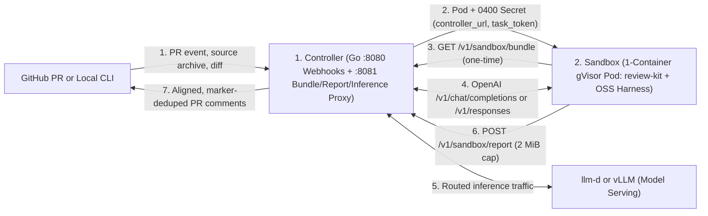
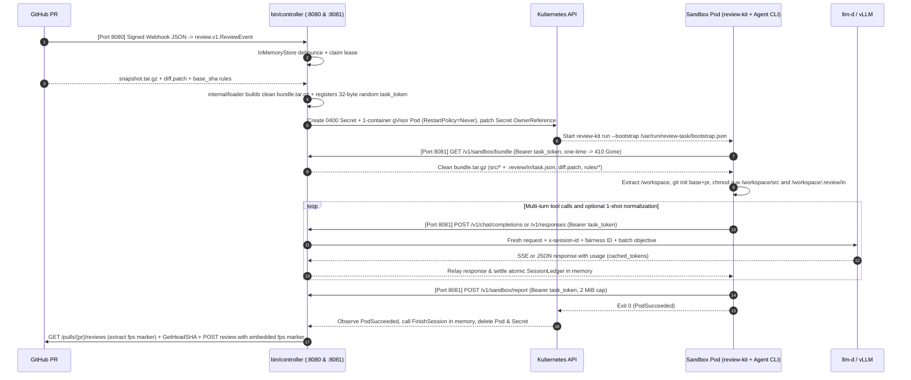
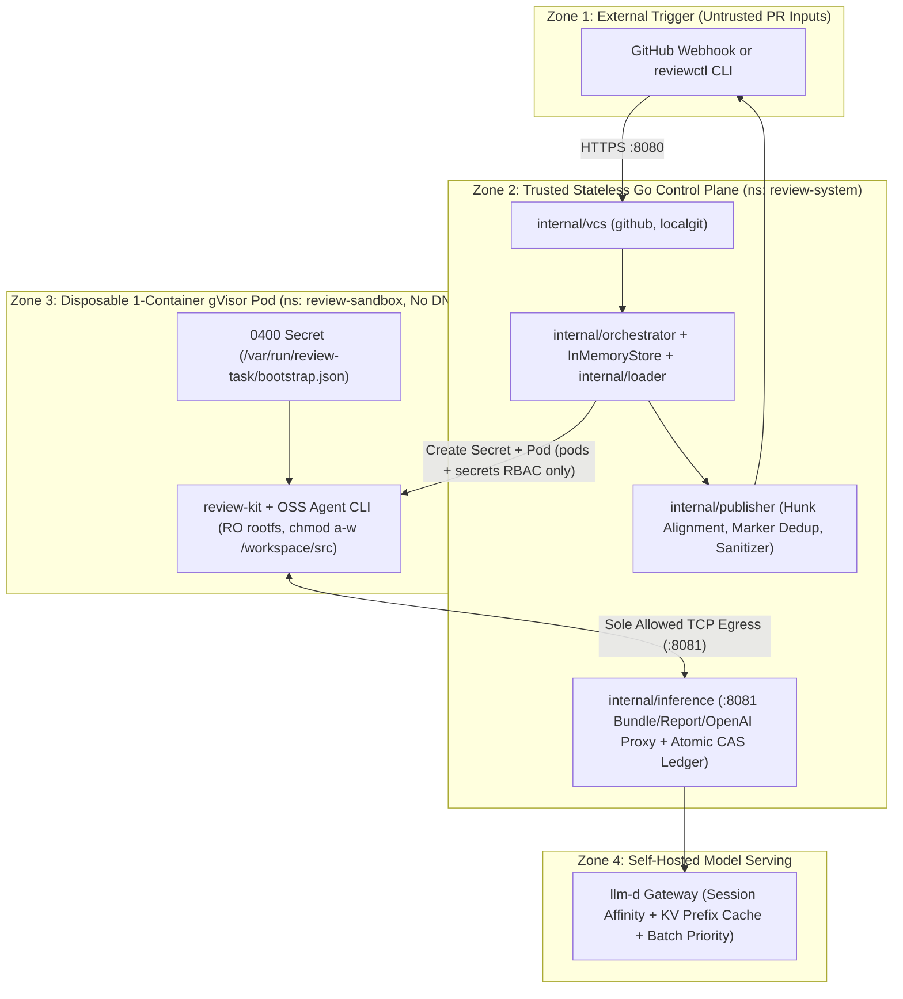

# Architecture Overview

`review-agent-infra` turns untrusted pull request diffs into aligned, deduplicated review comments on self-hosted infrastructure. One Protobuf file (`proto/review/v1/review.proto`) defines the contracts across the Go control plane (`bin/controller` / `bin/reviewctl`) and the in-sandbox Python harness kit (`review-kit`).

## 1. High-Level Pipeline and Component I/O

Two runtime components move a pull request from a webhook trigger to published review comments: the stateless Go **Controller** (with embedded host bundle builder and `:8081` sandbox/inference proxy) and the disposable single-container **Sandbox** running **`review-kit`**.

| Component | Entrypoint | Primary Responsibility | Inputs | Outputs |
| :--- | :--- | :--- | :--- | :--- |
| **1. Controller** | `cmd/controller` (or `cmd/reviewctl` locally) | Queues runs in memory, sanitizes & packs `bundle.tar.gz` via `internal/loader`, registers opaque random session tokens, serves `:8081` bundle/report/OpenAI proxy, denoises findings, deduplicates via GitHub PR review markers, and posts reviews | Signed GitHub webhooks (`ReviewEvent`), source tarball, `diff.patch`, `base_sha` rules, existing PR review markers, uploaded `report.json` | Clean `bundle.tar.gz`, in-memory `SessionLedger` usage, atomic GitHub PR `COMMENT` review with embedded fingerprint marker |
| **2. Harness Kit** | `review-kit` (`python/src/review_harness_kit`) | Bootstraps workspace from `GET /v1/sandbox/bundle`, builds offline `base`/`pr` Git repo, locks `/workspace/src` and `/workspace/.review/in` read-only, runs unmodified OSS coding agent under process-group timeout, normalizes output, and uploads `report.json` | Bootstrap JSON (`controller_url`, `task_token`) via `0400` Secret file or stdin, plus clean `bundle.tar.gz` | Canonical `protojson` `report.json` (`ReviewReport`) uploaded via `POST /v1/sandbox/report` |

---

## 2. Three Build Artifacts and Runtime Deployment

The repository builds two standalone Go binaries (`make build`) and one in-sandbox Python CLI (`review-kit`). `cmd/schemagen` runs at build time via `go run ./cmd/schemagen` during `make schema`.

| Artifact | Language | Execution Context | Role |
| :--- | :--- | :--- | :--- |
| `bin/controller` | Go (`CGO_ENABLED=0`) | Sole Kubernetes `Deployment` (`review-system`) | `:8080` public webhook/healthz/metrics server + `:8081` sandbox-only bundle/report/OpenAI proxy with lock-free CAS budgets, `InMemoryStore` queue, Pod orchestrator, orphan reaper, and stateless PR publisher |
| `review-kit` | Python 3.12 (`uv`) | Ephemeral 1-container gVisor Pod (`sandbox` container, `review-sandbox`) | Self-bootstrapping `CMD ["review-kit", "run"]` wrapper around `openhands`, `pr-agent`, `codex`, `mini-swe-agent`, `opencode`, `goose`, and `aider` |
| `bin/reviewctl` | Go | Developer workstation or CI job | Standalone CLI for single-commit reviews (`review`) and side-by-side multi-harness evaluation (`compare`) reusing the same `internal/loader` and `internal/inference` proxy on a loopback port |

---

## 3. End-to-End Sequence and Wire Formats

Every cross-process step uses an explicit Protobuf message from `proto/review/v1/review.proto` or a standard archive/HTTP payload.

### Protobuf Contract Summary

| Step | Protobuf Message | Serialization and Transport | Security or Validation Invariant |
| :--- | :--- | :--- | :--- |
| **1. Trigger** | `review.v1.ReviewEvent` | In-memory Go struct parsed from verified GitHub Webhook JSON or CLI flags | Deduplicated per delivery ID and gated for untrusted first-time forks |
| **4-8. Task Input** | `review.v1.AgentTask` | `protojson` file at `/workspace/.review/in/task.json` (`int64` fields encoded as strings) | Never stores API keys, GitHub tokens, or task tokens on disk |
| **4-10. Session Policy** | `review.v1.TaskClaims` | Held strictly in controller RAM, indexed by constant-time lookup of 32-byte random `task_token` | Token expires with run and is unregistered when the sandbox finishes; no HS256 JWT signing |
| **14. Sandbox Output** | `review.v1.ReviewReport` | `protojson` uploaded via `POST /v1/sandbox/report` (plus `llm_review_report.schema.json` for 1-shot LLM fallback) | Enforced `2 MiB` HTTP body cap and validated by `contract.DecodeAndValidateReport` in Go |
| **16. Token Ledger** | `review.v1.SandboxUsage` | Returned directly in memory by `ProxyHandler.FinishSession` | Tracks prompt, cached, completion, and rejected requests outside sandbox control |

---

## 4. Trust Zones and Package Boundaries

Production deployments isolate untrusted PR code inside a disposable 1-container gVisor Pod in `review-sandbox`, separate from GitHub App credentials and upstream model routing in `review-system`.

For detailed design trade-offs and `llm-d` Endpoint Picker configuration, see [High-Level Design](design/hld.md).
