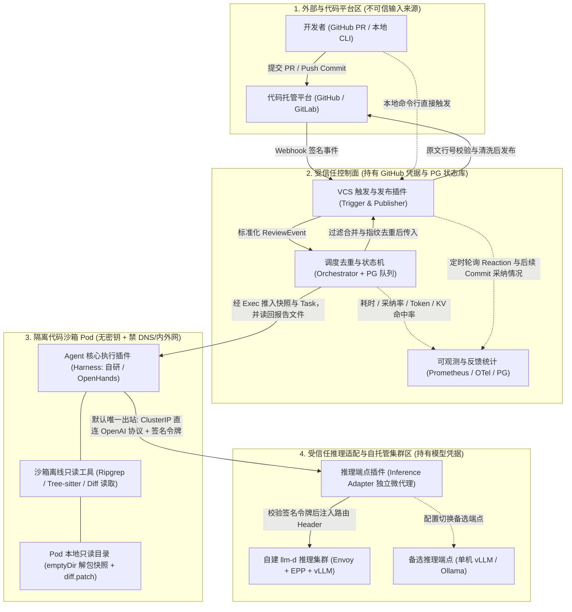
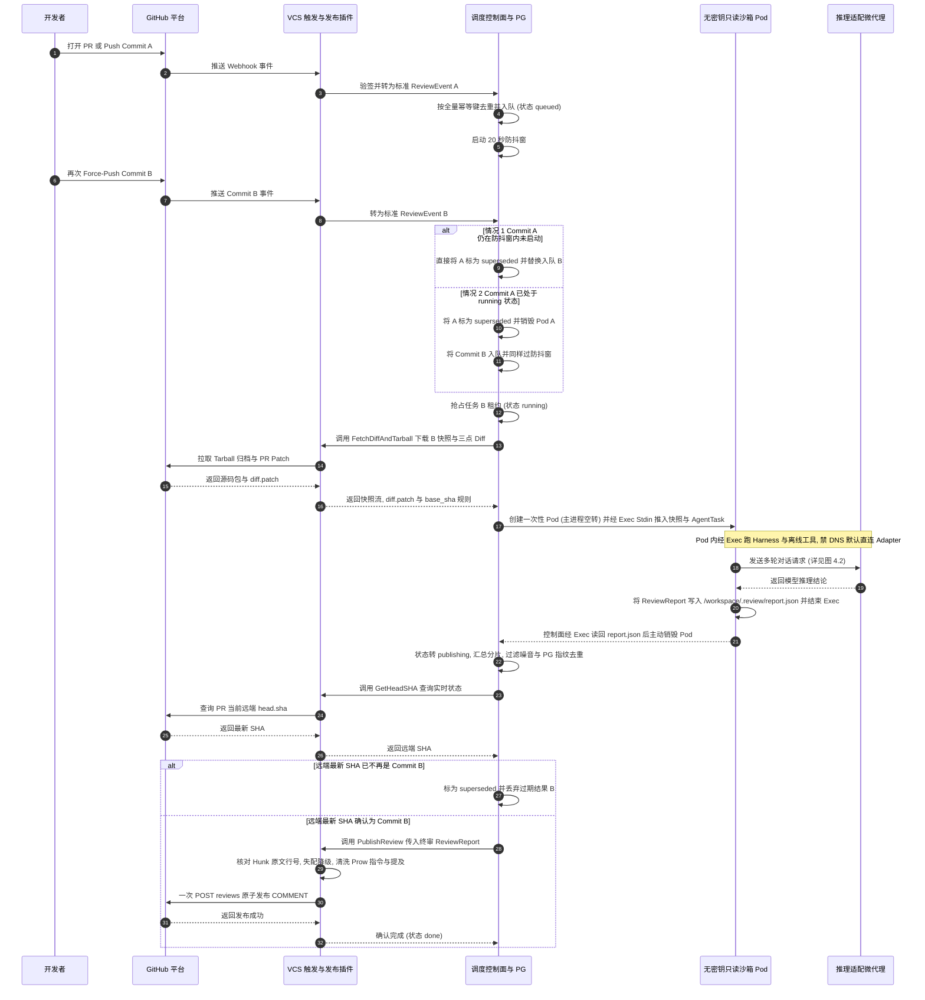
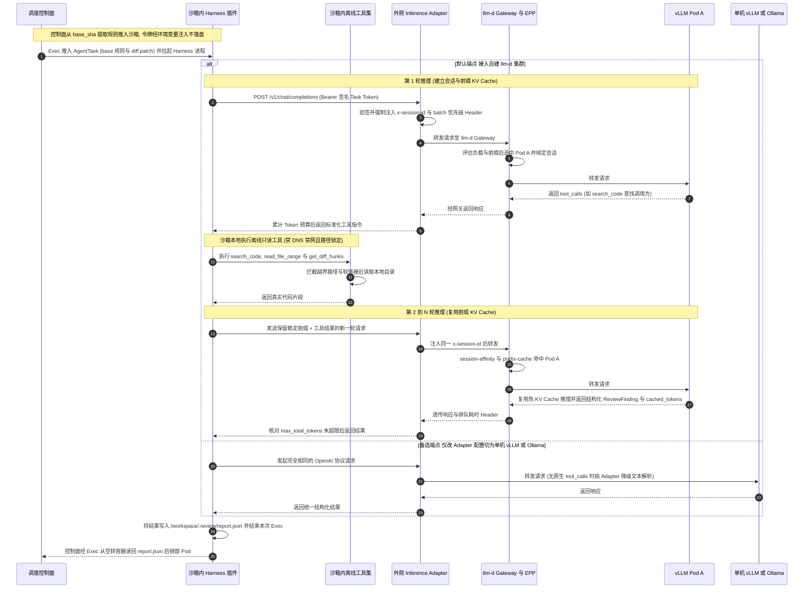

# 面向 llm-d 的端到端自托管、全链路可插拔 Coding Review Agent 高层设计（HLD）

## 1. 一句话定位、核心原则与“不做什么”

我们要建一套 **100% 自托管（Self-Hosted）、全链路可插拔（Plugin-based）** 的自动代码审查系统。它一方面服务于 `llm-d` 社区与内部仓库（Go、Kubernetes CRD/Helm、Python 等）的日常 PR 审查，另一方面**不依赖任何闭源 SaaS 服务或外部模型 API**——代码快照、调度存储、模型推理和监控看板全部部署在自己的基础设施上，并可直接接入自建的 `llm-d` 集群承载推理流量（Dogfooding）。

### 四条核心设计原则

1. **安全隔离**：开源仓库有大量外部 Fork PR，代码、脚本和注释都不可信。Agent 与源码一起关进**无密钥、只读、网络受限（禁 DNS 与内外网）**的一次性沙箱 Pod，凭据只留在外侧受信任组件中。
2. **只发高价值结论，不刷屏**：用跨轮指纹去重、低置信度过滤和 Diff 原文行号校验控制噪音；发不出去的行级评论自动降级，避免 API 报错丢单。
3. **边界干净、拒绝过度抽象**：全系统固定调度骨架，只切 **5 个插件边界**。替换 Agent 框架或推理后端只需改配置，调度逻辑、沙箱隔离与评论回写模块保持不变。
4. **适配 `llm-d` 推理特性**：多轮工具调用保持前缀稳定并透传会话标识，配合 `llm-d` Router（Envoy + EPP）做会话亲和与 KV Cache 复用，并用低优先级流量标识避免挤占线上推理资源。

### 明确边界：首期边界与“不做什么”

* **首期默认不跑全量编译与重型集成测试**：日常编译、构建与重型测试继续交由现有 CI 流水线；但插件接口已预留**CI 报错日志读取（`FetchCheckLogs`）**与**局部单测执行（`run_scoped_test`）**的可插拔扩展位（未来开启单测时必须跑在无任何 Token、100% 纯断网的独立子沙箱 Pod 中）。
* **不自动改代码或 Push Commit**：只提供只读代码审查建议，不向开发者分支写回任何代码。
* **不卡 PR 合并门禁**：Review 固定以 `COMMENT` 形式发出，绝不打 `APPROVE` 或 `REQUEST_CHANGES`，也不参与 Prow 合入投票。

---

## 2. 整体系统架构与信任边界

系统按“信任域”和“插件职责”分为四个区域。核心物理部署形态为：**Agent Harness 与只读工具共处同一个无密钥沙箱 Pod；沙箱默认唯一允许访问的外部目标，是外侧独立部署的 `Inference Adapter`（OpenAI 兼容微代理）的 ClusterIP**。



### 为什么这样划分“沙箱内”与“沙箱外”？

1. **兼容第三方 Agent 框架**：OpenHands、SWE-agent、Aider 等框架都自带本地文件读取和循环逻辑，且原生只认 OpenAI `base_url`。把 Harness 和只读工具一起放进沙箱 Pod 后，替换框架时无需强迫它们改造工具调用协议。
2. **数据进出走控制面 Exec 通道，不共享存储也不落盘凭据**：控制面通过 `client-go` 的 `exec/attach` 标准输入流（stdin）把“源码包 + `diff.patch` + 不含任何凭据的 `AgentTask.json`”推入沙箱的本地 `emptyDir`。沙箱容器主进程保持空转等待（直到 `activeDeadlineSeconds`），由控制面经 Exec 进程拉起 Harness；Harness 写完固定结果文件（如 `/workspace/.review/report.json`）后，控制面再经 Exec 读回该文件并随后主动销毁 Pod（避免容器随主进程退出而无法读文件，也避免报告与第三方框架 stdout 日志混杂），全程不需共享卷（RWX PVC）或环境变量传大块 Diff。
3. **无密钥 + 禁 DNS（需支持 NetworkPolicy 的 CNI）**：沙箱 Pod 关闭 `automountServiceAccountToken`，不挂载任何 GitHub 私钥或模型 API Key；只向 Harness 容器进程注入短期 **HMAC-SHA256 签名 `OPENAI_API_KEY` 与 `OPENAI_BASE_URL` 环境变量**（不写入 `AgentTask.json`）。通过 K8s `NetworkPolicy`（依赖 Cilium/Calico 等强制实施网络策略的 CNI）阻断一切外网、内网及 UDP/TCP 53 DNS 查询，**默认**仅放行向 `Inference Adapter` ClusterIP（可配 `hostAliases`）的 TCP 连接。
4. **安全能力的真实边界**：沙箱隔离与输出清洗能可靠阻断**凭据窃取**与**特权写操作**；但若恶意 PR 包含 Prompt Injection，仍可能诱导模型漏报问题或输出误报噪音——这部分需要靠规则锁定 `base_sha`、置信度门槛与人类最终判断来兜底。

---

## 3. 五个插件边界与控制面核心设计

调度器（Orchestrator + PostgreSQL 队列）和监控台是核心骨架，不做成插件。其余五个可变环节全部抽成轻量插件边界：

| 插件边界名称 | 核心职责 | 统一接口契约（输入 → 输出） | 默认轻量实现 | 可替换备选插件 |
| :--- | :--- | :--- | :--- | :--- |
| **1. VCS 触发与发布插件** | 收事件、取快照与 Diff、拉 `base_sha` 规则、校行号发评论、轮询反馈（可选拉 CI 日志） | `VerifyAndParseWebhook` / `GetHeadSHA` / `FetchDiffAndTarball` / `FetchBaseRules` / `PublishReview` / `PollFeedback`（可选 `CheckLogFetcher.FetchCheckLogs`） | `github-app` + `local-cli` | `gitlab` / `gitea` |
| **2. 沙箱运行器插件** | 创建一次性隔离 Pod、Exec 推入输入与读回报告文件 | `SandboxSpec`（含归档流与 Task） → `ReviewReport` JSON 文件 + 销毁清理 | `k8s-gvisor-pod`（一次性 Pod） | `k8s-kata` / 本地 `docker-rootless` |
| **3. Agent 执行插件 (Harness)** | 调模型读代码、产结构化审查结论 | `AgentTask`（含 `base_sha` 规则与 `diff.patch`） → `ReviewReport` | 自研轻量两阶段只读 Agent | `openhands` / `PR-Agent` / `swe-agent` / `aider` |
| **4. 上下文与工具插件** | 为 Agent 提供离线只读代码检索与可选扩展验证能力 | 工具调用 JSON → 限路径只读代码片段/大纲（预留 `run_scoped_test`） | `ripgrep` + `tree-sitter` + `diff.patch` 读取 | 预热缓存后的 `golangci-lint` / `gopls` / 独立断网测试 Runner |
| **5. 推理端点插件 (Adapter)** | 验签 Task Token、注 Header、预算熔断与退避重试 | OpenAI `/v1/chat/completions` + 签名令牌 → 响应 | `llmd-gateway` 适配器 | `vllm-direct` / `sglang` / `ollama` |

---

### 3.1 VCS 触发与发布插件（Trigger & Publisher）

* **极简数据结构**（全文统一使用 `ReviewEvent` 和 `ReviewReport`，其中 `ReviewReport` 内含 `ReviewFinding` 列表）：

```yaml
ReviewEvent:
  event_id: "github-delivery-uuid"
  source: "github"                       # github | gitlab | cli
  repo: "llm-d/llm-d-router"
  pr_number: 4232
  base_sha: "a1b2c3d"
  head_sha: "e4f5g6h"
  is_fork: true
  author: "contributor-name"
  trigger_type: "auto"                   # auto | manual_command
  force_rerun_seq: 0                     # 手动 /review 重跑递增，防止被幂等跳过
```

* **防滥用与门禁策略**：
  * **自动触发范围**：监听 `opened`、`synchronize`、`reopened`、`ready_for_review` 及维护者评论 `/review`；自动跳过 `draft` PR 与常见 Bot 账号；收到 `closed` 时立即中止任务。
  * **外部 Fork 防刷算力**：按仓库与作者做频率限流（如每 PR 每小时上限）；**首次贡献者（非 Org 成员且无历史合入记录）的 Fork PR 默认不自动触发**，需维护者评论 `/review` 或贴上信任标签（与 `llm-d` 的 `ci-pr-test` 门禁一致）后放行。
* **平台口径对齐、行号精确校验与输出清洗**：
  1. **统一通过平台 API 获取快照与 Diff（可选拉取 CI 日志）**：由 VCS 插件调用平台 Tarball API 按 `head_sha` 下载源码归档（天然无 Git Hooks、Submodule、LFS），调用平台 PR Diff API 获取与 GitHub PR 页面完全一致的三点 Diff 写成 `diff.patch` 并为每行标出绝对行号；同时预留可选方法 `FetchCheckLogs` 按需拉取现有 CI 失败的单测或 Lint 日志随任务下发（**CI 未跑完时不等待、有可用失败日志就带上，且因日志受 PR 可控，按不可信输入处理并做长度截断**）。**超限补丁策略**：当单文件或总体 Diff 超过平台 API 截断上限拿不到 patch 时，在 PR Summary 中注明“部分大文件未获取补丁已跳过行级审查”，不做行级评论。
  2. **原文校验与两级降级**：模型返回的每条 `ReviewFinding` 必须附带 `target_line_text`（目标行原文）。Publisher 核对 `Hunk[file][line]` 内容一致（忽略首尾空白）才发为 Inline Comment；若行号略偏但在该文件 Hunk 内能唯一搜到 `target_line_text`，则按原文位置校正；仍匹配不到则**优先降级为文件级评论**（*注：第 2 阶段需针对 GitHub `POST /pulls/{pr}/reviews` 实测文件级评论兼容性，若批量接口不支持则直接降级并入 Summary*），不在改动文件内则并入 Summary 正文，避免因单条越界返回 `422` 丢单。
  3. **不可信输出清洗与最小权限**：发帖前逐行清洗 `ReviewReport`，过滤/转义行首 Prow 指令（`/lgtm`、`/approve`、`/hold`、`/close` 等）、`@mention` 及未知外链/图片；**默认仅申请** `pull_requests: write` + `contents: read` 权限（若开启 `FetchCheckLogs`，需补充平台对应的只读 Checks/Actions 日志读取权限，具体权限项落地时以实测为准），固定以 `event=COMMENT` 一次原子提交 `POST /pulls/{pr}/reviews`，并在 Body 末尾写入隐藏标记 `<!-- review-run: {run_id} sha: {head_sha} -->` 供崩溃重试查重。

---

### 3.2 调度状态机、去重与安全沙箱层（Orchestrator & Sandbox）

* **任务生命周期状态机（PostgreSQL 持久化）**：

| 状态 | 触发条件与进入动作 | 异常与并发兜底策略 |
| :--- | :--- | :--- |
| `queued` | 幂等键 `(repo, pr, base_sha, head_sha, trigger_type, force_rerun_seq)` 不存在时入队 | 进入 15~30 秒防抖窗；新 Commit 到来直接把窗内旧 `queued` 任务标为 `superseded` |
| `running` | Worker 用 `SKIP LOCKED` 抢占并持租约（Lease）启动沙箱 | Worker 定期续期心跳；崩溃超时后自动重排（上限 `max_retries=2`）。新 Commit 到来立即标为 `superseded` 并删 Pod |
| `publishing` | 沙箱返回 `ReviewReport`，进入控制面汇总清洗与发布 | **发布前调 VCS `GetHeadSHA` 实时核对远端当前 `head.sha == reviewed_sha`**；若已过期立即转 `superseded` 丢弃 |
| `done` | 原子提交 GitHub Review 成功，持久化本次 Finding 指纹 | 默认记录统计；若手动 `/review` 触发且 0 问题，附带一条简短“未发现高风险问题”Summary |
| `superseded` | 被新 Commit 覆盖、或 PR 被关闭（`closed`） | 立即销毁对应一次性沙箱 Pod（靠 `activeDeadlineSeconds` 与定时孤儿 Reaper 兜底回收；同命名空间部署时可辅以控制器 Pod 的 `ownerReference`） |
| `failed` | 重试耗尽、沙箱超时或全部分片失败 | **自动触发默认静默（仅告警，不刷 PR）**；人工 `/review` 触发失败时回帖一行带 `run_id` 的错误提示 |

* **快照解包、规则源锁定与大 PR 分片策略**：
  * **解包安全**：沙箱解包源码归档时强制校验并拒绝指向目标目录之外的软链接（Symlink），以只读方式供工具检索。
  * **规则源锁定**：`AGENTS.md`、路径审查规则（如 `docs/review/`）与 Linter 配置**全部由控制面从 `base_sha` 读取**并放进 `AgentTask`，绝不读取待审 `head_sha` 里的改动。
  * **大 PR 分片与部分失败策略**：先过滤 `go.sum`、`vendor/`、`zz_generated.*` 等锁文件/生成代码；按 Token 估算拆片，**控制单片 Diff 不超过单次 `max_context_tokens` 上限的约 1/3**（如 `32K` 窗口下单片上限约 1 万 Token，留足其余空间给规则、工具调用与输出），超出时按包/目录拆成并发子任务（共用同一 `parent_session_id`）。**只要有任一分片成功，控制面照常汇总发布并在 Summary 顶部注明“部分目录因超时未完成审查”**；仅当全部分片都失败时才转 `failed`。
* **跨轮去重与集中噪音控制（统一放控制面，不放 Harness）**：
  * 控制面汇总所有分片产出，统一执行：**JSON Schema 校验 → 置信度过滤（如 `confidence >= 0.75`）→ 同文件邻近行合并 → PG 跨轮指纹去重 → 全局 Top N 截断（默认最多 8 条）**。
  * **PG 指纹去重（不做自动 Resolve）**：控制面结合已有快照按定位取目标行及前一行归一化文本，以 `hash(file + prev_line + target_line)` 为指纹存库（既避免多处 `return err` 等重复行误去重，也不带 `category` 防止跨轮分类波动导致漏去重）。连续 Push 重审时，已发过同指纹的问题**不再重复发帖**；不主动调 API Resolve 旧评论（防止模型随机波动误关未修 Bug，原代码行修改后 GitHub 会自动将其标为 Outdated）。

---

### 3.3 Agent 核心执行插件（Agent Harness Plugin）

* **极简接口契约**：

```yaml
# 统一输入（控制面通过 Exec Stdin 写入沙箱，落盘文件不含任何凭据；规则源自 base_sha）
AgentTask:
  pr_meta: { title, description, base_branch, labels }
  diff_file: "/workspace/.review/diff.patch"       # 带绝对行号的 PR Diff 文件
  ci_logs_file: "/workspace/.review/ci-logs.txt"   # 可选：VCS FetchCheckLogs 拉取的截断后 CI 失败日志
  repo_rules: ["AGENTS.md", "命中路径的专项规范"]   # 控制面从 base_sha 提取
  workspace_ro_dir: "/workspace/src"               # 沙箱内只读源码目录
  output_file: "/workspace/.review/report.json"    # 报告输出路径（避免与框架日志混在 stdout）
  tool_endpoints:                                  # 可选：指向独立断网测试 Runner 子沙箱 Pod 地址
    scoped_test: "http://10.96.x.x:9002"
  budget:
    max_turns: 12
    max_context_tokens: 32768                      # 单次请求上下文窗口上限
    max_total_tokens: 400000                       # 整个任务累计 Token 硬上限 (Adapter 强制熔断)

# Harness 容器环境变量（仅注入进程环境，不写入落盘的 AgentTask.json）
# OPENAI_BASE_URL="http://10.96.0.42:8080/v1"      # Adapter ClusterIP，无需 DNS
# OPENAI_API_KEY="hmac-signed-short-lived-token"   # 签名绑定 session / 预算 / 有效期

# 统一输出（控制面按此 Schema 校验；汇总去噪统一在控制面执行）
ReviewReport:
  summary: "整体改动评估..."
  findings:
    - file: "pkg/epp/scheduling/scorer/foo.go"
      line: 84
      side: "RIGHT"
      target_line_text: "s.cache[key] = val"       # 用于 Publisher 精确核对原文
      severity: "high"                             # critical | high | medium | low
      confidence: 0.92
      category: "concurrency"                      # correctness | concurrency | security | k8s | style
      title: "并发写 map 未加锁"
      explanation: "请求热路径存在并发写..."
      suggestion: "建议改用 sync.RWMutex..."
      evidence: "调用方 bar.go:45 在 goroutine 中并发触发"
```

* **默认实现（自研轻量两阶段只读 Harness）**：不做与框架绑定的确定性门禁预检（如 DCO 已由 `ci-signed-commits` 检查，若未来需要纯确定性规则检查可放在控制面按仓库开启），Harness 专注两件事：
  1. **多轮按需取证**：把固定前缀发给模型，模型按需调用沙箱只读工具查调用方、同包兄弟实现与单测，不超过 `max_turns` 和 `max_context_tokens`。
  2. **结构化输出与自我复核**：要求大模型按 `response_format` JSON Schema 输出，剔除没有具体代码 `evidence` 的猜测；Schema 校验失败时自动追加格式纠错提示原地重试 1 次。
* **如何插拔第三方框架（如 OpenHands / SWE-agent）**：Sandbox Pod 内已有本地源码目录并暴露标准 OpenAI `base_url`，只需一层薄入口脚本把 `AgentTask` 转成目标框架的配置（首期默认禁用写操作与本地测试命令，若后续启用局部单测则改为路由至 `tool_endpoints.scoped_test`），并将最终产出解析回标准 `ReviewReport` JSON，外围调度、防刷屏和 Adapter 完全不变。

---

### 3.4 上下文与工具插件（Context & Tooling Plugin）

* **第一阶段（默认必开、离线零依赖）**：沙箱内是平台下载的纯净源码快照（无 `.git` 历史，不提供 `git diff` 或 `git blame`），只提供纯本地只读工具，且每次调用严格拦截 `../` 与目录外软链接：
  * `get_diff_hunks(file)`：直接读取控制面下发的 `diff.patch` 文件。
  * `read_file_range(path, start, end)`、`search_code(query, glob)`（`ripgrep`）、`list_files(dir)`。
  * `tree-sitter`：按需提取函数签名与结构体大纲，控制上下文体积。
* **第二阶段可选增强插件（预热缓存后开启）**：
  * `golangci-lint` 和 `gopls` 做完整类型检查需要 Go 模块缓存（`GOMODCACHE`），断网沙箱默认跑不起来；后续可在基础镜像或共享只读镜像层预热常用依赖缓存后，按仓库配置启用。
  * **局部单测扩展接口 `run_scoped_test(target, filter)`**：预留用于未来按需跑局部单测或复现失败用例。**安全隔离前提**：实现该接口的测试 Runner 必须部署在**独立的无密钥、gVisor 隔离的独立子沙箱 Pod** 中（绝不与 Harness 共用 Pod，保证 Pod 级网络与内存完全隔离）；网络策略上 Runner Pod **出站全禁（`Egress: DenyAll`，连 `Inference Adapter` 都不通）**、**入站仅放行配对的 Harness Pod**（开启此扩展时，Harness Pod 出站相应多放行这一个配对 Runner Pod 地址）。Runner 的源码快照由控制面经同样的 Exec Stdin 推入（并预热只读依赖缓存），不挂载任何 `OPENAI_API_KEY` 或平台 Token，通过白名单过滤参数与超时限额防滥用，在不改变外围 Orchestrator 与 Harness 契约的前提下平滑扩展。
* **规则按路径注入（Rule Injector）**：控制面从 `base_sha` 读取根目录 `AGENTS.md`（若存在）及变更路径命中的专项非代码规则（参考 `llm-d-router` 的 `docs/review/` 路由表，每次仅附带 `0~2` 份高相关规则），既精准又控制 Prompt 长度。

---

### 3.5 推理端点插件与自建 `llm-d` 对接配置（Inference Endpoint Plugin）

`Inference Adapter` 作为独立的受信任微代理跑在沙箱外侧：接收沙箱发来的标准 `/v1/chat/completions` 请求，校验随机或 **HMAC-SHA256 签名 Task Token** 提取 `session_id`、`parent_session_id` 与 `max_total_tokens`（沙箱伪造任何路由或优先级 Header 均会被 Adapter 强制覆写），超额直接返回熔断错误。

* **前缀稳定排版**：Harness 固定按 `System Prompt -> Tool Schemas -> base 规则 -> diff.patch` 排列消息前缀，后续轮次只追加对话与工具结果，尽量提高前缀重合度（具体 KV 命中率以实际回放测试为准）。
* **自建 `llm-d` 集群侧前置配置清单（必须显式开启，否则 Header 不生效）**：

| `llm-d` 组件/插件 | 默认行为（坑点） | 对接 Review Agent 必须改的配置 | 实际作用说明 |
| :--- | :--- | :--- | :--- |
| **`session-affinity-scorer`** | 默认 `encoded_endpoint_header`，读 `x-session-token` 回显 | 显式设置 `strategy: session_id`，`sources` 配 `header: x-session-id` | 让 EPP 根据 Adapter 注入的 `x-session-id` 把同一会话多轮请求钉选在同一 Pod |
| **`agent-identity` / `agent-lineage`** | 默认不启用；且内置列表不含 `x-session-id` | 启用两插件，并在 `additionalSessionHeaders` 加入 `x-session-id` | 识别单会话与 `x-parent-session-id`（用于将同一大 PR 的并发子分片归并到同一公平队列） |
| **`requestHandler` 公平队列** | 传 `x-llm-d-inference-fairness-id: <repo>` 会让同仓所有 PR 挤一条队 | 配置 `composeFairnessIDs: true` | 开启 `agent-lineage` 后自动合成为 `<repo>/<root_session_id>`（分片树为 `<repo>/<parent_session_id>`，单任务为 `<repo>/<session_id>`），兼顾仓库级指标归属与整棵任务树独立排队 |
| **`flowControl` 与 `InferenceObjective`** | 需显式开启 Gate；`x-llm-d-inference-ttl` 只能改短不能延长有限 TTL | 开启 `featureGates: ["flowControl"]`，创建 `code-review-batch` Objective 并在低优先级 Band 配长 `defaultRequestTTL` | 保证在线业务高峰时审查流量在队列耐心礼让而不被过早 TTL 丢弃（网关超时同步调大） |
| **vLLM 引擎参数** | `prompt_tokens_details.cached_tokens` 默认不返回 | 开启 `--enable-prefix-caching` 与 `--enable-prompt-tokens-details` | 实际复用 KV Cache 并向上返回 `cached_tokens` 用量统计 |

* **排队超时与过载退避策略（避免 Batch 让路与超时冲突）**：
  * **分离排队预算与单任务总时长**：任务总存活时间设得足够宽裕（如 15 分钟），沙箱内单次 HTTP 调用及网关超时同步放宽（如 360 秒），由 EPP 侧该低优先级 Band 的 `defaultRequestTTL` 控制最长排队容忍时间。
  * **429 / 503 退避**：当 EPP 因排队 TTL 超时（`429 rejected-ttl-expired`）、流控拒绝或后端过载（`503`）返回失败时，`Inference Adapter` 执行带抖动的指数退避重试（最多 4 次，间隔 5s~40s）；仍失败则中止沙箱并交回控制面按重试策略处理。
* **切换其他后端**：只需修改 `Inference Adapter` 配置，把上游切换为直连单机 `vLLM / SGLang` 或 `Ollama`（针对无原生 `tool_calls` 的小模型自动启用 JSON/XML ReAct 文本降级解析），沙箱与 Harness 无需改动。

---

### 3.6 可观测性与效果闭环（Observability & Feedback）

* **系统效能指标（OTel + Prometheus + Grafana）**：跟踪任务各阶段延迟、平均轮数、Token 消耗、KV Cache 命中率（`cached_tokens / prompt_tokens`）及在 `llm-d` 网关的排队耗时（`x-llm-d-flow-queue-duration-ms`）。
* **审查质量回收（Webhook + 定时轮询）**：
  * 评论回复与后续 Commit 是否修改对应行，通过 Webhook / 合入事件实时关联；
  * **GitHub Emoji Reaction（`+1`/`-1`）没有实时 Webhook**，由控制面后台任务通过 VCS `PollFeedback` 定时轮询（如每小时及 PR 关闭时拉取一次）并记入 PostgreSQL 反馈表，用于定期淘汰误报率高的规则或调高特定类别的置信度阈值。

---

## 4. 核心交互时序图

### 4.1 端到端流程时序图（事件生命周期、双分支防抖取消、Exec 进出沙箱与原文行号回写）



### 4.2 沙箱内 Harness 与 `llm-d` 多轮交互及端点切换时序图



---

## 5. 全自托管技术选型建议表

所有推荐组件均为开源可自托管软件，默认组合面向“最易在现有 `llm-d` Kubernetes 集群中同集群低成本维护”：

| 核心模块 | 默认轻量推荐（K8s 同集群部署） | 可替换备选方案 | 为什么这么选（运维与工程考量） |
| :--- | :--- | :--- | :--- |
| **控制面与 VCS 平台** | **Go 单体微服务**（VCS + Orchestrator + Publisher） | Python FastAPI；GitLab / Gitea / CLI 插件（Diff 行号映射与评论回写可按需复用 `reviewdog` 等开源积木） | 与 `llm-d` / `llm-d-router` 同栈，团队维护方便；低内存高并发，原生用 `client-go` 管沙箱与 Exec 流 |
| **状态库与任务队列** | **PostgreSQL**（`SKIP LOCKED` 队列 + 状态机 + 指纹库） | Redis/Valkey + Asynq；NATS JetStream | 少运维一套消息中间件，PG 事务天然支撑防抖锁、指纹去重与租约；以后吞吐上来再换专业队列 |
| **安全隔离沙箱** | **K8s 一次性 Job/Pod + gVisor**（须节点安装 gVisor `RuntimeClass`，且 CNI 支持 `NetworkPolicy`） | Kata Containers；本地用 Docker Rootless / Bubblewrap | 断网禁 DNS 隔离外部 Fork PR，跑完即焚；gVisor 系统调用拦截比普通容器安全，且比全量 VM 轻量 |
| **Agent 核心执行** | **自研轻量两阶段 Harness**（离线工具循环 + JSON Schema 校验） | OpenHands / `PR-Agent` / SWE-agent / Aider / Codex CLI（均作可插拔开源积木） | 代码审查只需只读查证；自研轻量循环便于严格固定前缀顺序、控轮数与对齐输出格式；接入 `PR-Agent` 时仅复用其分析与提示词引擎，取 Diff 与发布评论仍走本系统以保无密钥隔离 |
| **代码工具与规范** | **ripgrep + tree-sitter + 平台 `diff.patch` + `base_sha` 规则注入** | 预热模块缓存后的 `golangci-lint` / `gopls`；Zoekt | 离线零依赖、秒级启动，不踩断网沙箱 `.git` 缺失与 Go 模块下载失败的坑；配合路径路由规则注入省上下文 |
| **推理适配与模型服务** | **Inference Adapter（Go/Python） + 自建 `llm-d` 集群**（vLLM/SGLang 跑开源代码模型） | 直连单机 vLLM / SGLang；本机 Ollama | 复用 `llm-d` 会话亲和与前缀缓存，并用低优先级配额错峰跑任务；**前置要求：所选开源模型需支持原生 Tool Calling（或降级解析），且上下文窗口不小于 `max_context_tokens`** |
| **可观测与反馈** | **OpenTelemetry + Prometheus + Grafana** + PG 反馈表 | Jaeger / Tempo；自托管 Langfuse (OSS) | 直接复用 `llm-d` 集群标配监控，一张看板同时观察 PR 采纳率、Token 与 KV 命中率 |

---

## 6. 建议的演进落地路径（三步走）

1. **第一阶段（本地 CLI + 单机推理调优）**：先做 `local-cli` 插件 + 自研轻量两阶段 Harness + `ripgrep`/`tree-sitter` 工具 + 单机 vLLM/Ollama。拿 `llm-d-router` 历史 PR 做离线回放基准测试，实际测出合适的置信度阈值、前缀缓存命中率与行号映射准确率。
2. **第二阶段（上线 GitHub App + PG 控制面 + 断网沙箱）**：补齐 Go 控制面、PG `SKIP LOCKED` 状态机、指纹去重、原行校验清洗、K8s gVisor 一次性沙箱，实测 GitHub `POST reviews` 文件级评论兼容性，并加上首次贡献者 `/review` 门禁，先在内部灰度仓库运行。
3. **第三阶段（接入 `llm-d` 集群 + 反馈闭环）**：按 §3.5 表格配好 EPP 的 `session-affinity-scorer`、`agent-identity`、`composeFairnessIDs`、开启 `flowControl` 及长队列 TTL 的 `code-review-batch` Objective，将 Adapter 指向自建 `llm-d` 网关；同时开启定时 Reaction 轮询，持续剔除低采纳率规则。
