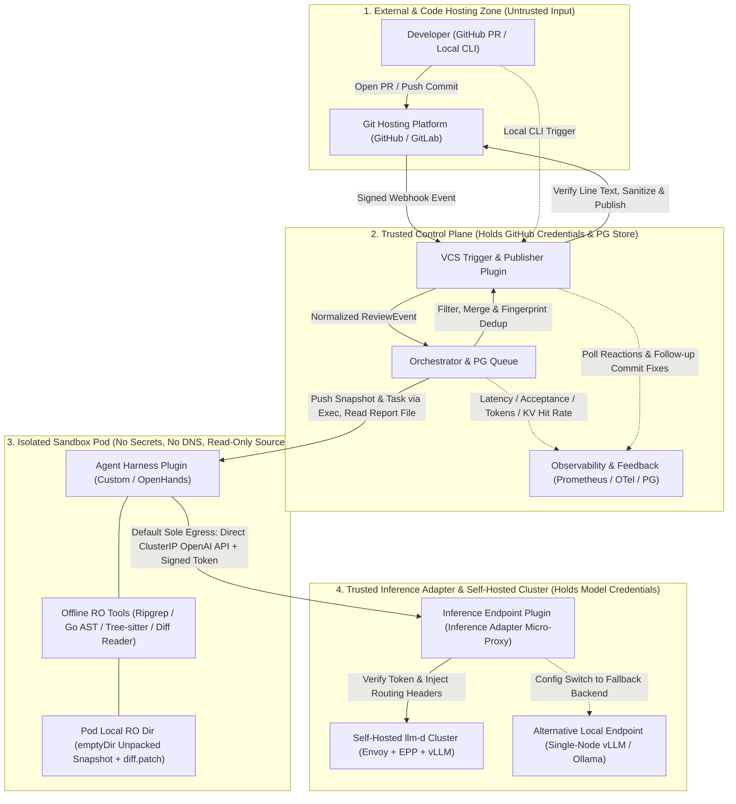
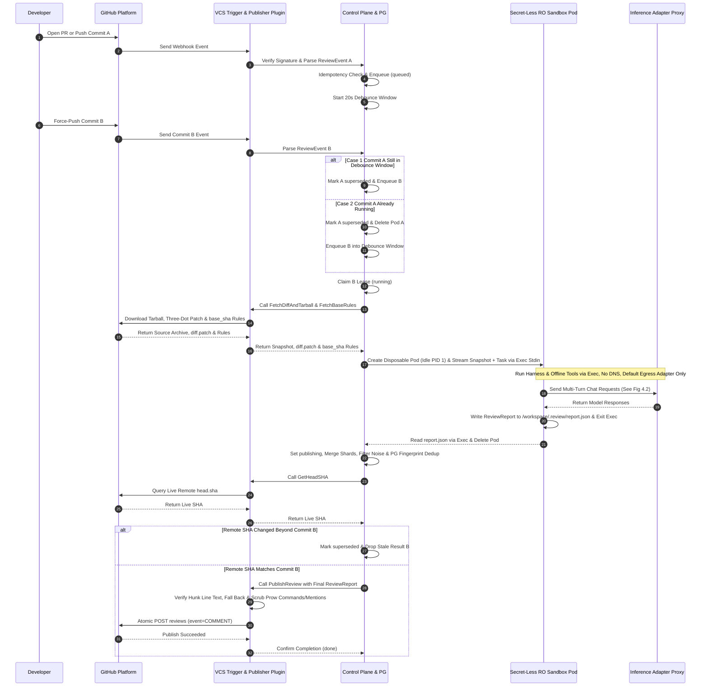
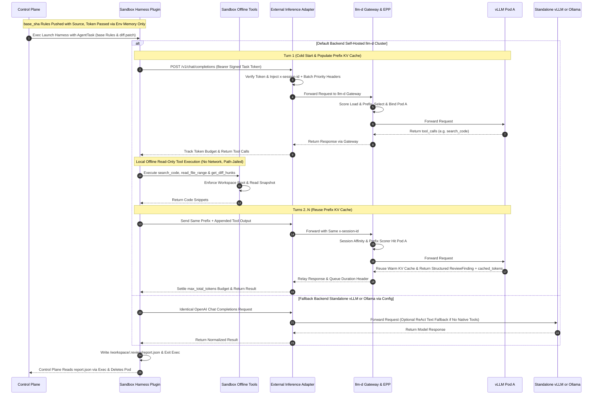

# High-Level Design (HLD): End-to-End Self-Hosted, Pluggable Coding Review Agent for llm-d

## 1. Purpose, Core Principles, and Explicit Non-Goals

We are building a **100% self-hosted, end-to-end pluggable** automated code review system. It handles daily PR reviews across `llm-d` community and internal repositories (Go, Kubernetes CRDs/Helm, Python, etc.) with **zero reliance on closed-source SaaS review services or external model APIs**. Code snapshots, job state, model weights, inference traffic, and dashboards all run on self-managed infrastructure, and the system can route its own inference traffic through a self-hosted `llm-d` cluster (dogfooding).

### Four Core Principles

1. **Strict Security Isolation**: Open-source repositories receive external fork PRs where source code, scripts, and comments are untrusted. The agent and source code run inside a **secret-less, read-only, network-restricted (no DNS, no internet or cluster access)** disposable sandbox Pod, while credentials stay strictly outside in trusted components.
2. **High-Signal Output Only**: Cross-round fingerprint deduplication, confidence filtering, and verbatim diff-line verification prevent comment spam. Inline comments that fail line matching fall back cleanly so API errors never drop a review.
3. **Clean Boundaries Without Over-Engineering**: The scheduling backbone is fixed, with only **5 plugin boundaries**. Swapping the agent framework or inference backend requires configuration changes only, leaving orchestration, sandboxing, and comment publishing untouched.
4. **Native Fit for `llm-d` Serving**: Multi-turn tool calling preserves a stable prompt prefix and passes session affinity headers so `llm-d` Router (Envoy + EPP) pins turns to warm KV-cache replicas and yields queue capacity to live interactive traffic.

### Explicit Scope and Non-Goals

* **No full builds or heavy integration tests in Phase 1**: Compilation, builds, and heavy test suites stay in existing CI pipelines. However, plugin interfaces reserve extension hooks for **CI failure log ingestion (`FetchCheckLogs`)** and **scoped unit test execution (`run_scoped_test`)**; when enabled later, unit tests must run in a separate secret-less, 100% air-gapped child sandbox Pod.
* **No code edits or commits pushed**: The agent posts read-only review feedback and never writes back to developer branches.
* **No merge-gate blocking**: Reviews are always posted as `COMMENT` events, never `APPROVE` or `REQUEST_CHANGES`, and the bot never participates in Prow merge voting.

---

## 2. System Architecture and Trust Boundaries

The system is split into four zones by trust domain and plugin role. Physically, **the Agent Harness and read-only tools share a secret-less sandbox Pod, and the sandbox's default sole allowed outbound target is the ClusterIP of an external `Inference Adapter` (OpenAI-compatible micro-proxy)**.



### Why Separate Inside-Sandbox vs. Outside-Sandbox Components?

1. **Compatibility with Third-Party Agent Frameworks**: Frameworks like OpenHands, SWE-agent, and Aider expect local file tools and a standard OpenAI `base_url`. Placing the Harness alongside read-only tools inside the sandbox Pod allows framework swaps without rewriting their internal tool protocols.
2. **Data I/O via Control-Plane Exec with Zero Shared Storage or Disk Secrets**: The control plane streams the source archive, `diff.patch`, and a credential-free `AgentTask.json` into the sandbox's local `emptyDir` via `client-go` `exec/attach` stdin. The sandbox container's PID 1 stays idle (until `activeDeadlineSeconds`) while the control plane runs the Harness via Exec, waits for it to write a fixed result file (such as `/workspace/.review/report.json`), reads that file back via Exec, and deletes the Pod. This avoids early container exit, avoids mixing reports with third-party stdout logs, requires no RWX PVC, and avoids stuffing large diffs into env vars.
3. **No Secrets and No DNS (Requires a NetworkPolicy-Enforcing CNI)**: The sandbox Pod sets `automountServiceAccountToken: false` and mounts no GitHub private keys or model API keys. Short-lived **HMAC-SHA256 signed `OPENAI_API_KEY` and `OPENAI_BASE_URL` environment variables** are injected only into the Harness process memory (never written to `AgentTask.json`). A Kubernetes `NetworkPolicy` (requiring Cilium, Calico, or another enforcing CNI) blocks internet access, internal cluster access, and UDP/TCP port 53 DNS lookups (blocking DNS exfiltration of private code), allowing TCP egress by **default** only to the `Inference Adapter` ClusterIP (with optional `hostAliases`).
4. **Honest Security Boundaries**: Sandboxing and output sanitization reliably block **credential theft** and **privileged write actions**. Prompt injection inside a malicious PR can still cause the model to miss real bugs or emit false positives, which is mitigated by locking rules to `base_sha`, confidence thresholds, and human review.

---

## 3. Five Plugin Boundaries and Control Plane Design

The scheduler (Orchestrator + PostgreSQL queue) and metrics backend form the fixed core backbone. The five variable stages are abstracted behind lightweight plugin boundaries:

| Plugin Boundary | Core Responsibility | Contract (Input to Output) | Default Lightweight Implementation | Swappable Alternatives |
| :--- | :--- | :--- | :--- | :--- |
| **1. VCS Trigger & Publisher** | Receive events, fetch snapshots/diffs, fetch `base_sha` rules, map lines, post reviews, poll feedback (optional CI logs) | `VerifyAndParseWebhook` / `GetHeadSHA` / `FetchDiffAndTarball` / `FetchBaseRules` / `PublishReview` / `PollFeedback` (optional `CheckLogFetcher.FetchCheckLogs`) | `github-app` + `local-cli` | `gitlab` / `gitea` |
| **2. Sandbox Runner** | Launch disposable isolated Pod, stream inputs and read report via Exec | `SandboxSpec` (archive stream + Task) to `ReviewReport` JSON file + Pod cleanup | `k8s-gvisor-pod` (disposable Pod) | `k8s-kata` / local `docker-rootless` |
| **3. Agent Harness** | Query model, inspect code, emit structured findings | `AgentTask` (with `base_sha` rules & `diff.patch`) to `ReviewReport` | Custom lightweight two-stage RO agent | `openhands` / `PR-Agent` / `swe-agent` / `aider` |
| **4. Context & Tooling** | Provide offline read-only code search and optional scoped test hooks | Tool-call JSON to path-jailed snippets/outlines (reserves `run_scoped_test`) | `ripgrep` + Go AST / `tree-sitter` + `diff.patch` reader | Pre-warmed `golangci-lint` / `gopls` / isolated air-gapped test runner |
| **5. Inference Endpoint (Adapter)** | Verify Task Token, inject headers, enforce budgets, retry transient errors | OpenAI `/v1/chat/completions` + signed token to model response | `llmd-gateway` adapter | `vllm-direct` / `sglang` / `ollama` |

---

### 3.1 VCS Trigger & Publisher Plugin

* **Minimal Data Contracts** (using two consistent structures across the entire system: `ReviewEvent` and `ReviewReport`, which contains a `ReviewFinding` slice):

```yaml
ReviewEvent:
  event_id: "github-delivery-uuid"
  source: "github"                       # github | gitlab | cli
  repo: "llm-d/llm-d-router"
  pr_number: 4232
  base_sha: "a1b2c3d"
  head_sha: "e4f5g6h"
  is_fork: true
  author: "contributor-name"
  trigger_type: "auto"                   # auto | manual_command
  force_rerun_seq: 0                     # Unique comment ID on /review rerun to avoid idempotency skip
```

* **Abuse Prevention & Gating**:
  * **Trigger scope**: Handles `opened`, `synchronize`, `reopened`, `ready_for_review`, and maintainer `/review` comments; automatically skips `draft` PRs and known bots; cancels active work on `closed`.
  * **Fork rate limiting & gatekeeping**: Enforces per-repo and per-author rate limits. **Fork PRs from first-time contributors (non-org members without prior merged commits) do not trigger automatically** and wait for a maintainer `/review` command or trust label (matching `llm-d`'s `ci-pr-test` pattern).
* **Platform Alignment, Line Verification, and Output Sanitization**:
  1. **Fetch snapshots and diffs via platform API (plus optional CI logs)**: The VCS plugin downloads the source tarball at `head_sha` (inherently free of git hooks, submodules, and LFS) and fetches the three-dot PR diff matching the GitHub UI into `diff.patch` with explicit absolute line numbers. Optional `FetchCheckLogs` retrieves existing CI test/lint failure logs (**without waiting for unfinished CI; truncated and treated as untrusted input**). **Oversized patch fallback**: If a file or the overall diff exceeds the platform diff truncation limit and lacks a patch, note it in the PR summary and skip inline comments for that file.
  2. **Verbatim line matching & two-tier fallback**: Every `ReviewFinding` must include `target_line_text`. The Publisher posts an inline comment only if `Hunk[file][line]` matches that text (ignoring leading/trailing whitespace). If shifted, it searches within the file's hunks for a unique verbatim match and adjusts the line number. Otherwise it **falls back to a file-level comment** (*note: verify file-level comment compatibility on GitHub `POST /pulls/{pr}/reviews` during Phase 2; if unsupported, fold directly into the PR summary*), or into the PR summary body if outside modified files, preventing `422` failures from dropping the review.
  3. **Untrusted output sanitization & least privilege**: Before posting, scrub line-leading Prow commands (`/lgtm`, `/approve`, `/hold`, `/close`, etc.), sanitize `@mention` strings, and strip external images/links. **By default request only** `pull_requests: write` and `contents: read` (adding read-only Checks/Actions log scopes only if `FetchCheckLogs` is enabled, to be verified against the platform during rollout). Submit atomically via one `POST /pulls/{pr}/reviews` call with `event=COMMENT` and a hidden `<!-- review-run: {run_id} sha: {head_sha} -->` marker at the end of the body for crash deduplication.

---

### 3.2 Orchestrator State Machine, Deduplication, and Sandbox Layer

* **Job Lifecycle State Machine (Persisted in PostgreSQL)**:

| State | Entry Condition & Action | Failure & Concurrency Handling |
| :--- | :--- | :--- |
| `queued` | Enqueued when idempotency key `(repo, pr, base_sha, head_sha, trigger_type, force_rerun_seq)` is not active/done | Waits in a 15-30s debounce window; newer commits mark queued runs `superseded` |
| `running` | Worker claims job via `SKIP LOCKED` with a lease and starts sandbox | Heartbeat renews lease; crashed leases are reclaimed (up to `max_retries=2`); newer commits mark `superseded` and delete the Pod |
| `publishing` | Sandbox returns `ReviewReport`; control plane deduplicates and prepares output | **Calls VCS `GetHeadSHA` right before posting**; if remote head changed, marks `superseded` and discards output |
| `done` | Atomic GitHub review posted and finding fingerprints saved | Records metrics; if triggered manually via `/review` with 0 findings, posts a short "no high-risk issues found" summary |
| `superseded` | Replaced by a newer commit or closed PR | Immediately deletes disposable sandbox Pod (backed by `activeDeadlineSeconds`, orphan Reaper, and controller-Pod `ownerReference` in single-namespace mode) |
| `failed` | Retries exhausted, sandbox timed out, or all shards failed | **Auto triggers fail silently (alerts only, no PR noise)**; manual `/review` failures post a one-line error note with `run_id` |

* **Safe Unpacking, Rule Locking, and Large PR Sharding**:
  * **Unpack safety**: Reject path traversal (`..`) and symlinks/hardlinks pointing outside the workspace root; mount read-only for tools.
  * **Rule source lock**: `AGENTS.md`, path-routed review rules (such as `docs/review/`), and linter configs are **fetched strictly from `base_sha` by the control plane** and passed into `AgentTask`, never read from the untrusted PR `head_sha`.
  * **Sharding & partial failure policy**: Filter out `go.sum`, `vendor/`, and generated files (`zz_generated.*`). Estimate token size so **each shard's diff stays under roughly 1/3 of `max_context_tokens`** (leaving 2/3 for rules, tool responses, and output), splitting oversized PRs by package/directory into concurrent child tasks sharing `parent_session_id`. **If at least one shard succeeds, publish available results and note skipped shards in the summary**; mark `failed` only when all shards fail.
* **Cross-Round Deduplication & Centralized Noise Control (In Control Plane, Not Harness)**:
  * The control plane aggregates all shard outputs and deterministically runs: **JSON Schema validation -> confidence filter (`>= 0.75`) -> nearby same-file clustering -> PG cross-round fingerprint dedup -> global Top N cap (default 8)**.
  * **PG Fingerprints (No Auto-Resolve)**: Compute `hash(file + prev_line + target_line)` from normalized source/hunk lines (omitting `category` so cross-round re-categorization cannot bypass dedup, while including the previous line so multiple `return err` lines do not collide). Already-posted fingerprints are skipped on subsequent pushes. The bot **does not** auto-resolve old threads (avoiding false resolves on model variance; GitHub marks edited lines Outdated automatically).

---

### 3.3 Agent Harness Plugin

* **Minimal Interface Contract**:

```yaml
# Uniform input (streamed via Exec Stdin; disk file holds zero credentials; rules come from base_sha)
AgentTask:
  pr_meta: { title, description, base_branch, labels }
  diff_file: "/workspace/.review/diff.patch"       # PR diff annotated with absolute line numbers
  ci_logs_file: "/workspace/.review/ci-logs.txt"   # Optional: truncated CI failure logs from FetchCheckLogs
  repo_rules: ["AGENTS.md", "Path-matched rules"]  # Extracted by control plane from base_sha
  workspace_ro_dir: "/workspace/src"               # Read-only source directory in sandbox
  output_file: "/workspace/.review/report.json"    # Output path (isolated from framework stdout logs)
  tool_endpoints:                                  # Optional: ClusterIP:port of isolated air-gapped test runner Pod
    scoped_test: "http://10.96.x.x:9002"
  budget:
    max_turns: 12
    max_context_tokens: 32768                      # Per-request context window limit
    max_total_tokens: 400000                       # Cumulative task token hard cap (enforced by Adapter)

# Harness container environment variables (injected into process memory only, never written to AgentTask.json)
# OPENAI_BASE_URL="http://10.96.0.42:8080/v1"      # Adapter ClusterIP, no DNS needed
# OPENAI_API_KEY="hmac-signed-short-lived-token"   # Bound to session / budget / expiration

# Uniform output (validated against Schema; filtering & dedup run in control plane)
ReviewReport:
  summary: "Overall assessment..."
  findings:
    - file: "pkg/epp/scheduling/scorer/foo.go"
      line: 84
      side: "RIGHT"
      target_line_text: "s.cache[key] = val"       # Verified verbatim by Publisher
      severity: "high"                             # critical | high | medium | low
      confidence: 0.92
      category: "concurrency"                      # correctness | concurrency | security | k8s | style
      title: "Unsynchronized concurrent map write"
      explanation: "Concurrent write on request hot path..."
      suggestion: "Use sync.RWMutex or..."
      evidence: "Caller bar.go:45 invokes concurrently in a goroutine"
```

* **Default Implementation (Custom Two-Stage Read-Only Harness)**: Keeps deterministic CI checks (such as DCO checked by `ci-signed-commits`) out of the Harness so swapping frameworks drops no checks (if purely deterministic rule checks are needed later, they belong in the control plane and are enabled per repo):
  1. **Multi-turn on-demand evidence gathering**: Sends a fixed prefix and uses read-only sandbox tools to inspect callers, sibling implementations, and tests within `max_turns` and `max_context_tokens`.
  2. **Structured output & self-check**: Enforces `response_format` JSON Schema, drops speculative claims lacking code `evidence`, and retries once in place if Schema validation fails.
* **Plugging in Third-Party Frameworks (e.g., OpenHands / SWE-agent)**: A thin entrypoint script maps `AgentTask` into the framework's config (disabling file writes and local test commands by default, or routing tests to `tool_endpoints.scoped_test` when enabled), uses the injected `OPENAI_BASE_URL`/`OPENAI_API_KEY`, and converts output back to `ReviewReport` JSON without touching the control plane or Adapter.

---

### 3.4 Context & Tooling Plugin

* **Phase 1 (Enabled by Default, Offline, Zero Dependencies)**: The sandbox holds a clean snapshot without `.git` history (no `git diff` or `git blame`), offering strictly read-only tools jailed to the workspace root; every tool call rejects `../` traversal and symlinks that escape the root:
  * `get_diff_hunks(file)`: Reads the pre-generated `diff.patch` file directly.
  * `read_file_range(path, start, end)`, `search_code(query, glob)` (`ripgrep`), `list_files(dir)`.
  * Code outline extraction (`go/parser` in Go or `tree-sitter`) to keep retrieved context compact.
* **Phase 2 Optional Extensions**:
  * `golangci-lint` and `gopls` require a Go module cache (`GOMODCACHE`) unavailable in an air-gapped container by default; enable per repo once a pre-warmed read-only cache layer is mounted.
  * **Scoped unit-test hook `run_scoped_test(target, filter)`**: Reserved for targeted unit-test reproduction. **Isolation requirement**: The test runner must run in a **separate secret-less, gVisor-isolated child sandbox Pod** (never sharing a Pod with the Harness, ensuring Pod-level network and memory isolation). Its `NetworkPolicy` must set **egress `DenyAll` (no access even to `Inference Adapter`)** and **ingress only from the paired Harness Pod** (when this extension is enabled, the Harness Pod additionally allows egress to this one paired runner Pod, on top of the Adapter). Control plane pushes the snapshot via Exec Stdin (with pre-warmed read-only dependencies), mounts no `OPENAI_API_KEY` or platform tokens, and enforces allowlisted filter arguments and timeouts. This extends the system without changing the Orchestrator or Harness contracts.
* **Path-Routed Rule Injection (Rule Injector)**: Control plane reads root `AGENTS.md` from `base_sha` plus 0-2 path-matched non-code rule files (mirroring `llm-d-router`'s `docs/review/` routing pattern) to stay accurate without bloating prompt length.

---

### 3.5 Inference Endpoint Plugin & Self-Hosted `llm-d` Integration

The `Inference Adapter` runs outside the sandbox as a trusted micro-proxy: it accepts standard `/v1/chat/completions` requests, verifies a **random or HMAC-SHA256 signed Task Token** to resolve `session_id`, `parent_session_id`, and `max_total_tokens` (overwriting any client-supplied routing headers), and cuts off requests exceeding budget.

* **Prefix-Stable Prompt Ordering**: The Harness orders messages strictly as `System Prompt -> Tool Schemas -> base rules -> diff.patch`, appending only new turns and tool outputs afterward (actual KV cache hit rates to be measured during offline replay benchmarks).
* **Required `llm-d` Cluster Configuration Checklist (must be enabled explicitly; otherwise the headers have no effect)**:

| `llm-d` Component / Plugin | Default Behavior (Gotcha) | Required Configuration for Review Agent | Effect |
| :--- | :--- | :--- | :--- |
| **`session-affinity-scorer`** | Defaults to `encoded_endpoint_header` (`x-session-token`) | Set `strategy: session_id` and `sources: [{ header: x-session-id }]` | Pins all turns of a review session to the same pod via Adapter-injected `x-session-id` |
| **`agent-identity` / `agent-lineage`** | Disabled by default; built-in defaults omit `x-session-id` | Enable both plugins and add `x-session-id` to `additionalSessionHeaders` | Tracks per-session identity and `x-parent-session-id` (merging sharded sub-tasks into one fairness queue) |
| **`requestHandler` Fairness** | `x-llm-d-inference-fairness-id: <repo>` queues all repo PRs together | Enable `composeFairnessIDs: true` | Composes `<repo>/<root_session_id>` (or `<repo>/<parent_session_id>` for sharded trees) for per-repo metrics and per-tree queues |
| **`flowControl` & `InferenceObjective`** | Feature gate off by default; `x-llm-d-inference-ttl` can only shorten finite TTLs | Enable `featureGates: ["flowControl"]`, create `code-review-batch` Objective, set long `defaultRequestTTL` on batch band | Allows review traffic to wait in queue during live traffic peaks without premature TTL shedding (match gateway timeout) |
| **vLLM Engine Flags** | `prompt_tokens_details.cached_tokens` omitted by default | Enable `--enable-prefix-caching` and `--enable-prompt-tokens-details` | Reuses KV cache blocks and reports `cached_tokens` usage back to Adapter |

* **Queue Timeout & Overload Backoff Strategy**:
  * **Separate queue budget from total job deadline**: Set a generous job deadline (e.g., 15 min) and single-HTTP/gateway timeout (e.g., 360s), governed by the batch band's `defaultRequestTTL` on EPP.
  * **429 / 503 backoff**: When EPP returns `429` (`rejected-ttl-expired` or queue limit) or `503`, `Inference Adapter` retries with jittered exponential backoff (up to 4 times, 5s-40s); if still failing, aborts and returns control to the Orchestrator retry policy.
* **Switching Backends**: Edit only `Inference Adapter` config to switch upstream from `llmd-gateway` to standalone `vLLM / SGLang` or `Ollama` (with optional ReAct text-parsing fallback for models without native `tool_calls`); the sandbox and Harness need no changes.

---

### 3.6 Observability & Feedback Loop

* **System Efficiency Metrics (OTel + Prometheus + Grafana)**: Track per-stage latency, average turns, token usage, KV cache hit ratio (`cached_tokens / prompt_tokens`), and EPP queue wait duration (`x-llm-d-flow-queue-duration-ms`).
* **Review Quality Signals (Webhooks + Periodic Polling)**:
  * Comment replies and follow-up commits touching flagged lines are tracked via webhooks and merge events.
  * **GitHub emoji reactions (`+1`/`-1`) have no real-time webhook**: A background poller via `VCSPlugin.PollFeedback` queries reactions periodically (hourly and on PR close) into PostgreSQL to retire noisy rules and tune confidence thresholds.

---

## 4. Core Interaction Sequence Diagrams

### 4.1 End-to-End PR Review Lifecycle (Debounce, Cancel, Exec Sandbox, and Line Verification)



### 4.2 Sandbox Harness, `llm-d` Multi-Turn Prefix Caching, and Endpoint Switching



---

## 5. Self-Hosted Technology Stack Comparison

All recommended components are open-source and self-hostable, favoring minimal operational overhead alongside an existing `llm-d` Kubernetes cluster:

| Layer | Recommended Default (Same K8s Cluster) | Swappable Alternatives | Rationale |
| :--- | :--- | :--- | :--- |
| **Control Plane & VCS** | **Go Microservice** (VCS + Orchestrator + Publisher) | Python FastAPI; GitLab / Gitea / CLI (`reviewdog` reusable for diff parsing/comment mapping) | Same stack as `llm-d` / `llm-d-router`; low memory footprint, native `client-go` Pod & Exec control |
| **State & Job Queue** | **PostgreSQL** (`SKIP LOCKED` queue + state machine + fingerprint store) | Redis/Valkey + Asynq; NATS JetStream | Avoids operating a separate message broker while providing transactional debounce locks, leases, and deduplication |
| **Isolated Sandbox** | **Disposable K8s Job/Pod + gVisor** (requires node gVisor `RuntimeClass` & enforcing `NetworkPolicy` CNI) | Kata Containers; local Docker Rootless / Bubblewrap | Air-gapped, DNS-blocked isolation for external fork PRs; stronger syscall isolation than standard containers and lighter than full VMs |
| **Agent Harness** | **Custom Lightweight Two-Stage Harness** (offline tools + JSON Schema check) | OpenHands / `PR-Agent` / SWE-agent / Aider / Codex CLI (when using `PR-Agent`, reuse only analysis/prompts while keeping fetch/publish in our control plane) | Reviews only need read-only inspection; custom harness locks prompt prefix order and JSON schema cleanly |
| **Context & Tools** | **ripgrep + Go AST / tree-sitter + platform `diff.patch` + `base_sha` rule injection** | Pre-warmed `golangci-lint` / `gopls`; Zoekt | Zero external network dependencies and fast startup; avoids missing `.git` or Go module download issues |
| **Inference & Serving** | **Inference Adapter + Self-Hosted `llm-d` Cluster** (vLLM/SGLang with open coding models) | Direct vLLM / SGLang; local Ollama | Reuses KV prefix cache across turns and defers to live traffic via Flow Control; **prerequisite: model supports tool calling (or fallback) and context window >= `max_context_tokens`** |
| **Observability & Feedback** | **OpenTelemetry + Prometheus + Grafana** + PG feedback table | Jaeger / Tempo; self-hosted Langfuse (OSS) | Reuses existing `llm-d` monitoring stack to correlate acceptance rate, token cost, and KV hit ratio |

---

## 6. Three-Phase Rollout Plan

1. **Phase 1 (Local CLI + Single-Node Model Tuning)**: Build the `local-cli` plugin, lightweight two-stage Harness, `ripgrep`/AST tools, and direct vLLM/Ollama adapter. Run offline replay evaluation on historical `llm-d-router` PRs to tune confidence thresholds, prefix cache hit rates, and line mapping accuracy.
2. **Phase 2 (GitHub App + PostgreSQL Control Plane + Air-Gapped Sandbox)**: Deploy the Go control plane, PG `SKIP LOCKED` state machine, fingerprint dedup, verbatim line checks, sanitization, disposable gVisor Pods, verify file-level comment compatibility on `POST reviews`, and enable first-time contributor `/review` gating on an internal pilot repo.
3. **Phase 3 (`llm-d` Cluster Integration + Feedback Flywheel)**: Configure `session-affinity-scorer`, `agent-identity`, `composeFairnessIDs`, `flowControl`, and long-TTL `code-review-batch` Objective per Section 3.5; point Adapter at the `llm-d` gateway and enable periodic reaction polling to prune noisy rules.
