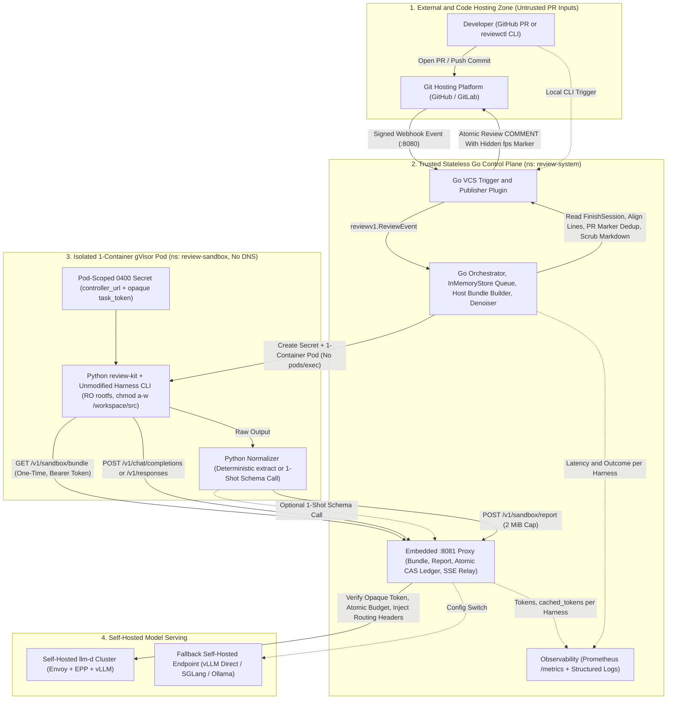
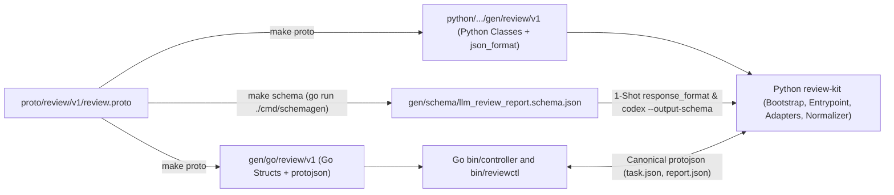
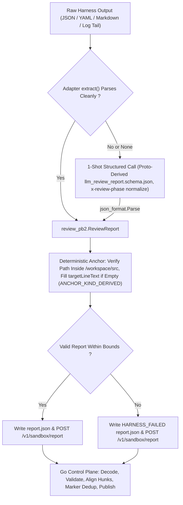
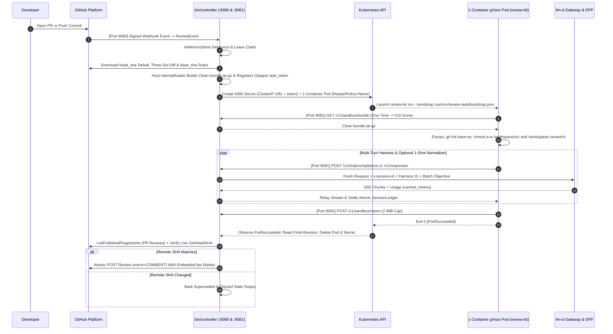

# High-Level Design (HLD): End-to-End Self-Hosted, Pluggable Coding Review Agent for llm-d

## 1. Purpose, Core Principles, and Explicit Non-Goals

We are building a **100% self-hosted, stateless, end-to-end pluggable** automated code review platform for `llm-d` community and internal repositories (Go, Kubernetes CRDs/Helm, Python). It runs completely on self-managed infrastructure with **zero dependency on closed-source SaaS review services, external model APIs, or external databases**, and routes its own multi-turn review traffic through a self-hosted `llm-d` cluster (dogfooding KV prefix caching and Flow Control batch priority).

The platform consolidates into **three build artifacts** across three technology layers:

* **Protobuf (`proto/review/v1/review.proto`)** is the single source of truth for every cross-boundary message, generating Go bindings, Python bindings, and the LLM output JSON Schema from one definition.
* **Go (`bin/controller` and `bin/reviewctl`)** runs all performance-sensitive, concurrent, network-facing, host-side archive sanitization, embedded `:8081` streaming proxy, Kubernetes `client-go`, and publishing infrastructure.
* **Python (`review-kit` from `python/review-harness-kit`)** stays strictly inside the disposable sandbox container to bootstrap the workspace, wrap **existing open-source coding harnesses** (`OpenHands`, `PR-Agent`, `Codex CLI`, `mini-SWE-agent`, `OpenCode`, `Goose`, `Aider`) unmodified, normalize output into a unified `ReviewReport`, and upload it back to the controller.

### Four Core Principles

1. **Strict Security Isolation**: Open-source repositories accept external fork PRs where source files, build scripts, and PR descriptions are untrusted. Host-side `internal/loader` sanitizes archives and strips untrusted instruction files before the sandbox ever sees them. Harnesses run inside a **DNS-disabled, gVisor-isolated, 1-container disposable Pod** with `ReadOnlyRootFilesystem: true`, dropped Linux capabilities, zero `pods/exec` RBAC, and `chmod a-w` read-only source trees; GitHub App keys and upstream model credentials never enter the Pod.
2. **Use Existing Harnesses, Not a Custom Loop**: There is no custom review agent loop in this codebase. Each supported harness sits behind a thin 3-method adapter (`prepare` / `collect` / `extract`) plus a shared Output Normalizer, so comparing or switching harnesses is a config change.
3. **High-Signal Output Only & Stateless Operation**: Schema validation, confidence gating, verbatim diff-line alignment, nearby clustering, cross-commit deduplication via hidden GitHub PR review markers (`<!-- review-run: <id> sha: <sha> fps: <fp1,fp2,...> -->`), and Markdown scrubbing run deterministically in the Go control plane without requiring PostgreSQL.
4. **Native Fit for `llm-d` Serving**: Append-only multi-turn harnesses preserve stable prompt prefixes, while the controller's embedded `:8081` proxy injects `x-session-id`, `x-parent-session-id`, fairness ID, and batch priority headers so `llm-d` EPP pins turns to warm KV-cache replicas and yields queue capacity to live traffic.

### Explicit Scope and Non-Goals

* **No full builds or heavy test suites in the review sandbox**: Compilation and integration suites stay in CI. Optional `CheckLogFetcher.FetchCheckLogs` supplies truncated CI failure logs directly into `/workspace/.review/in/ci_failure.log`.
* **No code edits or commits pushed**: The agent inspects read-only snapshots and never modifies developer branches.
* **No merge-gate blocking**: Reviews publish strictly as `COMMENT` events, never `APPROVE` or `REQUEST_CHANGES`.

---

## 2. System Architecture, Trust Boundaries, and Protobuf Contract Spine

The platform divides into four trust zones. The single `bin/controller` Deployment hosts both the public webhook endpoint (`:8080`) and the internal sandbox API (`:8081`: one-time bundle download, report upload, and streaming OpenAI proxy). Each review shard launches a single-container gVisor Pod in `review-sandbox` whose sole allowed egress is TCP `:8081` to `review-controller`.

### Protobuf as the Single Source of Truth (`proto/review/v1/review.proto`)

Instead of maintaining duplicate Pydantic classes in Python and Go structs by hand, one `.proto` schema drives every wire, file, session-policy, and LLM output contract across languages:

* **`google.golang.org/protobuf/encoding/protojson` (Go) and `google.protobuf.json_format` (Python)** serialize identical JSON (`lowerCamelCase` keys, exact enum names, `optional` scalar presence) across `task.json` and `report.json`.
* **`cmd/schemagen` reads `review.v1.ReviewReport` via `protoreflect`** to emit `gen/schema/llm_review_report.schema.json` (restricting enums away from `*_UNSPECIFIED` and encoding `optional double confidence` as `["number", "null"]` for OpenAI strict JSON Schema mode), so `codex --output-schema`, `goose`, and the 1-shot Normalizer stay locked to the `.proto` file automatically.

### Why Split Go Infrastructure vs. Python In-Sandbox Harness Kit?

1. **Off-the-shelf harnesses live in Python/CLI land, while core infrastructure shines in Go**: Orchestrating Kubernetes Pods, host-side archive sanitization, concurrent PR sharding, and streaming HTTP proxies with strict memory bounds is simpler, faster, and smaller in Go. Meanwhile `PR-Agent`, `OpenHands`, `mini-SWE-agent`, and `Aider` are native Python packages or Node/Rust CLIs best wrapped by a small Python kit inside their own container image.
2. **Zero `pods/exec`, zero separate loader binary, zero JWT signing**: Host-side `internal/loader` sanitizes untrusted GitHub tarballs and packs a clean `bundle.tar.gz` before creating the sandbox Pod. The controller embeds the `:8081` proxy directly in-process and issues 32-byte random opaque session tokens looked up in constant time, removing `cmd/loader`, `cmd/adapter`, `internal/token`, HS256 JWTs, and `pods/exec` RBAC entirely.
3. **Defense-in-depth sandbox isolation (`NetworkPolicy` CNI required)**: Each Pod runs a single `sandbox` container under gVisor (`RestartPolicy: Never`, `ReadOnlyRootFilesystem: true`, `Capabilities: Drop ALL`, `automountServiceAccountToken: false`, `enableServiceLinks: false`, `dnsPolicy: None` targeting `127.0.0.1`). `review-kit` extracts the clean bundle with `tarfile.extractall(..., filter="data")`, creates the offline `base`/`pr` git repo, and locks `/workspace/src` and `/workspace/.review/in` read-only (`0444`/`0555`) before spawning any harness subprocess. A dual-namespace `NetworkPolicy` blocks all ingress and restricts egress solely to `review-system/app=review-controller` TCP `:8081`.
4. **Honest Security Boundaries**: Sandbox and output sanitization block **credential theft** and **privileged write actions**. Prompt injection in a malicious PR can still mislead an LLM into missing bugs or generating false positives; we mitigate that by locking review rules to `base_sha`, stripping untrusted instruction files on the host before bundling, enforcing `confidence` thresholds, and leaving merge decisions to humans. The opaque `task_token` is scoped strictly to one session on `:8081` (one-time bundle read, 2 MiB report upload, bounded inference budget) and is unregistered as soon as the Pod exits.

---

## 3. Five Plugin Boundaries and Control Plane Design

The Go `Orchestrator` (with `InMemoryStore`), host-side `internal/loader`, embedded `internal/inference.ProxyHandler`, Go Denoiser, and Prometheus `/metrics` form the fixed backbone. Five boundaries swap cleanly via configuration and entry points:

| Plugin Boundary | Host Layer | Contract Interface | Default Lightweight Implementation | Swappable Alternatives |
| :--- | :--- | :--- | :--- | :--- |
| **1. VCS Trigger & Publisher** | Go (`cmd/controller`) | `VCSPlugin` (+ optional `CheckLogFetcher`) | `github-app` + `local-cli` | `gitlab` / `gitea` |
| **2. Sandbox Runner** | Go (`cmd/controller`) | `SandboxRunner` (`Run(ctx, SandboxSpec) error`) | `k8s-gvisor-pod` (1-container Pod + Secret) | `k8s-kata` / local `docker` / `local` |
| **3. Agent Harness Adapter** | Python (`review-harness-kit`) | `HarnessAdapter` (`prepare` / `collect` / `extract` + Normalizer) | `openhands` + `pr-agent` | `codex` / `mini-swe-agent` / `opencode` / `goose` / `aider` |
| **4. Context & Tooling** | Go + Sandbox `PATH` | `ContextProvider` + `rg` / `git` / `ast-grep` / `ctags` | `diff.patch` + `base_sha` rules + offline binaries | `FetchCheckLogs` / pre-warmed `golangci-lint` |
| **5. Inference Endpoint Adapter** | Go (`internal/inference`) | `UpstreamProvider` (`Build(claims, api, body) -> UpstreamRequest`) | `llmd-gateway` | `vllm-direct` / `sglang` / `ollama` |

---

### 3.1 VCS Trigger & Publisher Plugin (Go)

* **Canonical Input Contract**: Webhooks parse into `review.v1.ReviewEvent` (`event_id`, `event_kind`, `source`, `repo`, `pr_number`, `base_sha`, `head_sha`, `is_draft`, `is_bot_author`, `is_fork`, `author`, `triggered_by`, `is_maintainer`, `trigger_type`, `force_rerun_seq`, `requested_harness`).
* **Abuse Prevention & Gating**:
  * Triggers on `opened`, `synchronize`, `reopened`, `ready_for_review`, and maintainer `/review` comments; ignores `draft` PRs and bots; cancels active work on `closed`.
  * Enforces per-repo and per-author sliding-window rate limits. **Fork PRs from first-time external contributors never run automatically**—they wait for a maintainer `/review` command.
  * `/review <profile>` checks `requested_harness` against configured profile allowlists (never passed to a shell).
* **Diff Fetching, Line Alignment, Stateless Marker Dedup, and Sanitization**:
  1. Downloads the `head_sha` source tarball via platform API (free of `.git` hooks, submodules, and LFS) and three-dot `diff.patch` (stripping binary file sections before bundling).
  2. Verifies every finding's `targetLineText` against parsed diff hunks (`LEFT`/`RIGHT`). If lines shifted slightly, locates a unique verbatim hunk match; otherwise falls back to file-level comment (when supported) or the summary body so GitHub `422` errors never drop an entire review.
  3. **Stateless cross-commit deduplication**: Reads prior PR reviews via `VCSPlugin.ListPublishedFingerprints` (`GET /repos/{owner}/{repo}/pulls/{pr}/reviews`) to extract fingerprints embedded in hidden markers (`<!-- review-run: <run_id> sha: <head_sha> fps: <fp1,fp2,...> -->`), preventing duplicate comments even after controller restarts with zero database state.
  4. **Sanitizes all untrusted text** before posting: strips minted Task Tokens, escapes line-leading Prow commands (`/lgtm`, `/approve`, `/hold`, etc.) both inside and outside fenced code blocks, breaks `@mentions` with zero-width spaces, and strips raw HTML tags/comments, images, and external links. Posts atomically via `POST /pulls/{pr}/reviews` (`event=COMMENT`).

---

### 3.2 Stateless Orchestrator, Host Bundle Builder, and Sandbox Layer (Go)

* **In-Memory State Machine (`InMemoryStore`)**:

| State | Entry & Action | Concurrency & Failure Handling |
| :--- | :--- | :--- |
| `queued` | Inserted when `(repo, pr, base_sha, head_sha, trigger_type, force_rerun_seq)` is not active/done | Waits in configurable debounce window; newer commits mark queued runs `superseded` |
| `running` | Claimed by worker pool; picks sticky harness profile, builds `bundle.tar.gz`, registers session, and spawns disposable sandbox | Heartbeat renews lease; newer commits cancel context and delete Pod & Secret (`GracePeriodSeconds=0`) |
| `publishing` | Aggregates primary shards, deduplicates against in-memory store and live GitHub PR markers, checks `GetHeadSHA` CAS | If live remote `head_sha` changed, marks `superseded` and discards output |
| `done` | Atomic GitHub review posted with embedded `fps` marker | Auto 0-finding runs finish silently; manual `/review` posts a concise clean summary |
| `superseded` | Replaced by newer push or closed PR | Deletes sandbox Pod and Secret immediately (`GracePeriodSeconds=0`), backed by `activeDeadlineSeconds` and 5-minute `OrphanPodReaper` (sweeping both Pods and orphan Secrets) |
| `failed` | Retries exhausted or all shards failed | Auto runs fail silently (metrics/logs only); manual `/review` posts a 1-line error note with `run_id` |

* **Host-Side Safe Bundle Builder (`internal/loader`)**:
  * **Archive safety**: Streams GitHub's `snapshot.tar.gz`, strips single leading directory wrapper, skips PAX headers, rejects traversal, absolute paths, escaping symlinks, chained symlink escapes, symlink parent writes, escaping/unresolved hardlinks, device nodes, and size caps (`64 MiB` per file, `2 GiB` total).
  * **Rule source lock**: Review rules (`AGENTS.md`, `docs/review/` path-routed rules) come exclusively from `base_sha`, fetched by the controller.
  * **Instruction-file masking**: Strips `AGENTS.md`, `AGENTS.override.md`, `CLAUDE.md`, `GEMINI.md`, `.cursorrules`, `.goosehints`, `.pr_agent.toml`, `opencode.json`, `opencode.jsonc`, `.mcp.json`, `.aider.conf.yml`, and directories `.agents`, `.codex`, `.opencode`, `.openhands`, `.claude`, `.cursor`, `.goose` while recording `masked_files` in `.review/in/task.json`. Their changes remain inspectable as plain text inside `diff.patch`.
* **Large PR Sharding & Centralized Denoiser**:
  * Strips `go.sum`, `vendor/`, `zz_generated.*`; splits remaining diff into shards sized under ~1/3 of `max_context_tokens`. Runs primary shards plus any configured `shadow` profiles concurrently with unique Pod names (`shadow-<profile>` disambiguated).
  * Publishes partial results if at least one primary shard succeeds (listing failed shards in summary); runs **Schema & range validation -> confidence filter (`>= 0.75`, using profile default when unset) -> verbatim hunk alignment -> nearby same-file clustering -> in-memory + PR marker dedup -> Top 8 cap**.

---

### 3.3 Agent Harness Adapter Plugin (`python/review-harness-kit`)

Python stays confined strictly inside the disposable sandbox container (`CMD ["review-kit", "run"]`) behind the Protobuf `AgentTask` / `ReviewReport` contract (`protojson`—note `int64` fields encode as JSON strings per Proto3 JSON mapping, so both languages decode via `protojson` / `json_format`, never plain `json`).

During bootstrap, `review-kit`:
1. Reads `{"controller_url": ..., "task_token": ...}` from `--bootstrap /var/run/review-task/bootstrap.json` (K8s `0400` Secret) or stdin (Docker / local).
2. Downloads `GET {controller_url}/v1/sandbox/bundle` (one-time read) and extracts into `/workspace` using `tarfile.extractall(..., filter="data")`.
3. Initializes the offline 2-branch Git repo (`base` + `pr` via `git apply -R --index --exclude=...`, `core.hooksPath=/dev/null`, `GIT_CONFIG_NOSYSTEM=1`).
4. Recursively locks `/workspace/src` and `/workspace/.review/in` read-only (`0444` files, `0555` executables and directories).
5. Runs the configured `HarnessAdapter` (`OPENAI_BASE_URL={controller_url}/v1`, `OPENAI_API_KEY={task_token}`) under `wall_clock_seconds` process-group timeout, normalizes output into `report.json`, and uploads via `POST {controller_url}/v1/sandbox/report` (3x short retry).

#### 3.3.1 Supported Harnesses and Adapter Behavior

| Profile | Unmodified Harness | Loop Style | Wire API | Captured Output | Normalizer Path |
| :--- | :--- | :--- | :--- | :--- | :--- |
| `pr-agent` | PR-Agent (`local` git provider) | Single-shot structured review | Chat Completions (LiteLLM) | YAML prediction (`key_issues_to_review`) | Deterministic |
| `openhands` | OpenHands CLI (`--headless`) | Multi-turn shell/file agent | Chat Completions (LiteLLM) | `raw_report.json` or log tail | Deterministic, 1-shot fallback |
| `codex` | Codex CLI (`codex exec --output-schema`) | Multi-turn shell agent | Responses API (always SSE) | Schema-constrained final JSON | Deterministic |
| `mini-swe-agent` | `mini` CLI (local env) | Multi-turn linear bash history | Chat Completions (LiteLLM) | `raw_report.json` or trajectory tail | Deterministic, 1-shot fallback |
| `opencode` | `opencode run` | Multi-turn agent | Chat Completions (SSE) | `raw_report.json` or final message | Deterministic, 1-shot fallback |
| `goose` | `goose run --recipe` | Multi-turn agent | Chat Completions (SSE) | Schema-constrained output | Deterministic |
| `aider` | `aider --chat-mode ask` | Single-shot with repo map | Chat Completions (LiteLLM) | Markdown stdout | 1-shot structured call |

All prompt-driven harnesses receive the identical `prompts/review_task.md` (`base_sha` rules first, workspace paths, embedded Proto-derived JSON Schema, PR title/description marked untrusted, diff last), so A/B experiments compare harness loops rather than divergent prompts. `PR-Agent` keeps its own prompt pipeline and receives `base_sha` rules via `PR_REVIEWER__EXTRA_INSTRUCTIONS`.

#### 3.3.2 Output Normalization

---

### 3.4 Context & Tooling Plugin

* **Control-plane context providers (`ContextProvider` in Go)**: Contribute files into `.review/in/` before bundling (three-dot `diff.patch`, root `AGENTS.md` + 0-2 path-matched `base_sha` rules from `docs/review/`, PR metadata, and optional truncated CI failure logs from `CheckLogFetcher`).
* **In-sandbox static toolbox**: Harness images bake static `ripgrep`, `git`, `ast-grep`, and `universal-ctags`. Shell-driven harnesses invoke them directly against read-only `/workspace/src`.

---

### 3.5 Embedded Inference & Task Transfer Proxy (`internal/inference` on `:8081`)

`ProxyHandler` runs directly inside `bin/controller` (and `bin/reviewctl` on an ephemeral loopback port), serving all 5 sandbox endpoints under constant-time opaque Bearer token authentication:

| Endpoint | Purpose | Enforcement |
| :--- | :--- | :--- |
| `GET /v1/sandbox/bundle` | Streams clean `bundle.tar.gz` to `review-kit` | Atomic one-time `CompareAndSwap`; replays return HTTP `410 Gone`. |
| `POST /v1/sandbox/report` | Receives normalized `ReviewReport` protojson | `http.MaxBytesReader` `2 MiB` cap; stores latest bytes while session is active. |
| `POST /v1/chat/completions` | Chat Completions (OpenHands, PR-Agent, Goose, OpenCode, mini-SWE-agent, Aider) | Field allowlist, force configured `upstream_model`, cap `max_tokens`/`max_completion_tokens`, support `stream=false` & `stream=true` (forcing `stream_options.include_usage=true`, hiding usage-only tail chunk unless client requested it). |
| `POST /v1/responses` | Responses API (Codex CLI) | Stateless pass-through: forces `store=false`, strips `previous_response_id` and `conversation`, extracts usage from `response.completed`. |
| `GET /v1/models` | Harness startup probe | Verifies Bearer token and returns single configured `model_alias`. |

* **Atomic Budget & Request Enforcement (`SessionLedger`)**: Reserves `estimated_input + max_output_tokens` atomically before forwarding and settles to uncached work `(prompt - cached) + completion` afterward (charging estimate if a `2xx` stream drops without usage, while continuing to track raw prompt, cached, and completion totals separately). Enforces separate `max_requests` (60) and `max_normalize_requests` (2) counters plus `normalizer_reserve_tokens` (50,000 for multi-turn profiles; 20,000 for single-shot). Returns HTTP `403` (`budget_exhausted` / `request_limit_exhausted`) so SDKs do not auto-retry. Counts rejected harness-phase requests in `SandboxUsage.rejected_requests`. The control plane marks a report from a session with rejected requests `HARNESS_FAILED` unless the harness wrote a deterministic report file.

#### 3.5.1 Prefix-Cache Compatibility Matrix

| History Shape | Harnesses | Behavior on `llm-d` KV Prefix Cache |
| :--- | :--- | :--- |
| **Append-only** | `openhands`, `codex`, `mini-swe-agent`, `goose`, `opencode` | Re-sends identical prefix plus appended tool result; turns 2..N hit warm replica via `x-session-id`. |
| **Append-only with compaction** | Same harnesses near `max_context_tokens` | Recomputes from compaction point onward, then resumes prefix hits. Adapters configure `max_context_tokens` and disable aggressive output pruning where supported. |
| **Single-shot** | `pr-agent`, `aider` | Few independent calls; low total tokens, shares only identical system prompt across PRs landing on same replica. |
| **Sliding window** | Classic SWE-agent (`last_n_observations`) | Moving prefix invalidates cache every turn; excluded from defaults. |

#### 3.5.2 Required `llm-d` Cluster Configuration Checklist

`LlmdGatewayUpstream` constructs a fresh upstream HTTP request (zero sandbox headers forwarded) with four headers:

| Header | Value | Purpose |
| :--- | :--- | :--- |
| `x-session-id` | `<run_id>-s<shard>` (or `<run_id>-s<shard>-<profile>` for shadow) | Pins all turns of one harness execution to one replica |
| `x-parent-session-id` | `<run_id>` (set when shards > 1) | Groups sharded sibling runs into one lineage tree |
| `x-llm-d-inference-fairness-id` | `<repo>` | Per-repo fairness and telemetry |
| `x-llm-d-inference-objective` | `code-review-batch` | Selects low-priority batch objective |

| `llm-d` Component / Plugin | Default Behavior (Gotcha) | Required Configuration for Review Agent | Effect |
| :--- | :--- | :--- | :--- |
| **`session-affinity-scorer`** | Defaults to `encoded_endpoint_header` (`x-session-token`) | Set `strategy: session_id` and `sources: [{ header: x-session-id }]` | Pins all turns of a review session to the same pod via proxy-injected `x-session-id` |
| **`agent-identity` / `agent-lineage`** | Disabled by default; built-in defaults omit `x-session-id` | Enable both plugins and add `x-session-id` to `additionalSessionHeaders` | Tracks per-session identity and `x-parent-session-id` (merging sharded sub-tasks into one fairness queue) |
| **`requestHandler` Fairness** | `x-llm-d-inference-fairness-id: <repo>` queues all repo PRs together | Enable `composeFairnessIDs: true` | Composes `<repo>/<root_session_id>` (or `<repo>/<parent_session_id>` for sharded trees) for per-repo metrics and per-tree queues |
| **`flowControl` & `InferenceObjective`** | Feature gate off by default; `x-llm-d-inference-ttl` can only shorten finite TTLs | Enable `featureGates: ["flowControl"]`, create `code-review-batch` Objective, set long `defaultRequestTTL` on batch band | Allows review traffic to wait in queue during live traffic peaks without premature TTL shedding (match gateway timeout) |
| **vLLM Engine Flags** | `prompt_tokens_details.cached_tokens` omitted by default | Enable `--enable-prefix-caching` and `--enable-prompt-tokens-details` | Reuses KV cache blocks and reports `cached_tokens` usage back to the proxy |
| **vLLM Tool Calling** | Native `tool_calls` are off unless a parser is configured | Enable `--enable-auto-tool-choice` and the `--tool-call-parser` that matches the served model | Agentic harnesses depend on native tool calls, including in streamed responses |

* **Timeout & Retry**: Set generous Pod `wall_clock_seconds` (e.g. 1800s), upstream HTTP client timeout (420s) >= batch `defaultRequestTTL` (360s), and harness HTTP timeout >= 400s. On `429` / `503` before any SSE byte is relayed, `ProxyHandler` retries up to 4 times with jittered exponential backoff (5s-40s).
* **Swapping Backends**: Switch upstream config from `llmd-gateway` to `vllm-direct` / `sglang` / `ollama` with zero sandbox changes (served model must support tool calling and `max_context_tokens`).

---

## 4. Core Interaction Sequence Diagram

---

## 5. Technology Stack Selection

| Layer | Choice | Why This Combination Wins | Considered and Rejected |
| :--- | :--- | :--- | :--- |
| **Shared Contracts** | **Protobuf (`proto3`)** | One schema generates Go types, Python types, and `llm_review_report.schema.json`; `protojson` guarantees identical JSON and `optional` presence across Go and Python | Hand-duplicated Go structs + Pydantic models (drift risk) |
| **Control Plane & Proxy** | **Single Go binary (`bin/controller`, `net/http`, `k8s.io/client-go`)** | Single Deployment serving `:8080` webhooks and `:8081` sandbox bundle/report/OpenAI proxy, lock-free CAS budgets, opaque random session tokens, zero external database | Separate `cmd/adapter` Deployment, HS256 JWT signing, PostgreSQL StatefulSet |
| **Archive Sanitization** | **Host-side Go (`internal/loader`)** | Validates paths, symlink chains, hardlinks, and size caps and strips untrusted repo instructions into a clean `bundle.tar.gz` before any Pod starts | In-Pod `cmd/loader` binary + 2-container Pod + 4x `pods/exec` streams |
| **Isolated Sandbox** | **Disposable 1-container gVisor Pod + `NetworkPolicy`** | Syscall isolation, `ReadOnlyRootFilesystem: true`, `127.0.0.1` fail-fast DNS, `0400` Pod-owned Secret, zero `pods/exec` RBAC | 2-container `wait` Pods; nested Docker/Landlock inside harness |
| **Harness Layer** | **Python 3.12 (`uv`) + `review-kit` wrapping existing harnesses** | Off-the-shelf coding harnesses (`PR-Agent`, `OpenHands`, `mini-SWE-agent`, `Aider`) are Python or CLI-native; thin adapters avoid writing or maintaining a custom loop | Custom Go agent loop; bundling controller dependencies into sandbox images |
| **CLI & Offline Eval** | **Go `bin/reviewctl`** | Single developer binary reusing the exact same `internal/loader`, `internal/inference`, `internal/sandbox`, and `internal/publisher` packages for local evaluation and A/B scorecards | Maintaining a separate Python Denoiser or separate adapter process for CLI mode |
| **Serving & Telemetry** | **Self-hosted `llm-d` + Prometheus `/metrics`** | KV prefix caching + `flowControl` batch prioritization; direct correlation of tokens, cache hit ratio, and latency per harness | SaaS code review services or external proprietary APIs |
