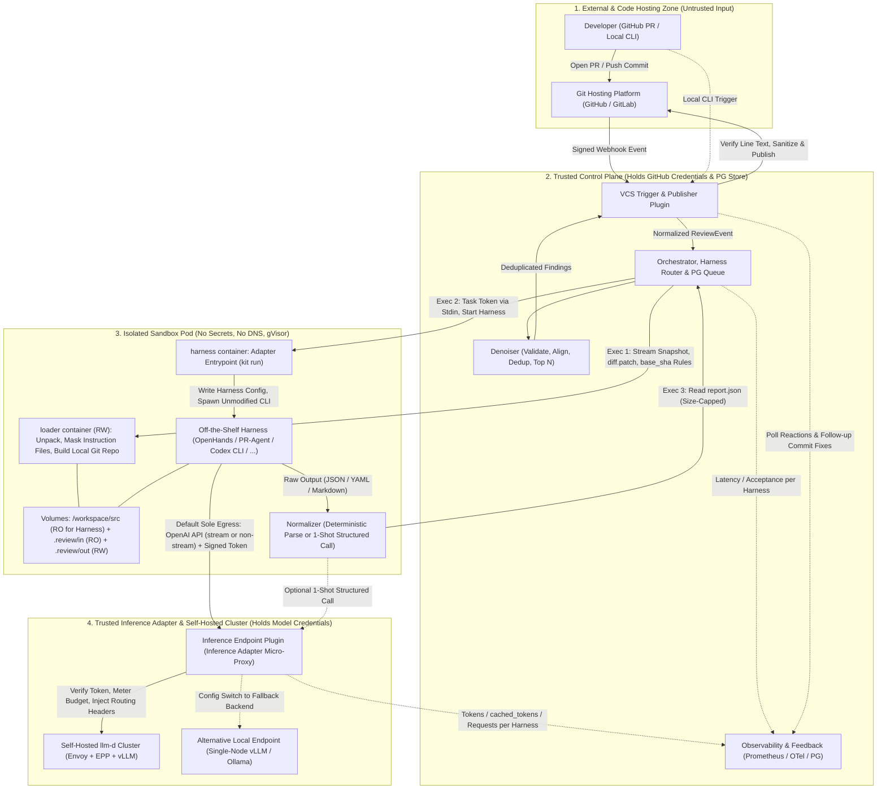
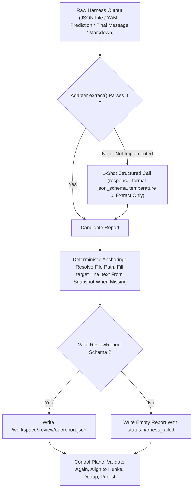
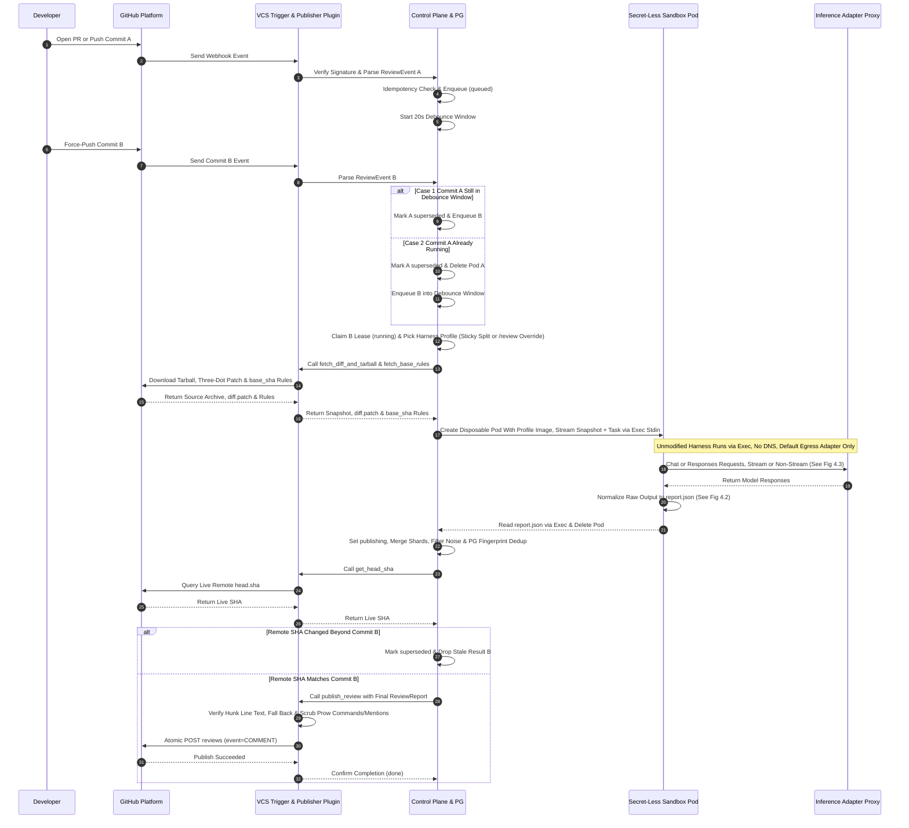
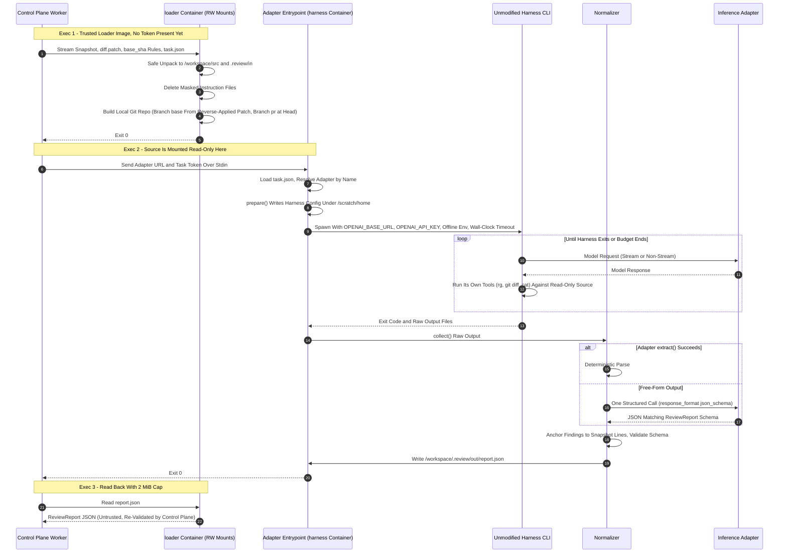
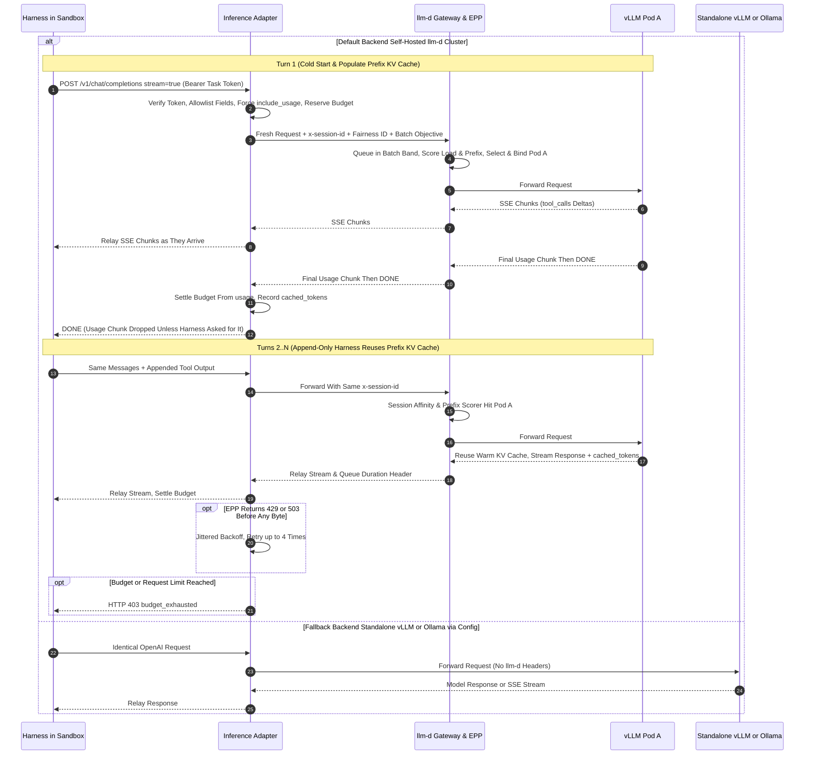

# High-Level Design (HLD): End-to-End Self-Hosted, Pluggable Coding Review Agent for llm-d

## 1. Purpose, Core Principles, and Explicit Non-Goals

We are building a **100% self-hosted, end-to-end pluggable** automated code review system. It handles daily PR reviews across `llm-d` community and internal repositories (Go, Kubernetes CRDs/Helm, Python, etc.) with **zero reliance on closed-source SaaS review services or external model APIs**. Code snapshots, job state, model weights, inference traffic, and dashboards all run on self-managed infrastructure, and the system can route its own inference traffic through a self-hosted `llm-d` cluster (dogfooding).

### Five Core Principles

1. **Reuse the agent, build the glue**: We do **not** write an agent loop. The reviewing agent is an existing open-source harness (OpenHands, PR-Agent, Codex CLI, mini-SWE-agent, OpenCode, Goose, Aider) that runs unmodified. We build only what no harness gives us: scheduling, isolation, a metered inference proxy, output normalization, noise control, and publishing.
2. **Strict Security Isolation**: Open-source repositories receive external fork PRs where source code, scripts, and comments are untrusted. The harness and source code run inside a **secret-less, read-only, network-restricted (no DNS, no internet or cluster access)** disposable sandbox Pod, while credentials stay strictly outside in trusted components.
3. **High-Signal Output Only**: Cross-round fingerprint deduplication, confidence filtering, and verbatim diff-line verification prevent comment spam. Inline comments that fail line matching fall back cleanly so API errors never drop a review.
4. **Clean Boundaries Without Over-Engineering**: The scheduling backbone is fixed, with only **5 plugin boundaries**. Swapping the harness or the inference backend is a configuration change. Orchestration, sandboxing, noise control, and publishing stay untouched.
5. **Native Fit for `llm-d` Serving**: The Inference Adapter stamps session, lineage, fairness, and batch-priority headers on every request, so `llm-d` Router (Envoy + EPP) pins the turns of one review to a warm KV-cache replica and lets review traffic yield to live interactive traffic.

### Explicit Scope and Non-Goals

* **No custom agent engine**: The earlier custom two-stage harness is removed. If no off-the-shelf harness is good enough, the fix is a better adapter, prompt, or model, not a homegrown loop.
* **No full builds or heavy integration tests in Phase 1**: Compilation, builds, and heavy test suites stay in existing CI pipelines. However, plugin interfaces reserve extension hooks for **CI failure log ingestion (`FetchCheckLogs`)** and **scoped unit test execution (`run_scoped_test`)**. When enabled later, unit tests must run in a separate secret-less, 100% air-gapped child sandbox Pod.
* **No code edits or commits pushed**: The agent posts read-only review feedback and never writes back to developer branches.
* **No merge-gate blocking**: Reviews are always posted as `COMMENT` events, never `APPROVE` or `REQUEST_CHANGES`, and the bot never participates in Prow merge voting.

### What We Build vs. What We Reuse

| Concern | Reused as-is | Built here (thin) |
| :--- | :--- | :--- |
| Agent loop, tool calling, context management | OpenHands, PR-Agent, Codex CLI, mini-SWE-agent, OpenCode, Goose, Aider | One adapter file per harness (config templating + output capture) |
| Code search and navigation tools | The harness's own shell and file tools, plus `ripgrep`, `git`, `ast-grep`, `universal-ctags` binaries in the image | Optional `review-tools` CLI and MCP server for extras such as `run_scoped_test` |
| Queue and state | PostgreSQL (`SKIP LOCKED`, advisory locks, partial unique indexes) | About six SQL statements for debounce, supersede, lease, and dedup |
| Sandbox | Kubernetes Pod, gVisor `RuntimeClass`, `NetworkPolicy` | Pod spec builder and three Exec steps |
| Model serving and routing | `llm-d` (Envoy + EPP + vLLM), or standalone vLLM / SGLang / Ollama | Inference Adapter: a small authenticated, metered reverse proxy |
| GitHub integration | GitHub App REST API through `githubkit` | Line alignment, sanitization, atomic review post |

---

## 2. System Architecture and Trust Boundaries

The system is split into four zones by trust domain and plugin role. Physically, **the off-the-shelf harness and its tools share a secret-less sandbox Pod, and the sandbox's default sole allowed outbound target is the ClusterIP of an external `Inference Adapter` (OpenAI-compatible micro-proxy)**.



### Why Separate Inside-Sandbox vs. Outside-Sandbox Components?

1. **Off-the-shelf harnesses run unmodified**: OpenHands, Codex CLI, Goose, and the others expect a local checkout, a shell, and a standard OpenAI `base_url`. Giving them exactly that inside the sandbox Pod means a harness swap never requires patching the harness.
2. **Data I/O via Control-Plane Exec with Zero Shared Storage or Disk Secrets**: The control plane streams the source archive, `diff.patch`, `base_sha` rules, and a credential-free `task.json` into Pod-local `emptyDir` volumes through Kubernetes Exec stdin. Both containers keep an idle PID 1 (until `activeDeadlineSeconds`). The control plane starts the harness via Exec, waits for the fixed result file `/workspace/.review/out/report.json`, reads it back via Exec, and deletes the Pod. This avoids early container exit, avoids mixing reports with harness stdout logs, requires no RWX PVC, and avoids stuffing large diffs into env vars.
3. **Read-only source enforced by the kernel, not by harness flags**: The Pod has two containers that share volumes. The `loader` container mounts the source volume read-write and unpacks into it. The `harness` container mounts the same volume with `readOnly: true`. A harness with an "edit file" tool simply gets `EROFS`. Only `/workspace/.review/out` and a size-limited `/scratch` (for `HOME`, caches, and session logs) are writable.
4. **No Secrets and No DNS (Requires a NetworkPolicy-Enforcing CNI)**: The sandbox Pod sets `automountServiceAccountToken: false` and mounts no GitHub private keys or model API keys. A short-lived **signed Task Token and the Adapter URL** are passed over Exec stdin into the harness process environment only (never written to `task.json`, the Pod spec, or a Secret). A harness may copy the token into its own scratch files; those live on the Pod's ephemeral volume and are destroyed with the Pod. A Kubernetes `NetworkPolicy` (requiring Cilium, Calico, or another enforcing CNI) blocks internet access, internal cluster access, and UDP/TCP port 53 DNS lookups (blocking DNS exfiltration of private code), allowing TCP egress by **default** only to the `Inference Adapter` Pods.
5. **Honest Security Boundaries**: Sandboxing and output sanitization reliably block **credential theft** and **privileged write actions**. Prompt injection inside a malicious PR can still cause the model to miss real bugs or emit false positives, which is mitigated by locking rules to `base_sha`, masking in-repo agent instruction files, confidence thresholds, and human review. The Task Token is visible to the harness process (every harness needs an API key). That is acceptable because the token is only valid at the Adapter, is bound to one run's budget, expires with the run, and the sandbox has nowhere else to send it.

---

## 3. Five Plugin Boundaries and Control Plane Design

The scheduler (Orchestrator + PostgreSQL queue), the Denoiser, and the metrics backend form the fixed core backbone. The five variable stages are abstracted behind lightweight plugin boundaries:

| Plugin Boundary | Core Responsibility | Contract (Input to Output) | Default Lightweight Implementation | Swappable Alternatives |
| :--- | :--- | :--- | :--- | :--- |
| **1. VCS Trigger & Publisher** | Receive events, fetch snapshots/diffs, fetch `base_sha` rules, map lines, post reviews, poll feedback (optional CI logs) | `verify_and_parse_webhook` / `get_head_sha` / `fetch_diff_and_tarball` / `fetch_base_rules` / `publish_review` / `poll_feedback` (optional `CheckLogFetcher.fetch_check_logs`) | `github-app` + `local-cli` | `gitlab` / `gitea` |
| **2. Sandbox Runner** | Launch disposable isolated Pod, stream inputs, start the harness, and read the report via Exec | `SandboxSpec` (archive stream + task + harness image) to `ReviewReport` JSON file + Pod cleanup | `k8s-gvisor-pod` (disposable Pod) | `k8s-kata` / local `docker` |
| **3. Agent Harness Adapter** | Run an **existing** harness unmodified and normalize whatever it prints | `AgentTask` (with `base_sha` rules, `diff.patch`, local git repo) to `ReviewReport` | `openhands` and `pr-agent` adapters | `codex` / `mini-swe-agent` / `opencode` / `goose` / `aider` |
| **4. Context & Tooling** | Decide what context enters the sandbox and which tools sit on `PATH` | Context providers add files to the context pack; toolbox exposes CLI and MCP tools (reserves `run_scoped_test`) | `base_sha` rules + `diff.patch` + `ripgrep` / `git` / `ast-grep` / `universal-ctags` | `FetchCheckLogs` provider / pre-warmed `golangci-lint` / isolated air-gapped test runner |
| **5. Inference Endpoint (Adapter)** | Verify Task Token, inject headers, enforce budgets, relay SSE, retry transient errors | OpenAI `/v1/chat/completions` and `/v1/responses` (stream or non-stream) + signed token to model response | `llmd-gateway` upstream | `vllm-direct` / `sglang` / `ollama` |

---

### 3.1 VCS Trigger & Publisher Plugin

* **Minimal Data Contracts** (using two consistent structures across the entire system: `ReviewEvent` and `ReviewReport`, which contains a list of `ReviewFinding`):

```yaml
ReviewEvent:
  event_id: "github-delivery-uuid"
  source: "github"                       # github | gitlab | cli
  repo: "llm-d/llm-d-router"
  pr_number: 4232
  base_sha: "a1b2c3d"
  head_sha: "e4f5g6h"
  is_fork: true
  author: "contributor-name"
  trigger_type: "auto"                   # auto | manual_command
  force_rerun_seq: 0                     # Unique comment ID on /review rerun to avoid idempotency skip
  requested_harness: null                # Set by "/review <profile>"; must match a configured profile name
```

* **Abuse Prevention & Gating**:
  * **Trigger scope**: Handles `opened`, `synchronize`, `reopened`, `ready_for_review`, and maintainer `/review` comments; automatically skips `draft` PRs and known bots; cancels active work on `closed`.
  * **Fork rate limiting & gatekeeping**: Enforces per-repo and per-author rate limits. **Fork PRs from first-time contributors (non-org members without prior merged commits) do not trigger automatically** and wait for a maintainer `/review` command or trust label (matching `llm-d`'s `ci-pr-test` pattern).
  * **Trying a harness on one PR**: A maintainer can comment `/review codex` to rerun the review with another configured harness profile. The name is matched against the configured allowlist and is never passed to a shell.
* **Platform Alignment, Line Verification, and Output Sanitization**:
  1. **Fetch snapshots and diffs via platform API (plus optional CI logs)**: The VCS plugin downloads the source tarball at `head_sha` (inherently free of git hooks, submodules, and LFS) and fetches the three-dot PR diff matching the GitHub UI into a standard unified `diff.patch`. Optional `fetch_check_logs` retrieves existing CI test/lint failure logs (**without waiting for unfinished CI; truncated and treated as untrusted input**). **Oversized patch fallback**: If a file or the overall diff exceeds the platform diff truncation limit and lacks a patch, note it in the PR summary and skip inline comments for that file.
  2. **Verbatim line matching & two-tier fallback**: Every `ReviewFinding` carries `target_line_text`. The Publisher posts an inline comment only if `Hunk[file][line]` matches that text (ignoring leading/trailing whitespace). If shifted, it searches within the file's hunks for a unique verbatim match and adjusts the line number. Otherwise it **falls back to a file-level comment** (*note: verify file-level comment compatibility on GitHub `POST /pulls/{pr}/reviews` during Phase 2; if unsupported, fold directly into the PR summary*), or into the PR summary body if outside modified files, preventing `422` failures from dropping the review.
  3. **Untrusted output sanitization & least privilege**: Before posting, scrub line-leading Prow commands (`/lgtm`, `/approve`, `/hold`, `/close`, etc.), sanitize `@mention` strings, strip external images/links and raw HTML, and drop any text that contains the run's Task Token. **By default request only** `pull_requests: write` and `contents: read` (adding read-only Checks/Actions log scopes only if `FetchCheckLogs` is enabled, to be verified against the platform during rollout). Submit atomically via one `POST /pulls/{pr}/reviews` call with `event=COMMENT` and a hidden `<!-- review-run: {run_id} sha: {head_sha} -->` marker at the end of the body for crash deduplication.

---

### 3.2 Orchestrator State Machine, Deduplication, and Sandbox Layer

* **Job Lifecycle State Machine (Persisted in PostgreSQL)**:

| State | Entry Condition & Action | Failure & Concurrency Handling |
| :--- | :--- | :--- |
| `queued` | Enqueued when idempotency key `(repo, pr, base_sha, head_sha, trigger_type, force_rerun_seq)` is not active/done | Waits in a 15-30s debounce window; newer commits mark queued runs `superseded` |
| `running` | Worker claims job via `SKIP LOCKED` with a lease, picks the harness profile, and starts sandbox | Heartbeat renews lease; crashed leases are reclaimed (up to `max_retries=2`); newer commits mark `superseded` and delete the Pod |
| `publishing` | Sandbox returns `ReviewReport`; control plane deduplicates and prepares output | **Calls VCS `get_head_sha` right before posting**; if remote head changed, marks `superseded` and discards output |
| `done` | Atomic GitHub review posted and finding fingerprints saved | Records metrics; if triggered manually via `/review` with 0 findings, posts a short "no high-risk issues found" summary |
| `superseded` | Replaced by a newer commit or closed PR | Immediately deletes disposable sandbox Pod (backed by `activeDeadlineSeconds`, orphan Reaper, and controller-Pod `ownerReference` in single-namespace mode) |
| `failed` | Retries exhausted, sandbox timed out, or all shards failed | **Auto triggers fail silently (alerts only, no PR noise)**; manual `/review` failures post a one-line error note with `run_id` |

* **Safe Unpacking, Rule Locking, and Large PR Sharding**:
  * **Unpack safety**: Reject path traversal (`..`), absolute paths, device nodes, and symlinks/hardlinks pointing outside the workspace root; the harness container then sees the tree read-only.
  * **Rule source lock**: `AGENTS.md`, path-routed review rules (such as `docs/review/`), and linter configs are **fetched strictly from `base_sha` by the control plane** and passed into the task, never read from the untrusted PR `head_sha`.
  * **Instruction-file masking**: Many harnesses auto-load instruction and config files from the working directory (`AGENTS.md`, `CLAUDE.md`, `.goosehints`, `.codex/`, `.openhands/`, `opencode.json`, `.mcp.json`, `.pr_agent.toml`, and similar). In the snapshot these come from the untrusted `head_sha`. The loader deletes them from `/workspace/src` before the harness starts. Their changes remain visible as plain text in `diff.patch`, and the trusted `base_sha` rules reach the harness through the task prompt instead. Containment never depends on this step; it protects review quality, not secrets.
  * **Sharding & partial failure policy**: Filter out `go.sum`, `vendor/`, and generated files (`zz_generated.*`). Estimate token size so **each shard's diff stays under roughly 1/3 of `max_context_tokens`** (leaving 2/3 for rules, tool responses, and output), splitting oversized PRs by package/directory into concurrent child tasks sharing `parent_session_id`. Each shard runs in its own Pod with the full snapshot and only its slice of the diff. **If at least one shard succeeds, publish available results and note skipped shards in the summary**; mark `failed` only when all shards fail.
* **Cross-Round Deduplication & Centralized Noise Control (In Control Plane, Not Harness)**:
  * The control plane aggregates all shard outputs and deterministically runs: **JSON Schema validation -> confidence filter (`>= 0.75`) -> hunk text alignment -> nearby same-file clustering -> PG cross-round fingerprint dedup -> global Top N cap (default 8)**. Because this runs outside the sandbox, every harness gets the same noise control for free.
  * **PG Fingerprints (No Auto-Resolve)**: Compute `hash(file + prev_line + target_line)` from normalized source/hunk lines (omitting `category` so cross-round re-categorization cannot bypass dedup, while including the previous line so multiple `return err` lines do not collide). Already-posted fingerprints are skipped on subsequent pushes. The fingerprint does not include the harness name, so dedup keeps working when the harness changes between rounds. The bot **does not** auto-resolve old threads (avoiding false resolves on model variance; GitHub marks edited lines Outdated automatically).

---

### 3.3 Agent Harness Plugin: Adapters Around Existing Harnesses

The plugin is **not** an agent. It is a thin adapter that makes an existing harness run inside our sandbox and turns its output into `ReviewReport`. The contract has two parts:

1. **Harness Adapter (one small file per harness)**: `prepare()` writes the harness's own config files and returns the command line; `collect()` picks up whatever the harness produced; `extract()` optionally parses that output deterministically.
2. **Shared Normalizer**: Takes the adapter's raw output and always returns a schema-valid `ReviewReport`, using the deterministic parse when it works and one structured-output model call when it does not.

* **Minimal Interface Contract**:

```yaml
# Uniform input (streamed via Exec stdin into /workspace/.review/in; holds zero credentials; rules come from base_sha)
AgentTask:
  run_id: "7f3a9c1e-..."
  harness: { profile: "openhands", adapter: "openhands" }
  model_alias: "review-coder"                      # The only model name harnesses ever see; the Adapter maps it upstream
  pr_meta: { title, description, base_branch, labels }
  src_dir: "/workspace/src"                        # Read-only for the harness; local git repo with branches "base" and "pr"
  diff_file: "/workspace/.review/in/diff.patch"    # Standard unified diff (three-dot, text files only)
  rules_dir: "/workspace/.review/in/rules"         # AGENTS.md + path-matched rules, extracted from base_sha
  ci_logs_file: "/workspace/.review/in/ci-logs.txt" # Optional: truncated CI failure logs from FetchCheckLogs
  out_dir: "/workspace/.review/out"                # Writable; report.json is read back from here
  masked_files: ["AGENTS.md", ".codex/*"]          # Removed from src_dir by the loader (see 3.2)
  tool_endpoints:                                  # Optional: ClusterIP:port of isolated air-gapped test runner Pod
    scoped_test: "http://10.96.x.x:9002"
  budget:
    max_requests: 60                               # Enforced by Adapter (request count per token)
    max_context_tokens: 32768                      # Passed to the harness's own context-window setting
    max_total_tokens: 1500000                      # Cumulative task token hard cap (enforced by Adapter)
    wall_clock_s: 900                              # Enforced by the entrypoint and the Pod deadline

# Harness process environment (passed over Exec stdin, set in process memory only, never written to task.json)
# OPENAI_BASE_URL="http://10.96.0.42:8080/v1"      # Adapter ClusterIP, no DNS needed
# OPENAI_API_KEY="short-lived-signed-task-token"   # Bound to session / budget / expiration

# Uniform output (validated against Schema; filtering & dedup run in control plane)
ReviewReport:
  summary: "Overall assessment..."
  findings:
    - file: "pkg/epp/scheduling/scorer/foo.go"
      line: 84
      side: "RIGHT"
      target_line_text: "s.cache[key] = val"       # Verified verbatim by Publisher
      anchor: "quoted"                             # quoted (harness copied the line) | derived (normalizer read it from the snapshot)
      severity: "high"                             # critical | high | medium | low
      confidence: 0.92                             # null when the harness reports none; the profile default applies
      category: "concurrency"                      # correctness | concurrency | security | k8s | style
      title: "Unsynchronized concurrent map write"
      explanation: "Concurrent write on request hot path..."
      suggestion: "Use sync.RWMutex or..."
      evidence: "Caller bar.go:45 invokes concurrently in a goroutine"
  provenance: { profile: "openhands", harness_version: "1.0.0", normalizer: "deterministic", status: "ok" }
```

#### 3.3.1 Supported Harnesses and What Each Adapter Does

Each row is one adapter file plus one container image. Flags and file names are pinned per harness version, and each adapter has a contract test that runs the real harness against a scripted fake OpenAI server, so upstream flag drift fails CI instead of production.

| Profile | Existing harness and mode | Loop style | Wire API it speaks | Raw output we capture | Normalizer path |
| :--- | :--- | :--- | :--- | :--- | :--- |
| `pr-agent` | PR-Agent `/review` with its built-in `local` git provider | Single-shot, purpose-built review prompts | Chat Completions (via LiteLLM) | Its own YAML prediction (`key_issues_to_review` with file and line range) | Deterministic |
| `openhands` | OpenHands CLI `--headless` | Multi-turn agent with shell and file tools | Chat Completions (via LiteLLM) | JSON file the agent writes to `out_dir` | Deterministic, 1-shot fallback |
| `codex` | Codex CLI `codex exec --output-schema` | Multi-turn agent with shell tool | Responses API, always SSE | Final message constrained to our JSON Schema | Deterministic |
| `mini-swe-agent` | `mini` CLI with local environment | Multi-turn, bash only, strictly linear history | Chat Completions (via LiteLLM) | JSON file the agent writes to `out_dir` | Deterministic, 1-shot fallback |
| `opencode` | `opencode run` | Multi-turn agent | Chat Completions, SSE | Final message or JSON file | Deterministic, 1-shot fallback |
| `goose` | `goose run --recipe` with a `response` schema | Multi-turn agent | Chat Completions, SSE | Schema-constrained final output | Deterministic |
| `aider` | `aider --message` in ask mode | Single-shot with repo map | Chat Completions (via LiteLLM) | Free-form Markdown on stdout | 1-shot structured call |

All prompt-driven harnesses (every row except `pr-agent`) receive the **same** task prompt from `prompts/review_task.md`: review rules from `base_sha`, PR metadata, the diff, and the output schema with the instruction to copy `target_line_text` verbatim. An A/B test between them therefore compares the harness loop, not the prompt. `pr-agent` keeps its own prompts (that is its value) and receives the rules through its `extra_instructions` setting.

#### 3.3.2 Credential and Sandbox Isolation for Unmodified Harnesses

Off-the-shelf harnesses assume things our sandbox deliberately does not provide. The adapter entrypoint closes each gap without patching the harness:

| The harness normally assumes | What the sandbox gives it instead |
| :--- | :--- |
| A GitHub token and a PR URL to fetch the diff (PR-Agent) | The loader builds a **local git repo** in `/workspace/src` with two commits: branch `base` (head snapshot with `diff.patch` reverse-applied) and branch `pr` (head snapshot). PR-Agent runs with `git_provider=local` against branch `base`. No token, no API call. |
| Permission to post comments back to the PR | No credential and no route exists. The "publish" step of PR-Agent's local provider writes a file under `out_dir`. Publishing stays in our Publisher. |
| A `.git` directory, `git diff`, `git log` (Codex CLI, OpenCode, Aider) | The same local repo. `git diff base...pr` reproduces the PR diff offline. `GIT_OPTIONAL_LOCKS=0` keeps read commands from trying to write. |
| A Docker daemon for its own sandbox (OpenHands), or Landlock/seccomp (Codex CLI) | The Pod **is** the sandbox. Adapters select the harness's local/process runtime and turn off nested sandboxing, which does not work under gVisor anyway. |
| Internet access for model price tables, update checks, telemetry, or plugin downloads | All dependencies are baked into the image. The entrypoint sets offline switches (`LITELLM_LOCAL_MODEL_COST_MAP=True`, `DO_NOT_TRACK=1`, harness-specific update and telemetry flags). Pod DNS points at a dead local address so stray lookups fail fast instead of hanging. |
| A writable home directory and project directory | `HOME`, `TMPDIR`, and caches point at size-limited `/scratch`. The source tree is read-only, so edit tools fail harmlessly. |
| `stream=true` SSE, or `GET /v1/models` at startup, or the Responses API | The Inference Adapter serves all of them (Section 3.5). |
| A long-lived provider API key | The short-lived Task Token in `OPENAI_API_KEY`. |
| Project instruction files in the working directory | Masked by the loader (Section 3.2). Rules come from `base_sha` through the prompt. |

Write and network lock-down therefore never rely on a harness honoring a "read-only mode" flag. Where a harness has such a flag (OpenCode `permission.edit=deny`, Goose approval mode) the adapter sets it too, but only to save wasted turns.

#### 3.3.3 Output Normalization



* **Deterministic first**: Harnesses that can emit schema-constrained output (Codex `--output-schema`, Goose recipe `response`) or that already emit structured data (PR-Agent YAML) never need a model call to normalize.
* **One structured call as the fallback**: For free-form Markdown, the Normalizer sends the raw text and the changed-file list to the model once, with `response_format: json_schema` and an instruction to extract only and never invent findings. This is a single request, not a loop.
* **Anchoring is deterministic**: When a harness reports file and line but no quoted line text (PR-Agent), the Normalizer reads the line from the snapshot and marks the finding `anchor: derived`. Such a finding can only become an inline comment if its line is inside a changed hunk; otherwise it falls back to a file-level comment.
* **Nothing downstream knows the harness**: The Normalizer runs inside the sandbox after the harness exits and uses the same Task Token, so the Sandbox Runner contract stays "Pod in, `report.json` out". The control plane treats `report.json` as untrusted and re-validates it. Switching harnesses never touches the Orchestrator, Denoiser, or Publisher.

#### 3.3.4 Selecting and A/B Testing Harnesses

Harness choice is configuration:

```yaml
harness:
  default: openhands
  profiles:
    openhands:
      adapter: openhands
      image: ghcr.io/zetxqx/review-harness-openhands:1.0.0
      cache_shape: append_only
      budget: { max_requests: 60, max_total_tokens: 1500000, wall_clock_s: 900 }
    pr-agent:
      adapter: pr-agent
      image: ghcr.io/zetxqx/review-harness-pr-agent:1.0.0
      cache_shape: single_shot
      default_confidence: 0.8
      budget: { max_requests: 8, max_total_tokens: 150000, wall_clock_s: 300 }
  routing:
    - repos: ["llm-d/llm-d-router"]
      split: { openhands: 80, pr-agent: 20 }       # Sticky per PR: bucket = hash(repo, pr_number) mod 100
      shadow: ["codex"]                            # Runs too; report is stored for comparison, never published
```

* **Sticky split**: A PR always maps to the same profile, so later pushes to the same PR are reviewed by the same harness.
* **Shadow mode**: A shadow profile runs in its own Pod with its own budget. Its report goes to PostgreSQL only.
* **Manual override**: `/review <profile>` on a PR.
* **Offline replay**: `reviewctl replay` runs historical PRs through several profiles and `reviewctl compare` prints findings, tokens, cache hit ratio, and latency side by side.

---

### 3.4 Context & Tooling Plugin

With off-the-shelf harnesses the model uses the **harness's own** shell and file tools. This boundary therefore controls two things: what context enters the sandbox, and what is installed on `PATH`.

* **Context Pack (control plane, trusted)**: A list of context providers each add files under `/workspace/.review/in/`. Phase 1 ships three: the unified `diff.patch`, the `base_sha` rule files (root `AGENTS.md` plus 0-2 path-matched rule files, mirroring `llm-d-router`'s `docs/review/` routing pattern), and PR metadata. The optional `FetchCheckLogs` provider adds truncated CI failure logs.
* **Toolbox (inside the sandbox, offline)**: Every harness image carries the same static binaries: `ripgrep`, `git` (against the local repo built by the loader), `ast-grep`, and `universal-ctags`. Shell-driven harnesses call them directly. Everything is jailed by the read-only mount and the Pod, not by argument filtering.
* **Typed tools when needed**: The same image ships a small `review-tools` command. It runs as a plain CLI for shell-driven harnesses and as a stdio MCP server for harnesses that load MCP tools (OpenHands, Codex CLI, Goose, OpenCode). Phase 1 does not need it; it exists so later tools plug into every harness the same way.
* **Phase 2 Optional Extensions**:
  * `golangci-lint` and `gopls` require a Go module cache (`GOMODCACHE`) unavailable in an air-gapped container by default; enable per repo once a pre-warmed read-only cache layer is mounted.
  * **Scoped unit-test hook `run_scoped_test(target, filter)`**: Reserved for targeted unit-test reproduction, exposed through `review-tools`. **Isolation requirement**: The test runner must run in a **separate secret-less, gVisor-isolated child sandbox Pod** (never sharing a Pod with the harness, ensuring Pod-level network and memory isolation). Its `NetworkPolicy` must set **egress `DenyAll` (no access even to `Inference Adapter`)** and **ingress only from the paired harness Pod** (when this extension is enabled, the harness Pod additionally allows egress to this one paired runner Pod, on top of the Adapter). Control plane pushes the snapshot via Exec stdin (with pre-warmed read-only dependencies), mounts no `OPENAI_API_KEY` or platform tokens, and enforces allowlisted filter arguments and timeouts. This extends the system without changing the Orchestrator or Harness contracts.
* **Honest limit**: Single-shot harnesses (`pr-agent`, `aider`) do not explore with tools, so the toolbox and `run_scoped_test` do nothing for them. They see the diff plus whatever context their own logic adds.

---

### 3.5 Inference Endpoint Plugin & Self-Hosted `llm-d` Integration

The `Inference Adapter` runs outside the sandbox as a trusted micro-proxy. It verifies the **signed Task Token** to resolve `session_id`, `parent_session_id`, repo, and budget (overwriting any client-supplied routing headers), and cuts off requests exceeding budget.

* **API surface for unmodified harnesses**:

| Endpoint | Why it exists | Behavior |
| :--- | :--- | :--- |
| `POST /v1/chat/completions` | Used by most harnesses | Supports **both `stream=false` and `stream=true`**. Fields are allowlisted, `model` is overwritten with the configured upstream model, and `max_tokens` is capped. |
| `POST /v1/responses` | Codex CLI speaks only the Responses API | Stateless pass-through: forces `store=false` and drops `previous_response_id` and `conversation`, which matches what `llm-d` routes. Enabled only when the upstream serves this API. |
| `GET /v1/models` | Several harnesses probe it at startup | Returns the single configured model alias. |

* **Streaming and token accounting**: For `stream=true` the Adapter rewrites `stream_options` to `{"include_usage": true}`, relays SSE chunks as they arrive, and reads token usage from the final usage chunk (or from the `response.completed` event on the Responses API). If the harness did not ask for usage, the Adapter drops that one usage-only chunk so strict clients never see an empty `choices` array. If a stream ends without usage, the full reservation is charged.
* **Budget**: The Adapter reserves `estimated input + max output` before forwarding and settles to actual usage afterward. It also counts requests per token. Exhaustion returns HTTP `403` with code `budget_exhausted` (not `429`, which SDKs retry). A small slice of the budget is reserved for the Normalizer's single call, so a harness that burns its budget still yields a report from whatever it produced.
* **Harness-agnostic measurement**: Because all model traffic passes through the Adapter, requests, prompt tokens, `cached_tokens`, completion tokens, and time to first byte are recorded per run and per harness profile without any harness cooperation. This is the data source for A/B comparison.

#### 3.5.1 Prefix-Cache Compatibility of Existing Harnesses

We no longer control prompt layout, so cache behavior depends on how each harness builds its requests. The Adapter guarantees the routing half (same `x-session-id` on every request of a run). The prefix half is the harness's own behavior:

| History shape | Harnesses | What happens to the KV prefix cache on `llm-d` |
| :--- | :--- | :--- |
| **Append-only** | `openhands`, `codex`, `mini-swe-agent`, `goose`, `opencode` | Each turn re-sends the previous request plus new messages. With session affinity, turns 2..N reuse almost the whole prefix. This is the best case and the main reason to dogfood `llm-d`. |
| **Append-only with compaction** | Same harnesses when the context fills up (OpenHands condenser, Codex and Goose auto-compaction, OpenCode compaction and old tool-output pruning) | The turn after a compaction is cold from the rewritten point onward, then caching resumes. Adapters set the harness's context window to `max_context_tokens` and disable pruning of old tool output where the harness allows it. |
| **Single-shot** | `pr-agent`, `aider` | One or a few independent requests per shard. Nothing to reuse within a run. Only the identical system prompt is shared across PRs, and only when requests land on the same replica. These harnesses are cheap in total tokens but do not exercise session affinity. |
| **Sliding window** | Classic SWE-agent with `last_n_observations`, and any harness that elides older tool output every turn | The prefix changes at a moving point on every turn, so most of the prompt is recomputed each time. We do not ship such a configuration by default. |

Each profile declares its expected `cache_shape`. The dashboard compares it with the measured `cached_tokens / prompt_tokens` so a harness upgrade that silently breaks caching is visible. Actual hit rates are measured during offline replay.

#### 3.5.2 Required `llm-d` Cluster Configuration

The `llmd-gateway` upstream builds a fresh request, drops every header the sandbox sent, and injects:

| Header | Value | Purpose |
| :--- | :--- | :--- |
| `x-session-id` | `<run_id>-s<shard>` | Pins all requests of one harness run to one replica |
| `x-parent-session-id` | `<run_id>` (only for sharded runs) | Groups shard sessions into one lineage tree |
| `x-llm-d-inference-fairness-id` | `<repo>` | Per-repo fairness and metrics |
| `x-llm-d-inference-objective` | `code-review-batch` | Selects the low-priority batch objective |

* **Required `llm-d` Cluster Configuration Checklist (must be enabled explicitly; otherwise the headers have no effect)**:

| `llm-d` Component / Plugin | Default Behavior (Gotcha) | Required Configuration for Review Agent | Effect |
| :--- | :--- | :--- | :--- |
| **`session-affinity-scorer`** | Defaults to `encoded_endpoint_header` (`x-session-token`) | Set `strategy: session_id` and `sources: [{ header: x-session-id }]` | Pins all turns of a review session to the same pod via Adapter-injected `x-session-id` |
| **`agent-identity` / `agent-lineage`** | Disabled by default; built-in defaults omit `x-session-id` | Enable both plugins and add `x-session-id` to `additionalSessionHeaders` | Tracks per-session identity and `x-parent-session-id` (merging sharded sub-tasks into one fairness queue) |
| **`requestHandler` Fairness** | `x-llm-d-inference-fairness-id: <repo>` queues all repo PRs together | Enable `composeFairnessIDs: true` | Composes `<repo>/<root_session_id>` (or `<repo>/<parent_session_id>` for sharded trees) for per-repo metrics and per-tree queues |
| **`flowControl` & `InferenceObjective`** | Feature gate off by default; `x-llm-d-inference-ttl` can only shorten finite TTLs | Enable `featureGates: ["flowControl"]`, create `code-review-batch` Objective, set long `defaultRequestTTL` on batch band | Allows review traffic to wait in queue during live traffic peaks without premature TTL shedding (match gateway timeout) |
| **vLLM Engine Flags** | `prompt_tokens_details.cached_tokens` omitted by default | Enable `--enable-prefix-caching` and `--enable-prompt-tokens-details` | Reuses KV cache blocks and reports `cached_tokens` usage back to Adapter |
| **vLLM Tool Calling** | Native `tool_calls` are off unless a parser is configured | Enable `--enable-auto-tool-choice` and the `--tool-call-parser` that matches the served model | Agentic harnesses depend on native tool calls, including in streamed responses |

* **Queue Timeout & Overload Backoff Strategy**:
  * **Separate queue budget from total job deadline**: Set a generous job deadline (e.g., 15 min) and single-HTTP/gateway timeout (e.g., 360s), governed by the batch band's `defaultRequestTTL` on EPP. Each adapter sets the harness's own HTTP timeout to at least the gateway timeout, because an off-the-shelf client default (often 60-120s) would otherwise abort while the request waits in the batch queue.
  * **429 / 503 backoff**: When EPP returns `429` (`rejected-ttl-expired` or queue limit) or `503`, `Inference Adapter` retries with jittered exponential backoff (up to 4 times, 5s-40s). Retries happen before the first response byte reaches the harness, so they work the same for streaming and non-streaming requests. If still failing, the Adapter returns the error and the Orchestrator retry policy takes over.
* **Switching Backends**: Edit only `Inference Adapter` config to switch upstream from `llmd-gateway` to standalone `vLLM / SGLang` or `Ollama`; the sandbox and harness need no changes. **Prerequisite for agentic harnesses**: the served model supports tool calling and a context window of at least `max_context_tokens`.

---

### 3.6 Observability & Feedback Loop

* **System Efficiency Metrics (OTel + Prometheus + Grafana)**: Track per-stage latency, requests per run, token usage, KV cache hit ratio (`cached_tokens / prompt_tokens`), and EPP queue wait duration (`x-llm-d-flow-queue-duration-ms`). Every metric carries a `harness` label.
* **Review Quality Signals (Webhooks + Periodic Polling)**:
  * Comment replies and follow-up commits touching flagged lines are tracked via webhooks and merge events.
  * **GitHub emoji reactions (`+1`/`-1`) have no real-time webhook**: A background poller via `VCSPlugin.poll_feedback` queries reactions periodically (hourly and on PR close) into PostgreSQL to retire noisy rules and tune confidence thresholds.
* **Per-Harness Scorecard**: PostgreSQL stores one row per harness execution (profile, harness version, normalizer path, raw vs. published finding counts, tokens, cache ratio, duration). Joined with the feedback table, this answers the practical question "which harness gives the most accepted findings per million tokens on our model".

---

## 4. Core Interaction Sequence Diagrams

### 4.1 End-to-End PR Review Lifecycle (Debounce, Cancel, Exec Sandbox, and Line Verification)



### 4.2 Running an Off-the-Shelf Harness Inside the Sandbox



### 4.3 Streaming Inference Through the Adapter to `llm-d` (Session Affinity and Usage Accounting)



---

## 5. Technology Stack Selection

The previous Go-first choice existed mainly to compile a custom agent into a static binary. With the agent loop now reused, the remaining work is glue: template a harness config, spawn a CLI, parse YAML/JSON/Markdown, proxy HTTP, run SQL, call the Kubernetes API, and compare harnesses offline. Almost every harness we wrap is a Python package or a CLI, and the evaluation ecosystem is Python. So the whole repository is **one Python 3.12 package** with one set of Pydantic models shared by the control plane, the Adapter, the in-sandbox kit, and the eval CLI.

| Layer | Choice | Why This Is the Lowest-Effort, Highest-Leverage Option | Considered and Rejected |
| :--- | :--- | :--- | :--- |
| **Language & packaging** | **Python 3.12, single `pyproject.toml`, `uv`** | One language for glue, adapters, and eval; `uv` gives fast locked installs and small images | Go (no longer buys a static in-sandbox binary; awkward for harness glue), Go + Python hybrid (two toolchains and duplicated contract types for no gain at review-traffic volume) |
| **Contracts** | **Pydantic v2 models** | Validation, JSON Schema export, and settings from the same classes; the same schema feeds `response_format` and `codex --output-schema` | Hand-written JSON Schema, protobuf |
| **Control Plane & VCS** | **FastAPI + uvicorn**, asyncio workers in the same process, **`githubkit`** | Webhook endpoint plus background workers in about one file each; `githubkit` handles App JWT, installation tokens, and webhook signatures | Celery / Temporal (a second scheduler next to the PG state machine) |
| **State & Job Queue** | **PostgreSQL** via **`psycopg` 3** (async, plain SQL) | `SKIP LOCKED` queue, state machine, leases, and fingerprints in one transactional store; plain SQL because the queue semantics are the SQL | Redis/Valkey queue; ORM; generic PG job-queue libraries (they cannot express supersede and one-active-run-per-PR on the run row itself) |
| **Isolated Sandbox** | **Disposable K8s Pod + gVisor** via the official **`kubernetes`** Python client (requires node gVisor `RuntimeClass` & enforcing `NetworkPolicy` CNI) | Air-gapped, DNS-blocked isolation for external fork PRs; stronger syscall isolation than standard containers and lighter than full VMs | Kata Containers (kept as an alternative runner); harness-native sandboxes (Docker-in-Docker, Landlock) |
| **Agent Harness** | **Existing harnesses behind adapters**, starting with `openhands` and `pr-agent` | No agent loop to write or maintain; the two defaults bracket the design space (multi-turn agent vs. single-shot reviewer) | Custom two-stage engine (removed) |
| **Output Normalizer** | **Pydantic + one `response_format: json_schema` call** through the `openai` SDK | Deterministic where possible, one structured call otherwise; no parsing framework | Regex-parsing Markdown per harness; multi-step extraction agents |
| **Context & Tools** | **`ripgrep` + `git` + `ast-grep` + `universal-ctags`** binaries, `base_sha` rule injection, optional `review-tools` CLI/MCP | Harnesses already know how to use a shell; static binaries need no network | Custom tool-call protocol; language servers in Phase 1 |
| **Inference Adapter** | **FastAPI + `httpx`** streaming reverse proxy with **PyJWT** (HS256) task tokens | About 300 lines that do exactly what we need: verify, allowlist, meter, inject headers, relay SSE | LiteLLM Proxy (its own database, key model, and cost-based budgets; large dependency surface inside the trust boundary) |
| **Inference & Serving** | **Self-hosted `llm-d` cluster** (vLLM/SGLang with open coding models) | Reuses KV prefix cache across turns and defers to live traffic via Flow Control; **prerequisite: model supports tool calling and context window >= `max_context_tokens`** | Direct vLLM / SGLang and local Ollama stay available as Adapter upstreams |
| **Diff parsing** | **`unidiff`** | Mature unified-diff parser with per-line source and target numbers | Hand-rolled hunk parser |
| **Observability & Feedback** | **OpenTelemetry + `prometheus-client` + Grafana** + PG feedback and scorecard tables | Reuses existing `llm-d` monitoring stack to correlate acceptance rate, token cost, and KV hit ratio per harness | Self-hosted Langfuse (optional later for prompt traces) |
| **CLI & eval** | **Typer `reviewctl`** (`review`, `replay`, `compare`) | Same contracts and adapters locally with a Docker sandbox | Separate eval repo |

**Costs we accept with Python**: closing Exec stdin through the official Kubernetes client is not dependable across protocol versions, so input is sent in length-prefixed frames (see the implementation plan); the control plane uses more memory than a Go binary; and there is no single static binary, so every component ships as a container image. None of these matter at review-traffic volume.

---

## 6. Three-Phase Rollout Plan

1. **Phase 1 (Local CLI + Two Harnesses + Single-Node Model)**: Build the contracts, the in-sandbox kit (loader, entrypoint, Normalizer), the `pr-agent` and `openhands` adapters with their images, the Adapter with a `vllm-direct` upstream (stream and non-stream), and `reviewctl` with a local Docker sandbox. Run offline replay on historical `llm-d-router` PRs to compare the two harnesses on finding quality, tokens, and cache hit ratio, and to tune confidence thresholds and line mapping.
2. **Phase 2 (GitHub App + PostgreSQL Control Plane + Air-Gapped Sandbox)**: Deploy the control plane, PG `SKIP LOCKED` state machine, fingerprint dedup, verbatim line checks, sanitization, and disposable gVisor Pods; verify file-level comment compatibility on `POST reviews`; enable first-time contributor `/review` gating on an internal pilot repo. Add the `codex` and `mini-swe-agent` adapters.
3. **Phase 3 (`llm-d` Cluster Integration + Harness A/B + Feedback Flywheel)**: Configure `session-affinity-scorer`, `agent-identity`, `composeFairnessIDs`, `flowControl`, and long-TTL `code-review-batch` Objective per Section 3.5; point the Adapter at the `llm-d` gateway; turn on sticky split and shadow runs; enable periodic reaction polling and use the per-harness scorecard to choose the default profile.
