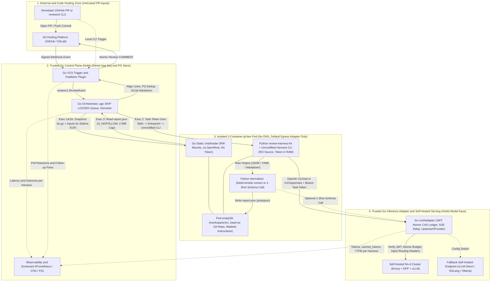
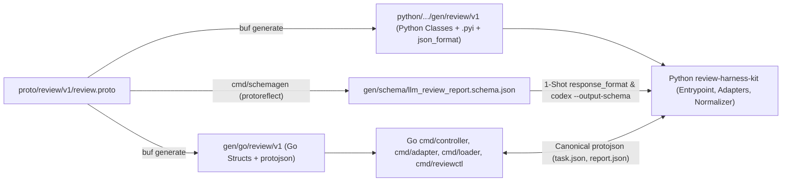
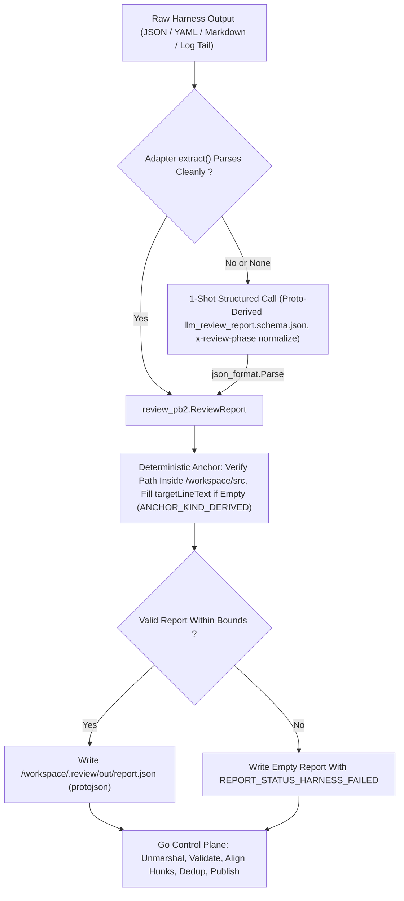
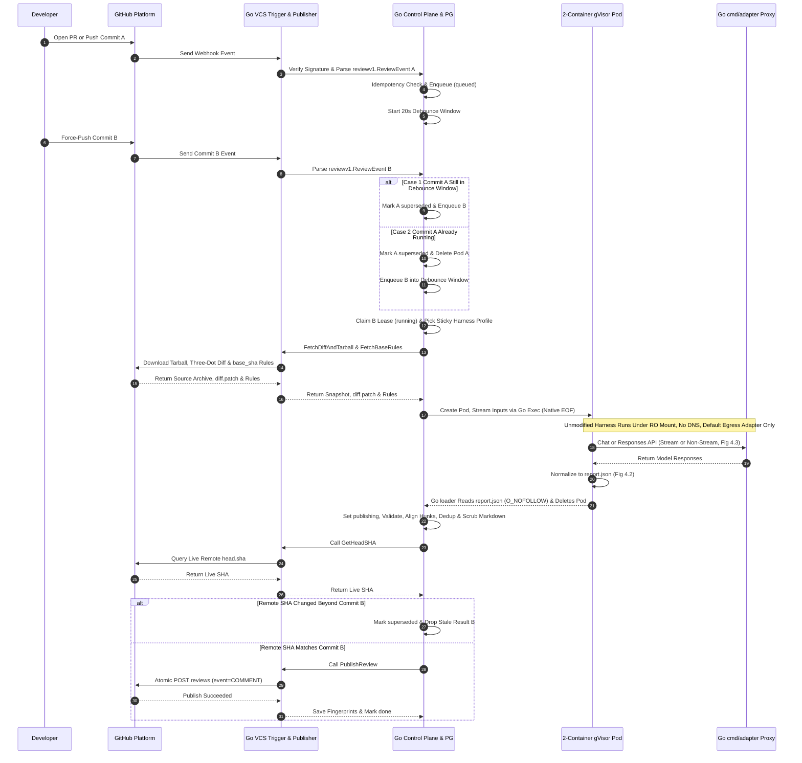
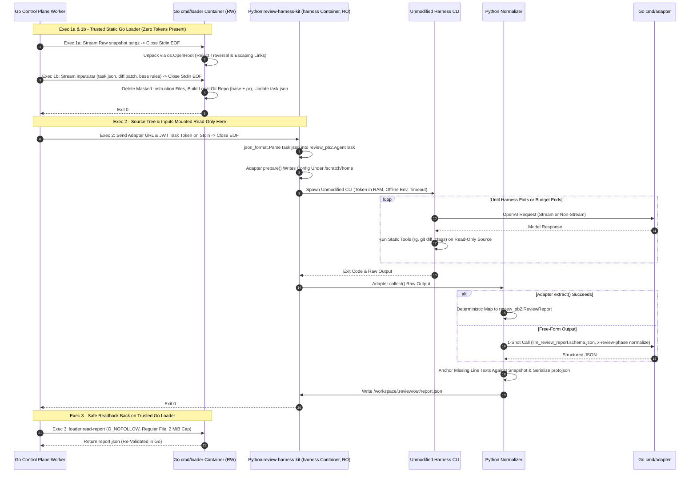
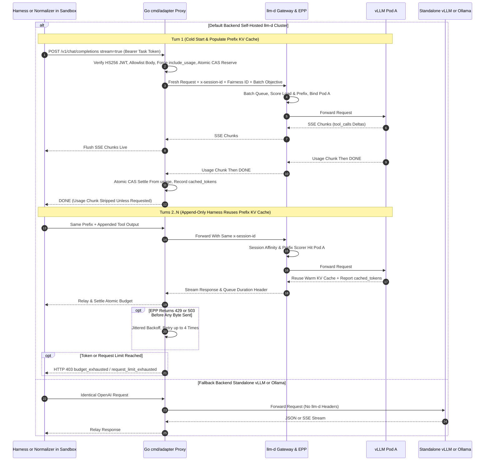

# High-Level Design (HLD): End-to-End Self-Hosted, Pluggable Coding Review Agent for llm-d

## 1. Purpose, Core Principles, and Explicit Non-Goals

We are building a **100% self-hosted, end-to-end pluggable** automated code review platform for `llm-d` community and internal repositories (Go, Kubernetes CRDs/Helm, Python). It runs completely on self-managed infrastructure with **zero dependency on closed-source SaaS review services or external model APIs**, and can route its own multi-turn review traffic through a self-hosted `llm-d` cluster (dogfooding KV prefix caching and Flow Control batch priority).

The platform uses a clean split across three technology layers:

* **Protobuf (`proto/review/v1/review.proto`)** is the single source of truth for every cross-boundary message, generating Go bindings, Python bindings, and the LLM output JSON Schema from one definition.
* **Go (`cmd/controller`, `cmd/adapter`, `cmd/loader`, `cmd/reviewctl`)** runs all performance-sensitive, concurrent, network-facing, PostgreSQL, Kubernetes `client-go`, and filesystem-hardening infrastructure.
* **Python (`python/review-harness-kit`)** stays strictly inside the sandbox container to wrap **existing open-source coding harnesses** (`OpenHands`, `PR-Agent`, `Codex CLI`, `mini-SWE-agent`, `OpenCode`, `Goose`, `Aider`) unmodified and turn their output into a unified `ReviewReport`.

### Four Core Principles

1. **Strict Security Isolation**: Open-source repositories accept external fork PRs where source files, build scripts, and PR descriptions are untrusted. Harnesses run inside a **secret-less, DNS-disabled, gVisor-isolated disposable Pod** whose source volume is mounted read-only, while GitHub keys, PostgreSQL credentials, and inference credentials never enter the Pod.
2. **Use Existing Harnesses, Not a Custom Loop**: There is no custom review agent loop in this codebase. Each supported harness sits behind a thin 3-method adapter (`prepare` / `collect` / `extract`) plus a shared Output Normalizer, so comparing or switching harnesses is a config change.
3. **High-Signal Output Only**: Schema validation, confidence gating, verbatim diff-line alignment, nearby clustering, cross-round PostgreSQL deduplication, and Markdown scrubbing run deterministically in the Go control plane—never inside the harness.
4. **Native Fit for `llm-d` Serving**: Append-only multi-turn harnesses preserve stable prompt prefixes, while the Go `Inference Adapter` injects `x-session-id`, `x-parent-session-id`, fairness ID, and batch priority headers so `llm-d` EPP pins turns to warm KV-cache replicas and yields queue capacity to live traffic.

### Explicit Scope and Non-Goals

* **No full builds or heavy test suites in Phase 1**: Compilation and integration suites stay in CI. Optional plugin interfaces reserve **CI failure log ingestion (`CheckLogFetcher.FetchCheckLogs`)** and **isolated unit test reproduction (`run_scoped_test`)**, which runs in a separate air-gapped (`egress: DenyAll`) child sandbox Pod when enabled.
* **No code edits or commits pushed**: The agent inspects read-only snapshots and never modifies developer branches.
* **No merge-gate blocking**: Reviews publish strictly as `COMMENT` events, never `APPROVE` or `REQUEST_CHANGES`.

---

## 2. System Architecture, Trust Boundaries, and Protobuf Contract Spine

The platform divides into four trust zones. Inside the sandbox Pod, **two containers** separate trusted Go workspace preparation (`loader`, read-write) from untrusted third-party harness execution (`harness`, read-only source). The Go `Inference Adapter` sits outside the sandbox as the default sole egress target.



### Protobuf as the Single Source of Truth (`proto/review/v1/review.proto`)

Instead of maintaining duplicate Pydantic classes in Python and Go structs by hand, one `.proto` schema drives every wire, file, token, and LLM output contract across languages:



* **`google.golang.org/protobuf/encoding/protojson` (Go) and `google.protobuf.json_format` (Python)** serialize identical JSON (`lowerCamelCase` keys, exact enum names, `optional` scalar presence) across `task.json` and `report.json`.
* **`cmd/schemagen` reads `review.v1.ReviewReport` via `protoreflect`** to emit `gen/schema/llm_review_report.schema.json` (restricting enums away from `*_UNSPECIFIED` and encoding `optional double confidence` as `["number", "null"]` for OpenAI strict JSON Schema mode), so `codex --output-schema`, `goose`, and the 1-shot Normalizer stay locked to the `.proto` file automatically.

### Why Split Go Infrastructure vs. Python In-Sandbox Harness Kit?

1. **Off-the-shelf harnesses live in Python/CLI land, while core infrastructure shines in Go**: Orchestrating Kubernetes Exec streams, PostgreSQL connection pools, concurrent PR sharding, and streaming HTTP proxies with strict memory bounds is simpler, faster, and smaller in Go. Meanwhile `PR-Agent`, `OpenHands`, `mini-SWE-agent`, and `Aider` are native Python packages or Node/Rust CLIs best wrapped by a small Python kit inside their own container image.
2. **Native Kubernetes `client-go` Exec EOF without custom stdin framing**: Python's official `kubernetes` WebSocket client fails to close Exec stdin on `v4.channel.k8s.io`, requiring custom length-prefixed framing. Go's `k8s.io/client-go` closes Exec stdin cleanly on EOF, so the controller simply pipes raw `snapshot.tar.gz`, `inputs.tar`, and stdin credentials directly into `cmd/loader` and `review-kit`.
3. **Static trusted `cmd/loader` (`CGO_ENABLED=0`) separate from untrusted harness images**: Even inside the Pod, container images carrying Node/Python/CLI agent ecosystems never mount `/workspace/src` read-write. Only the minimal static Go `loader` image mounts `/workspace/src` read-write, unpacks safely via `os.OpenRoot`, masks untrusted repo instruction files, builds the local `base` and `pr` git branches, and reads back `/workspace/.review/out/report.json` with `O_NOFOLLOW`.
4. **Kernel-enforced read-only source, zero secrets, fail-fast DNS (`NetworkPolicy` CNI required)**: `harness` mounts `/workspace/src` and `/workspace/.review/in` with `readOnly: true`, sets `automountServiceAccountToken: false` and `enableServiceLinks: false`, and sets `dnsPolicy: None` targeting `127.0.0.1` so stray DNS calls fail in `<1ms`. A dual-namespace `NetworkPolicy` drops all ingress and blocks cluster/internet/port-53 egress, allowing TCP egress by **default** only to `review-system/inference-adapter:8080`.
5. **Honest Security Boundaries**: Sandbox and output sanitization block **credential theft** and **privileged write actions**. Prompt injection in a malicious PR can still mislead an LLM into missing bugs or generating false positives; we mitigate that by locking review rules to `base_sha`, masking untrusted instruction files in the working tree, enforcing `confidence` thresholds, and leaving merge decisions to humans. Passing the short-lived HS256 JWT Task Token into `harness` process RAM is necessary because unmodified harnesses require `OPENAI_API_KEY`; that risk stays bounded because the token works only at `cmd/adapter`, encodes strict per-run token/request limits, expires with the Pod, and cannot be routed elsewhere under `NetworkPolicy`.

---

## 3. Five Plugin Boundaries and Control Plane Design

The Go scheduler (`Orchestrator` + PostgreSQL), Go Denoiser, and Prometheus/Scorecard tables form the fixed backbone. Five boundaries swap cleanly via configuration and entry points:

| Plugin Boundary | Host Layer | Contract Interface | Default Lightweight Implementation | Swappable Alternatives |
| :--- | :--- | :--- | :--- | :--- |
| **1. VCS Trigger & Publisher** | Go (`cmd/controller`) | `VCSPlugin` (+ optional `CheckLogFetcher`) | `github-app` + `local-cli` | `gitlab` / `gitea` |
| **2. Sandbox Runner** | Go (`cmd/controller`) | `SandboxRunner` (`Run(ctx, SandboxSpec) -> *ReviewReport`) | `k8s-gvisor-pod` (2-container Pod) | `k8s-kata` / local `docker` |
| **3. Agent Harness Adapter** | Python (`review-harness-kit`) | `HarnessAdapter` (`prepare` / `collect` / `extract` + Normalizer) | `openhands` + `pr-agent` | `codex` / `mini-swe-agent` / `opencode` / `goose` / `aider` |
| **4. Context & Tooling** | Go + Sandbox `PATH` | `ContextProvider` + `rg` / `git` / `ast-grep` / `ctags` | `diff.patch` + `base_sha` rules + offline binaries | `FetchCheckLogs` / pre-warmed `golangci-lint` / air-gapped `run_scoped_test` Pod |
| **5. Inference Endpoint Adapter** | Go (`cmd/adapter`) | `UpstreamProvider` (`Build(claims, api, body) -> UpstreamRequest`) | `llmd-gateway` | `vllm-direct` / `sglang` / `ollama` |

---

### 3.1 VCS Trigger & Publisher Plugin (Go)

* **Canonical Input Contract**: Webhooks parse into `review.v1.ReviewEvent` (`event_id`, `event_kind`, `source`, `repo`, `pr_number`, `base_sha`, `head_sha`, `is_draft`, `is_bot_author`, `is_fork`, `author`, `triggered_by`, `is_maintainer`, `trigger_type`, `force_rerun_seq`, `requested_harness`).
* **Abuse Prevention & Gating**:
  * Triggers on `opened`, `synchronize`, `reopened`, `ready_for_review`, and maintainer `/review` comments; ignores `draft` PRs and bots; cancels active work on `closed`.
  * Enforces per-repo and per-author sliding-window rate limits. **Fork PRs from first-time external contributors never run automatically**—they wait for a maintainer `/review` command.
  * `/review <profile>` checks `requested_harness` against configured profile allowlists (never passed to a shell).
* **Diff Fetching, Line Alignment, and Sanitization**:
  1. Downloads the `head_sha` source tarball via platform API (free of `.git` hooks, submodules, and LFS) and three-dot `diff.patch` (stripping binary file sections before shipping to the sandbox).
  2. Verifies every finding's `targetLineText` against parsed diff hunks (`LEFT`/`RIGHT`). If lines shifted slightly, locates a unique verbatim hunk match; otherwise falls back to file-level comment (when supported) or the summary body so GitHub `422` errors never drop an entire review.
  3. **Sanitizes all untrusted text** before posting: strips minted Task Tokens, escapes line-leading Prow commands (`/lgtm`, `/approve`, `/hold`, etc.) both inside and outside fenced code blocks, breaks `@mentions` with zero-width spaces, and strips raw HTML tags/comments, images, and external links. Posts atomically via `POST /pulls/{pr}/reviews` (`event=COMMENT`) with a hidden `<!-- review-run: <run_id> sha: <head_sha> -->` marker. Default GitHub App scopes stay minimal (`pull_requests: write`, `contents: read`; Checks/Actions read-only added only if `CheckLogFetcher` is enabled).

---

### 3.2 Orchestrator State Machine, Deduplication, and Sandbox Layer (Go + PostgreSQL)

* **PostgreSQL State Machine (`pgx/v5`)**:

| State | Entry & Action | Concurrency & Failure Handling |
| :--- | :--- | :--- |
| `queued` | Inserted when `(repo, pr, base_sha, head_sha, trigger_type, force_rerun_seq)` is not active/done | Waits in 15-30s debounce window; newer commits mark queued runs `superseded` under `pg_advisory_xact_lock` |
| `running` | Claimed via `FOR UPDATE OF r SKIP LOCKED`; picks sticky harness profile and spawns sandbox Pod(s) | Heartbeat renews lease; stale leases reclaimed up to `max_retries=2`; newer commits mark `superseded` and delete Pods |
| `publishing` | Aggregates primary shards, deduplicates, checks `GetHeadSHA` CAS | If live remote `head_sha` changed, marks `superseded` and discards output |
| `done` | Atomic GitHub review posted and fingerprints committed | Auto 0-finding runs finish silently; manual `/review` posts a concise clean summary |
| `superseded` | Replaced by newer push or closed PR | Deletes sandbox Pods immediately (`GracePeriodSeconds=0`), backed by `activeDeadlineSeconds` and 5-minute Reaper |
| `failed` | Retries exhausted or all shards failed | Auto runs fail silently (alerts only); manual `/review` posts a 1-line error note with `run_id` |

* **Trusted Workspace Preparation (`cmd/loader`)**:
  * **Unpack safety via Go `os.OpenRoot`**: Strips single leading directory wrapper, skips PAX global headers, rejects device/FIFO nodes and traversal, confines hardlinks (`root.Link`) and validates relative symlinks strictly inside `/workspace/src` and `/workspace/.review/in`.
  * **Rule source lock**: Review rules (`AGENTS.md`, `docs/review/` path-routed rules) come exclusively from `base_sha`, fetched by `cmd/controller`.
  * **Instruction-file masking**: Before building the local git repo, `cmd/loader` deletes `AGENTS.md`, `AGENTS.override.md`, `CLAUDE.md`, `GEMINI.md`, `.cursorrules`, `.goosehints`, `.pr_agent.toml`, `opencode.json`, `opencode.jsonc`, `.mcp.json`, `.aider.conf.yml`, and directories `.agents`, `.codex`, `.opencode`, `.openhands`, `.claude`, `.cursor`, `.goose` from `/workspace/src`. Their changes remain inspectable as plain text inside `diff.patch`.
  * **Local 2-branch git repo**: Runs `git init -b pr`, reverse-applies `diff.patch` excluding masked files (`git apply -R --exclude=...`) to create commit `base`, and resets working tree to `pr`. Harnesses needing `git diff base...pr` or local git providers work completely offline.
* **Large PR Sharding & Centralized Denoiser**:
  * Strips `go.sum`, `vendor/`, `zz_generated.*`; splits remaining diff into shards sized under ~1/3 of `max_context_tokens`. Runs primary shards plus any configured `shadow` profiles concurrently with unique Pod names (`shadow-<profile>` disambiguated!).
  * Publishes partial results if at least one primary shard succeeds (listing failed shards in summary); runs **Schema & range validation -> confidence filter (`>= 0.75`, using profile default when unset) -> verbatim hunk alignment -> nearby same-file clustering -> PG `finding_fingerprints` dedup -> Top 8 cap**. Fingerprints hash `file + prev_line + target_line` (harness-agnostic and category-agnostic; never auto-resolves old threads).

---

### 3.3 Agent Harness Adapter Plugin (`python/review-harness-kit`)

Python stays confined strictly inside the `harness` container behind the Protobuf `AgentTask` / `ReviewReport` file contract (`protojson`—note `int64` fields encode as JSON strings per Proto3 JSON mapping, so both languages decode via `protojson` / `json_format`, never plain `json`):

```json
// /workspace/.review/in/task.json (credential-free protojson written by controller + updated by cmd/loader)
{
  "runId": "7f3a9c1e-...",
  "shardIndex": 0,
  "harness": { "profile": "openhands", "adapter": "openhands" },
  "modelAlias": "review-coder",
  "prTitle": "Fix scorer cache race on eviction",
  "srcDir": "/workspace/src",
  "diffFile": "/workspace/.review/in/diff.patch",
  "rulesDir": "/workspace/.review/in/rules",
  "outDir": "/workspace/.review/out",
  "git": { "baseRef": "base", "headRef": "pr" },
  "maskedFiles": ["AGENTS.md", ".codex/*"],
  "budget": {
    "maxRequests": 60,
    "maxContextTokens": 32768,
    "maxTotalTokens": "5000000",
    "normalizerReserveTokens": "50000",
    "wallClockSeconds": 900
  }
}
```

#### 3.3.1 Supported Harnesses and Adapter Behavior

| Profile | Unmodified Harness | Loop Style | Wire API | Captured Output | Normalizer Path |
| :--- | :--- | :--- | :--- | :--- | :--- |
| `pr-agent` | PR-Agent (`local` git provider) | Single-shot structured review | Chat Completions (LiteLLM) | YAML prediction (`key_issues_to_review`) | Deterministic |
| `openhands` | OpenHands CLI (`--headless`) | Multi-turn shell/file agent | Chat Completions (LiteLLM) | `raw_report.json` or log tail | Deterministic, 1-shot fallback |
| `codex` | Codex CLI (`codex exec --output-schema`) | Multi-turn shell agent | Responses API (always SSE) | Schema-constrained final JSON | Deterministic |
| `mini-swe-agent` | `mini` CLI (local env) | Multi-turn linear bash history | Chat Completions (LiteLLM) | `raw_report.json` or trajectory tail | Deterministic, 1-shot fallback |
| `opencode` | `opencode run` | Multi-turn agent | Chat Completions (SSE) | `raw_report.json` or final message | Deterministic, 1-shot fallback |
| `goose` | `goose run --recipe` | Multi-turn agent | Chat Completions (SSE) | Schema-constrained output | Deterministic |
| `aider` | `aider --chat-mode ask` | Single-shot with repo map | Chat Completions (LiteLLM) | Markdown stdout | 1-shot structured call |

All prompt-driven harnesses receive the identical `prompts/review_task.md` (`base_sha` rules first, workspace paths, embedded Proto-derived JSON Schema, PR title/description marked untrusted, diff last), so A/B experiments compare harness loops rather than divergent prompts. `PR-Agent` keeps its own prompt pipeline and receives `base_sha` rules via `PR_REVIEWER__EXTRA_INSTRUCTIONS`.

#### 3.3.2 Credential & Sandbox Isolation for Unmodified Harnesses

| Harness Assumption | How `cmd/loader` + `review-harness-kit` Satisfy It Offline |
| :--- | :--- |
| GitHub API / token to fetch diff & post comments | `cmd/loader` creates local git branches `base` and `pr`; PR-Agent uses `CONFIG__GIT_PROVIDER=local` and writes `LOCAL__REVIEW_PATH` under writable `out_dir`. |
| `.git` history (`git diff`, `git log`) | Same local repo; `GIT_OPTIONAL_LOCKS=0` stops git from attempting index writes on the read-only mount. |
| Docker daemon or nested Landlock/seccomp | Disabled in adapter config (`sandbox_mode = "danger-full-access"` / local process mode); the gVisor Pod provides outer containment. |
| Internet for price maps, telemetry, plugin downloads | Dependencies pre-baked in image; offline env vars (`LITELLM_LOCAL_MODEL_COST_MAP=True`, `DO_NOT_TRACK=1`, `PIP_NO_INDEX=1`) + `127.0.0.1` DNS fail-fast. |
| Writable home/caches | `HOME`, `XDG_*`, `TMPDIR` point to size-capped `/scratch` and `/tmp`; source edits fail immediately with `EROFS`. |
| `stream=true` SSE, `/v1/models`, or `/v1/responses` | All three served by Go `cmd/adapter`. |

#### 3.3.3 Output Normalization



#### 3.3.4 Harness Config, Sticky Routing, and Shadow Runs

```yaml
harness:
  default: openhands
  profiles:
    openhands:
      adapter: openhands
      image: ghcr.io/zetxqx/review-harness-openhands:1.0.0
      cache_shape: append_only
      budget: { max_requests: 60, max_context_tokens: 32768, max_total_tokens: 5000000, normalizer_reserve_tokens: 50000, wall_clock_seconds: 900 }
    pr-agent:
      adapter: pr-agent
      image: ghcr.io/zetxqx/review-harness-pr-agent:1.0.0
      cache_shape: single_shot
      default_confidence: 0.8
      budget: { max_requests: 8, max_context_tokens: 32768, max_total_tokens: 150000, normalizer_reserve_tokens: 20000, wall_clock_seconds: 300 }
  routing:
    - repos: ["llm-d/llm-d-router"]
      split: { openhands: 80, pr-agent: 20 }    # Sticky SHA-256 bucket(repo#pr) mod 100
      shadow: ["codex"]                         # Runs in parallel Pod (report stored to PG only)
```

---

### 3.4 Context & Tooling Plugin

* **Control-plane context providers (`ContextProvider` in Go)**: Assemble `/workspace/.review/in/` (three-dot `diff.patch`, root `AGENTS.md` + 0-2 path-matched `base_sha` rules from `docs/review/`, PR metadata, and optional truncated CI failure logs from `CheckLogFetcher`).
* **In-sandbox static toolbox**: Harness images bake static `ripgrep`, `git`, `ast-grep`, and `universal-ctags`. Shell-driven harnesses invoke them directly against read-only `/workspace/src`.
* **Optional Phase 2 / M4 Extensions**:
  * Per-repo read-only `GOMODCACHE` layer for `golangci-lint` / `gopls`.
  * **`review-tools` (`python/pyproject.toml` `[tools]` extra)**: CLI + stdio MCP wrapper reserved for **`run_scoped_test(target, filter)`**. When enabled, tests execute in a **separate secret-less gVisor child Pod** whose `NetworkPolicy` enforces **`egress: DenyAll` (cannot reach `cmd/adapter` or DNS)** and `ingress` only from the paired `harness` Pod.

---

### 3.5 Inference Endpoint Plugin & Self-Hosted `llm-d` Integration (Go `cmd/adapter`)

`cmd/adapter` runs outside the sandbox (single replica in Phase 1-3 so the in-memory `atomic` ledger is exact; `:8080` for sandbox `/v1/*`, `:9090` for controller `/internal/usage/{jti}` and Prometheus `/metrics`):

| Endpoint | Purpose | Enforcement |
| :--- | :--- | :--- |
| `POST /v1/chat/completions` | Chat Completions (OpenHands, PR-Agent, Goose, OpenCode, mini-SWE-agent, Aider) | Field allowlist, force configured `upstream_model`, cap `max_tokens`/`max_completion_tokens`, support `stream=false` & `stream=true` (forcing `stream_options.include_usage=true`, hiding usage-only tail chunk unless client requested it). |
| `POST /v1/responses` | Responses API (Codex CLI) | Stateless pass-through: forces `store=false`, strips `previous_response_id` and `conversation`, extracts usage from `response.completed`. |
| `GET /v1/models` | Harness startup probe | Verifies Bearer token and returns single configured `model_alias`. |

* **Atomic Budget & Request Enforcement (`SessionLedger`)**: Reserves `estimated_input + max_output_tokens` atomically before forwarding and settles to uncached work `(prompt - cached) + completion` afterward (charging estimate if a `2xx` stream drops without usage, while continuing to track raw prompt, cached, and completion totals separately). Enforces separate `max_requests` (60 for trusted PRs; tightened to 20 requests / 500,000 uncached tokens for untrusted non-maintainer fork PRs) and `max_normalize_requests` (2) counters plus `normalizer_reserve_tokens` (50,000 for multi-turn profiles; 20,000 for single-shot), so spoofing `x-review-phase: normalize` cannot bypass request caps or exceed `max_total_tokens`. Returns HTTP `403` (`budget_exhausted` / `request_limit_exhausted`) so SDKs do not auto-retry.

#### 3.5.1 Prefix-Cache Compatibility Matrix

| History Shape | Harnesses | Behavior on `llm-d` KV Prefix Cache |
| :--- | :--- | :--- |
| **Append-only** | `openhands`, `codex`, `mini-swe-agent`, `goose`, `opencode` | Re-sends identical prefix plus appended tool result; turns 2..N hit warm replica via `x-session-id`. |
| **Append-only with compaction** | Same harnesses near `max_context_tokens` | Recomputes from compaction point onward, then resumes prefix hits. Adapters configure `max_context_tokens` and disable aggressive output pruning where supported. |
| **Single-shot** | `pr-agent`, `aider` | Few independent calls; low total tokens, shares only identical system prompt across PRs landing on same replica. |
| **Sliding window** | Classic SWE-agent (`last_n_observations`) | Moving prefix invalidates cache every turn; excluded from defaults. |

#### 3.5.2 Required `llm-d` Cluster Configuration Checklist

`LlmdGatewayUpstream` constructs a fresh upstream HTTP request (zero sandbox headers forwarded) with four headers:

| Header | Value | Purpose |
| :--- | :--- | :--- |
| `x-session-id` | `<run_id>-s<shard>` (or `<run_id>-s<shard>-<profile>` for shadow) | Pins all turns of one harness execution to one replica |
| `x-parent-session-id` | `<run_id>` (set when shards > 1) | Groups sharded sibling runs into one lineage tree |
| `x-llm-d-inference-fairness-id` | `<repo>` | Per-repo fairness and telemetry |
| `x-llm-d-inference-objective` | `code-review-batch` | Selects low-priority batch objective |

| `llm-d` Component / Plugin | Default Behavior (Gotcha) | Required Configuration for Review Agent | Effect |
| :--- | :--- | :--- | :--- |
| **`session-affinity-scorer`** | Defaults to `encoded_endpoint_header` (`x-session-token`) | Set `strategy: session_id` and `sources: [{ header: x-session-id }]` | Pins all turns of a review session to the same pod via Adapter-injected `x-session-id` |
| **`agent-identity` / `agent-lineage`** | Disabled by default; built-in defaults omit `x-session-id` | Enable both plugins and add `x-session-id` to `additionalSessionHeaders` | Tracks per-session identity and `x-parent-session-id` (merging sharded sub-tasks into one fairness queue) |
| **`requestHandler` Fairness** | `x-llm-d-inference-fairness-id: <repo>` queues all repo PRs together | Enable `composeFairnessIDs: true` | Composes `<repo>/<root_session_id>` (or `<repo>/<parent_session_id>` for sharded trees) for per-repo metrics and per-tree queues |
| **`flowControl` & `InferenceObjective`** | Feature gate off by default; `x-llm-d-inference-ttl` can only shorten finite TTLs | Enable `featureGates: ["flowControl"]`, create `code-review-batch` Objective, set long `defaultRequestTTL` on batch band | Allows review traffic to wait in queue during live traffic peaks without premature TTL shedding (match gateway timeout) |
| **vLLM Engine Flags** | `prompt_tokens_details.cached_tokens` omitted by default | Enable `--enable-prefix-caching` and `--enable-prompt-tokens-details` | Reuses KV cache blocks and reports `cached_tokens` usage back to Adapter |
| **vLLM Tool Calling** | Native `tool_calls` are off unless a parser is configured | Enable `--enable-auto-tool-choice` and the `--tool-call-parser` that matches the served model | Agentic harnesses depend on native tool calls, including in streamed responses |

* **Timeout & Retry**: Set generous Pod `wall_clock_seconds` (e.g. 900s), upstream HTTP client timeout (400s) >= batch `defaultRequestTTL` (360s), and harness HTTP timeout >= 400s. On `429` / `503` before any SSE byte is relayed, `cmd/adapter` retries up to 4 times with jittered exponential backoff (5s-40s).
* **Swapping Backends**: Switch upstream config from `llmd-gateway` to `vllm-direct` / `sglang` / `ollama` with zero sandbox changes (served model must support tool calling and `max_context_tokens`).

---

### 3.6 Observability & Feedback Loop

* **Prometheus + OTel + Grafana**: Per-harness latency, requests, prompt/completion/`cached_tokens`, KV cache hit ratio, and `x-llm-d-flow-queue-duration-ms`.
* **PostgreSQL Quality Scorecard**: Tracks reactions (`+1`/`-1` polled periodically via `VCSPlugin.PollFeedback`) and follow-up commit fixes alongside `harness_executions` metrics to rank harnesses by accepted findings per million tokens.

---

## 4. Core Interaction Sequence Diagrams

### 4.1 End-to-End PR Review Lifecycle (Debounce, Cancel, Exec Sandbox, and Line Verification)



### 4.2 Two-Container Sandbox Execution (Go Loader + Python Harness Kit + Normalizer)



### 4.3 Streaming Inference Through Go `cmd/adapter` to `llm-d`



---

## 5. Technology Stack Selection

| Layer | Choice | Why This Combination Wins | Considered and Rejected |
| :--- | :--- | :--- | :--- |
| **Shared Contracts** | **Protobuf (`proto3`) + `buf`** | One schema generates Go types, Python types, and `llm_review_report.schema.json`; `protojson` guarantees identical JSON and `optional` presence across Go and Python | Hand-duplicated Go structs + Pydantic models (drift risk); JSON-only schema without typed codegen |
| **Control Plane & VCS** | **Go (`cmd/controller`, `net/http`, `pgx/v5`, `k8s.io/client-go`)** | Low memory footprint, clean goroutine/`errgroup` concurrency, native Kubernetes Exec stdin EOF closing without framing hacks, battle-tested `llm-d` stack | Python control plane (higher memory, broken Exec stdin EOF in official client); Celery/Temporal (second scheduler beside PG) |
| **State & Queue** | **PostgreSQL (`pgx/v5`, plain SQL)** | `SKIP LOCKED`, `pg_advisory_xact_lock`, partial unique indexes, fingerprints, and A/B scorecard in one transactional store | Redis/Valkey queue; ORM |
| **Sandbox Prep (`loader`)** | **Go static binary (`cmd/loader`, `CGO_ENABLED=0`)** | Minimal trusted container (`distroless`/scratch + `git`), OS-enforced `os.OpenRoot` tar extraction, `O_NOFOLLOW` report readback | Sharing the large Python harness container with RW source mounts |
| **Isolated Sandbox** | **Disposable 2-container Pod + gVisor + `NetworkPolicy`** | Hardware/syscall isolation for untrusted fork code; kernel-enforced RO source mount for `harness`; `127.0.0.1` fail-fast DNS | Kata Containers (kept as `SandboxRunner` alternative); nested Docker/Landlock inside harness |
| **Harness Layer** | **Python 3.12 (`uv`) + `review-harness-kit` wrapping existing harnesses** | Almost every off-the-shelf coding harness (`PR-Agent`, `OpenHands`, `mini-SWE-agent`, `Aider`) is Python or CLI-native; thin adapters avoid writing or maintaining a custom loop | Custom two-stage Go agent loop (redundant); bundling controller dependencies into sandbox images |
| **Inference Proxy** | **Go `cmd/adapter` (`net/http`, `atomic` CAS, `golang-jwt`)** | Zero-overhead SSE line relay, race-free lock-free CAS budget/request limits, strict field allowlisting, Prometheus metrics | Python proxy; LiteLLM Proxy (heavy DB/key state and dependencies inside trust boundary) |
| **CLI & Offline Eval** | **Go `cmd/reviewctl`** | Single static developer binary orchestrating local Docker harness containers and printing A/B scorecards using exact production Denoiser code | Maintaining a separate Python Denoiser implementation for CLI mode |
| **Serving & Telemetry** | **Self-hosted `llm-d` + OTel + Prometheus + Grafana** | KV prefix caching + `flowControl` batch prioritization; direct correlation of acceptance rate, tokens, and cache hit ratio per harness | SaaS code review services or external proprietary APIs |

**Accepted Trade-offs**: Using two languages means running `buf generate` (plus `cmd/schemagen`) when editing `proto/review/v1/review.proto`, and shipping separate Go (`controller`, `adapter`, `loader`, `reviewctl`) and Python-enabled (`harness-*`) container images. Because all cross-language communication crosses only Protobuf-serialized `task.json`, `report.json`, and `TaskClaims` JWTs, developers rarely touch both stacks in the same change.

---

## 6. Three-Phase Rollout Plan

1. **Phase 1 (Protobuf Contracts + Local `reviewctl` + Two Harnesses + Single-Node vLLM)**: Generate Go/Python bindings and `llm_review_report.schema.json` from `proto/review/v1/review.proto`; build Go `cmd/loader`, Go `cmd/adapter` (`vllm-direct` stream + non-stream), Go Denoiser, Go `cmd/reviewctl` with Docker runner, and Python `review-harness-kit` (`pr-agent` and `openhands`). Run offline replay against historical `llm-d-router` PRs to measure finding quality, tokens, and cache hit ratio.
2. **Phase 2 (Go Control Plane + PG `SKIP LOCKED` + Air-Gapped gVisor Pods)**: Deploy Go `cmd/controller` with GitHub App webhooks, PG state machine, cross-round fingerprints, Markdown scrubbing, and 2-container gVisor Pods; verify GitHub file-level review comment compatibility; enable first-time external contributor `/review` gating on an internal pilot repo; add `codex` and `mini-swe-agent` adapters.
3. **Phase 3 (`llm-d` Cluster Integration + Harness A/B + Feedback Flywheel)**: Configure `session-affinity-scorer`, `agent-identity`, `composeFairnessIDs`, `flowControl`, and long-TTL `code-review-batch` Objective per Section 3.5; point Go `cmd/adapter` at `llm-d` gateway; turn on sticky traffic splits, shadow runs, and periodic reaction polling (`harness_executions` + `review_feedback` scorecard).
