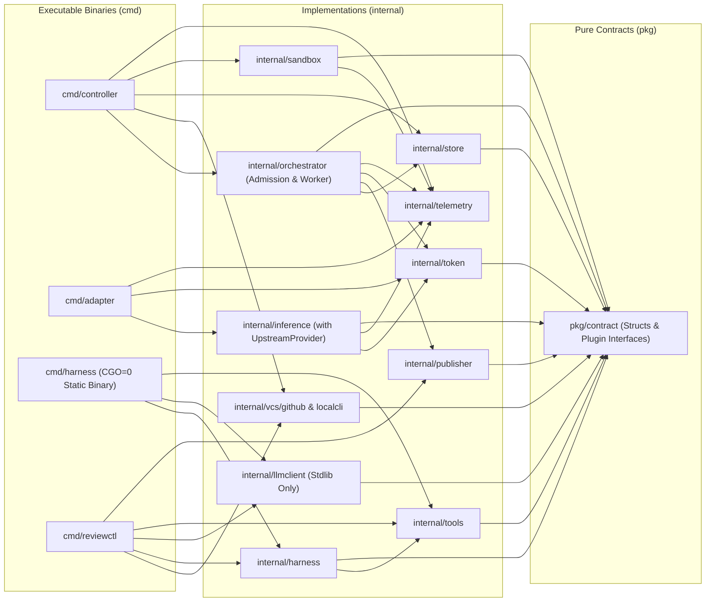
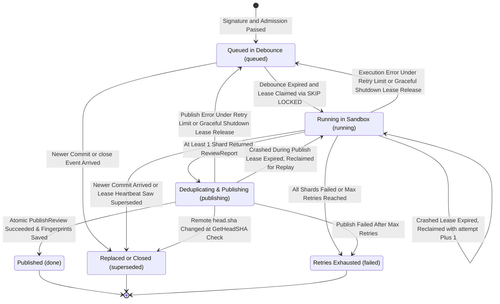
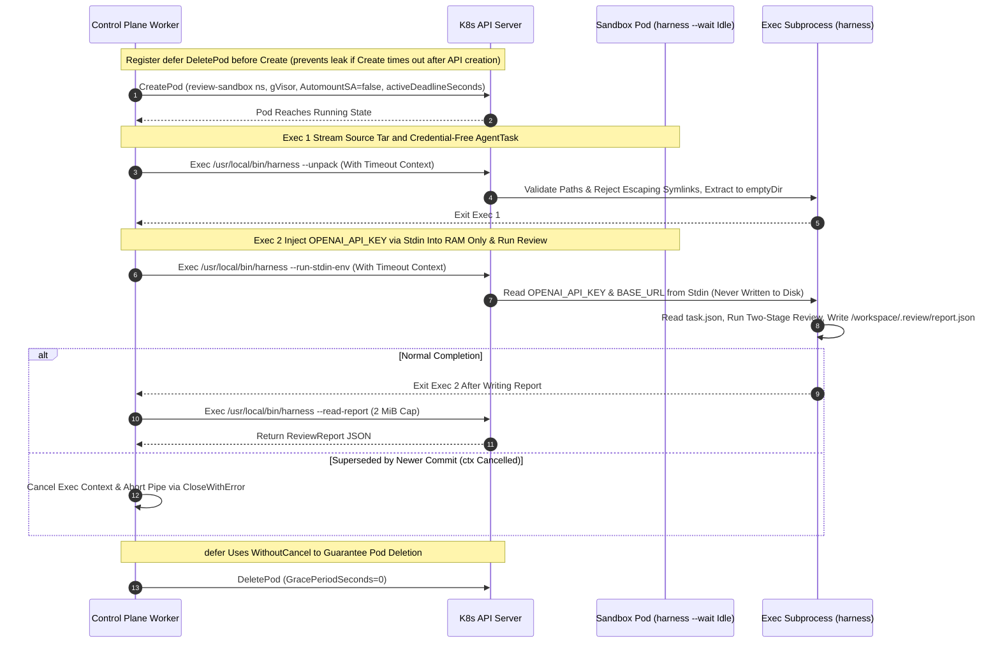
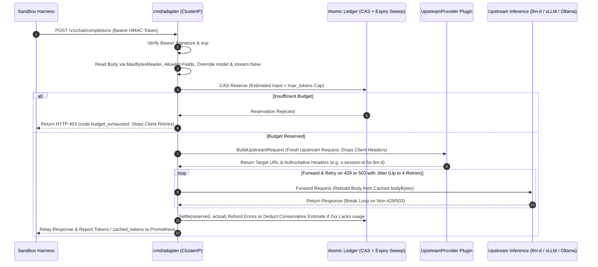
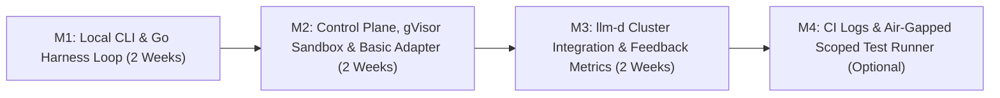

# review-agent-infra Concrete Go Implementation Plan

> This document defines the engineering implementation plan for the [High-Level Design (HLD)](hld.md): Go repository layout, acyclic package boundaries, core `interface` definitions, PostgreSQL concurrent state machine, Kubernetes gVisor Exec sandbox, `cmd/harness` and `cmd/adapter` core logic, and M1-M4 milestones.

---

## 1. Go-First Stack and Package Dependency Architecture

The entire system lives in a **single Go module (`github.com/zetxqx/review-agent-infra`)** producing four binaries. This unifies engineering maintenance in Go while keeping the in-sandbox binary free of any Python runtime dependencies:

| Binary | Runtime Location | Core Responsibilities | Key Engineering Notes |
| :--- | :--- | :--- | :--- |
| **`cmd/controller`** | Trusted control-plane Pod | Webhook intake, admission/rate-limiting, PG state machine, debounce/cancellation, K8s sandbox orchestration, dedup/publishing, and feedback polling | Single low-memory binary using `k8s.io/client-go` directly for sandbox Pods and Exec streams |
| **`cmd/adapter`** | Standalone micro-proxy Pod outside sandbox (1 replica in Phase 1-3) | Verify HMAC-SHA256 task tokens, atomic CAS token budget reservation/settlement, call `UpstreamProvider` to inject routing headers, and retry `429/503` | Exposes ClusterIP over `net/http`; the sandbox reaches only this port and never holds real upstream credentials |
| **`cmd/harness`** | Inside sandbox Pod | `--wait` idle PID 1, `--unpack` safe tar extraction, `--run-stdin-env` two-stage read-only loop, `--read-report` output stream | Compiled with `CGO_ENABLED=0` into a static binary; preserves the `AgentTask.json` file contract for future OpenHands swaps |
| **`cmd/reviewctl`** | Developer laptop / CI | Local `git diff` review (`localcli`) and offline historical PR replay evaluation | Reuses `internal/harness`, `internal/llmclient`, `internal/publisher`, and `internal/tools` without K8s or PG in M1 |

### 1.1 Repository Layout and Strict Acyclic Dependencies

```text
review-agent-infra/
├── cmd/
│   ├── controller/           # Control-plane service entrypoint
│   ├── adapter/              # Inference Adapter proxy entrypoint
│   ├── harness/              # Static sandbox runner (--wait / --unpack / --run-stdin-env / --read-report)
│   └── reviewctl/            # Local CLI and offline replay evaluation tool
├── pkg/
│   └── contract/             # Shared structs and plugin interfaces (stdlib only)
└── internal/
    ├── token/                # HMAC-SHA256 short-lived token signing and verification
    ├── telemetry/            # OpenTelemetry and Prometheus metrics (budget/KV metrics reported by adapter)
    ├── llmclient/            # Pure stdlib OpenAI-compatible HTTP client (implements contract.InferenceClient)
    ├── tools/                # Offline read-only tools (os.Root jail, safe exec rg, go/parser outlines, optional scoped_test)
    ├── inference/            # Adapter proxy core, CAS budget ledger, UpstreamProvider plugin (llmd/vllm/ollama), retries
    ├── harness/              # Two-stage read-only loop, stable prefix builder, JSON Schema validation & retry
    ├── vcs/
    │   ├── github/           # GitHub App signature check, tarball/diff/base-rules fetch, idempotent PublishReview, optional FetchCheckLogs
    │   └── localcli/         # Local git diff trigger and terminal output
    ├── store/                # PostgreSQL migrations, SKIP LOCKED queue, debounce locks, and fingerprint store
    ├── sandbox/              # K8s gVisor Pod Exec runner and local Docker runner
    ├── publisher/            # Diff hunk parser, target_line_text verbatim alignment, two-tier fallback, Prow scrubbing
    └── orchestrator/         # Admission checks (draft/bot/first-time contributor/rate limit), Worker loop, sharding & dedup pipeline
```

Dependencies stay strictly acyclic so `cmd/harness` never pulls in `client-go`, `telemetry`, or PostgreSQL drivers:



---

## 2. Core Contracts and Five Plugin Interfaces (`pkg/contract`)

`pkg/contract` imports only the Go standard library and defines uniform structs and interfaces so replacing any plugin never touches `internal/orchestrator`:

```go
package contract

import (
	"context"
	"io"
	"time"
)

type ReviewEvent struct {
	EventID       string `json:"event_id"`        // Webhook delivery UUID
	EventKind     string `json:"event_kind"`      // review | close | feedback | ignore
	Source        string `json:"source"`          // github | gitlab | cli
	Repo          string `json:"repo"`            // e.g. "llm-d/llm-d-router"
	PRNumber      int    `json:"pr_number"`
	BaseSHA       string `json:"base_sha"`
	HeadSHA       string `json:"head_sha"`
	IsDraft       bool   `json:"is_draft"`
	IsBotAuthor   bool   `json:"is_bot_author"`
	IsFork        bool   `json:"is_fork"`
	Author        string `json:"author"`
	TriggeredBy   string `json:"triggered_by"`    // Actor triggering event (differs from PR Author on /review comments)
	IsMaintainer  bool   `json:"is_maintainer"`   // Set by VCS plugin from author_association (OWNER/MEMBER/COLLABORATOR)
	TriggerType   string `json:"trigger_type"`    // auto | manual_command
	ForceRerunSeq int64  `json:"force_rerun_seq"` // auto=0; manual /review uses comment ID for retry idempotency
}

type ToolEndpoints struct {
	ScopedTest string `json:"scoped_test,omitempty"` // Optional: ClusterIP:port of isolated air-gapped test runner Pod
}

type TaskBudget struct {
	MaxTurns         int   `json:"max_turns"`
	MaxContextTokens int   `json:"max_context_tokens"`
	MaxTotalTokens   int64 `json:"max_total_tokens"`
}

// AgentTask is written to sandbox emptyDir and MUST NOT contain OPENAI_API_KEY or platform secrets.
type AgentTask struct {
	RunID          string        `json:"run_id"`
	PRTitle        string        `json:"pr_title"`
	PRBody         string        `json:"pr_body"`
	BaseBranch     string        `json:"base_branch"`
	DiffFile       string        `json:"diff_file"`              // /workspace/.review/diff.patch
	CILogsFile     string        `json:"ci_logs_file,omitempty"` // Optional: truncated CI failure logs
	RepoRules      []string      `json:"repo_rules"`             // Extracted by control plane from base_sha
	WorkspaceRODir string        `json:"workspace_ro_dir"`       // /workspace/src
	OutputFile     string        `json:"output_file"`            // /workspace/.review/report.json
	ToolEndpoints  ToolEndpoints `json:"tool_endpoints,omitempty"`
	Budget         TaskBudget    `json:"budget"`
}

type SandboxSpec struct {
	ShortRunID      string
	ShardIndex      int
	Attempt         int
	TarballPath     string        // Controller temp snapshot archive path (size-capped, reused across shards)
	DiffPatch       []byte        // Line-numbered diff for this shard
	CILogs          []byte        // Optional: truncated CI failure logs
	TaskJSON        []byte        // Credential-free AgentTask JSON
	AdapterURL      string        // Passed only via Exec Stdin into Harness memory
	SignedTaskToken string        // Passed only via Exec Stdin into Harness memory
	Timeout         time.Duration // Overall sandbox timeout
}

type ReviewFinding struct {
	File           string  `json:"file"`
	Line           int     `json:"line"`
	Side           string  `json:"side"`             // RIGHT | LEFT
	TargetLineText string  `json:"target_line_text"` // Verbatim line text verified by Publisher
	Severity       string  `json:"severity"`         // critical | high | medium | low
	Confidence     float64 `json:"confidence"`
	Category       string  `json:"category"`         // correctness | concurrency | security | k8s | style
	Title          string  `json:"title"`
	Explanation    string  `json:"explanation"`
	Suggestion     string  `json:"suggestion"`
	Evidence       string  `json:"evidence"`
}

// RunMetrics is for local CLI reference only; server billing and KV stats come exclusively from cmd/adapter.
type RunMetrics struct {
	Turns            int   `json:"turns"`
	PromptTokens     int64 `json:"prompt_tokens"`
	CachedTokens     int64 `json:"cached_tokens"`
	CompletionTokens int64 `json:"completion_tokens"`
	DurationMs       int64 `json:"duration_ms"`
}

type ReviewReport struct {
	Summary  string          `json:"summary"`
	Findings []ReviewFinding `json:"findings"`
	Metrics  RunMetrics      `json:"metrics"`
}

type InlineComment struct {
	Fingerprint string
	Category    string
	File        string
	Line        int
	Side        string
	Body        string
}

type PublishRequest struct {
	Repo         string
	PRNumber     int
	CommitID     string
	RunID        string
	Event        string // Always "COMMENT"
	Summary      string
	Inlines      []InlineComment
	FileComments []InlineComment
}

type PublishedComment struct {
	Fingerprint string
	Category    string
	CommentID   int64 // 0 when folded into PR summary (stored as NULL in DB)
}

type PublishResult struct {
	ReviewID int64
	Comments []PublishedComment
}

// 1. VCS Trigger & Publisher Plugin (6 core methods)
type VCSPlugin interface {
	VerifyAndParseWebhook(ctx context.Context, headers map[string]string, body []byte) (*ReviewEvent, error)
	GetHeadSHA(ctx context.Context, repo string, prNumber int) (string, error)
	FetchDiffAndTarball(ctx context.Context, repo string, prNumber int, baseSHA, headSHA string) (diffPatch []byte, tarball io.ReadCloser, err error)
	FetchBaseRules(ctx context.Context, repo, baseSHA string, changedFiles []string) ([]string, error)
	PublishReview(ctx context.Context, req PublishRequest) (*PublishResult, error)
	PollFeedback(ctx context.Context, repo string, prNumber int, commentIDs []int64) ([]FeedbackSample, error)
}

// Optional extension interface probed by orchestrator via type assertion to fetch truncated CI failure logs.
type CheckLogFetcher interface {
	FetchCheckLogs(ctx context.Context, repo string, prNumber int, headSHA string, maxBytes int) ([]byte, error)
}

// 2. Sandbox Runner Plugin
type SandboxRunner interface {
	Run(ctx context.Context, spec SandboxSpec) (*ReviewReport, error)
}

// 3. Agent Harness Plugin
type HarnessEngine interface {
	Execute(ctx context.Context, task AgentTask) (*ReviewReport, error)
}

// 4. Context & Read-Only Tooling Plugin
type ToolRegistry interface {
	Definitions() []ToolSchema
	Dispatch(ctx context.Context, name string, rawArgs []byte) (string, error)
}

// 5a. In-Harness Inference Client (implemented by internal/llmclient)
type InferenceClient interface {
	ChatWithTools(ctx context.Context, req ChatRequest) (*ChatResponse, error)
}

// 5b. Adapter Upstream Endpoint Plugin (switches llmd-gateway / vllm-direct / ollama)
type UpstreamProvider interface {
	BuildUpstreamRequest(ctx context.Context, claims TaskClaims, normalizedBody []byte) (targetURL string, headers map[string]string, body []byte, err error)
}
```

---

## 3. PostgreSQL State Machine, Concurrency, and Fingerprints (`internal/store`)

### 3.1 Job Lifecycle State Machine



### 3.2 Core Tables (SQL DDL)

```sql
-- 1. Webhook delivery deduplication table (prevents duplicate network deliveries)
CREATE TABLE webhook_deliveries (
    delivery_id TEXT PRIMARY KEY,
    received_at TIMESTAMPTZ NOT NULL DEFAULT now()
);

-- 2. Main review job table
CREATE TABLE review_runs (
    id               UUID PRIMARY KEY,
    repo             TEXT   NOT NULL,
    pr_number        INT    NOT NULL,
    base_sha         TEXT   NOT NULL,
    head_sha         TEXT   NOT NULL,
    trigger_type     TEXT   NOT NULL, -- 'auto' | 'manual_command'
    force_rerun_seq  BIGINT NOT NULL DEFAULT 0, -- auto=0; manual /review uses comment ID for retry idempotency
    status           TEXT   NOT NULL, -- 'queued'|'running'|'publishing'|'done'|'superseded'|'failed'
    debounce_until   TIMESTAMPTZ NOT NULL,
    attempt          INT    NOT NULL DEFAULT 0,
    max_retries      INT    NOT NULL DEFAULT 2,
    worker_id        TEXT,
    lease_expires_at TIMESTAMPTZ,
    error_reason     TEXT,
    created_at       TIMESTAMPTZ NOT NULL DEFAULT now(),
    updated_at       TIMESTAMPTZ NOT NULL DEFAULT now()
);

-- Partial unique idempotency index: permits re-review on force-push back to prior SHA or PR reopen without duplicating active/done runs
CREATE UNIQUE INDEX uq_active_or_done_run_idempotency
    ON review_runs (repo, pr_number, base_sha, head_sha, trigger_type, force_rerun_seq)
    WHERE status NOT IN ('superseded', 'failed');

-- Hard DB invariant: at most 1 active running or publishing run per PR
CREATE UNIQUE INDEX uq_active_pr_run
    ON review_runs (repo, pr_number)
    WHERE status IN ('running', 'publishing');

CREATE INDEX idx_runs_claimable
    ON review_runs (status, debounce_until, lease_expires_at);

-- 3. Cross-round deduplication fingerprints (file + prev_line + target_line only; no category; comment_id NULL when folded into Summary)
CREATE TABLE finding_fingerprints (
    repo         TEXT NOT NULL,
    pr_number    INT  NOT NULL,
    fingerprint  TEXT NOT NULL,
    first_run_id UUID NOT NULL REFERENCES review_runs(id),
    comment_id   BIGINT,
    created_at   TIMESTAMPTZ NOT NULL DEFAULT now(),
    PRIMARY KEY (repo, pr_number, fingerprint)
);

-- 4. Quality feedback table (populated from webhooks and periodic reaction polling for comments with comment_id > 0)
CREATE TABLE review_feedback (
    repo                    TEXT NOT NULL,
    pr_number               INT  NOT NULL,
    comment_id              BIGINT NOT NULL,
    run_id                  UUID NOT NULL REFERENCES review_runs(id),
    fingerprint             TEXT NOT NULL,
    category                TEXT NOT NULL,
    thumbs_up               INT  NOT NULL DEFAULT 0,
    thumbs_down             INT  NOT NULL DEFAULT 0,
    resolved_in_next_commit BOOLEAN NOT NULL DEFAULT FALSE,
    updated_at              TIMESTAMPTZ NOT NULL DEFAULT now(),
    PRIMARY KEY (repo, pr_number, comment_id)
);
```

### 3.3 Concurrent Enqueue, Close Supersede, Lease Claim, and Heartbeat (Go + SQL Pseudo-Code)

```go
// SupersedeAll handles PR closed events: supersedes active runs without inserting a new job.
func (s *PGStore) SupersedeAll(ctx context.Context, repo string, prNumber int, deliveryID string) error {
	tx, err := s.db.BeginTx(ctx, nil)
	if err != nil {
		return err
	}
	defer tx.Rollback()

	if deliveryID != "" {
		res, err := tx.ExecContext(ctx, `INSERT INTO webhook_deliveries (delivery_id) VALUES ($1) ON CONFLICT DO NOTHING`, deliveryID)
		if err != nil {
			return err
		}
		if n, _ := res.RowsAffected(); n == 0 {
			return tx.Commit()
		}
	}
	if _, err := tx.ExecContext(ctx, `SELECT pg_advisory_xact_lock(hashtext($1), $2)`, repo, prNumber); err != nil {
		return err
	}
	if _, err := tx.ExecContext(ctx, `
		UPDATE review_runs SET status = 'superseded', updated_at = now()
		WHERE repo = $1 AND pr_number = $2 AND status IN ('queued', 'running', 'publishing')
	`, repo, prNumber); err != nil {
		return err
	}
	return tx.Commit()
}

// EnqueueOrSupersede atomically deduplicates delivery, supersedes older jobs for the PR, and inserts a debounced run.
func (s *PGStore) EnqueueOrSupersede(ctx context.Context, ev contract.ReviewEvent, debounce time.Duration) (uuid.UUID, bool, error) {
	tx, err := s.db.BeginTx(ctx, nil)
	if err != nil {
		return uuid.Nil, false, err
	}
	defer tx.Rollback()

	if ev.EventID != "" {
		res, err := tx.ExecContext(ctx, `INSERT INTO webhook_deliveries (delivery_id) VALUES ($1) ON CONFLICT DO NOTHING`, ev.EventID)
		if err != nil {
			return uuid.Nil, false, err
		}
		if n, _ := res.RowsAffected(); n == 0 {
			return uuid.Nil, false, tx.Commit()
		}
	}

	if _, err := tx.ExecContext(ctx, `SELECT pg_advisory_xact_lock(hashtext($1), $2)`, ev.Repo, ev.PRNumber); err != nil {
		return uuid.Nil, false, err
	}

	// Supersede older queued/running/publishing jobs (frees uq_active_pr_run slot immediately)
	if _, err := tx.ExecContext(ctx, `
		UPDATE review_runs SET status = 'superseded', updated_at = now()
		WHERE repo = $1 AND pr_number = $2
		  AND status IN ('queued', 'running', 'publishing')
		  AND NOT (base_sha = $3 AND head_sha = $4 AND trigger_type = $5 AND force_rerun_seq = $6)
	`, ev.Repo, ev.PRNumber, ev.BaseSHA, ev.HeadSHA, ev.TriggerType, ev.ForceRerunSeq); err != nil {
		return uuid.Nil, false, err
	}

	runID := uuid.New()
	res, err := tx.ExecContext(ctx, `
		INSERT INTO review_runs (id, repo, pr_number, base_sha, head_sha, trigger_type, force_rerun_seq, status, debounce_until)
		VALUES ($1, $2, $3, $4, $5, $6, $7, 'queued', now() + ($8 * interval '1 second'))
		ON CONFLICT (repo, pr_number, base_sha, head_sha, trigger_type, force_rerun_seq)
		WHERE status NOT IN ('superseded', 'failed') DO NOTHING
	`, runID, ev.Repo, ev.PRNumber, ev.BaseSHA, ev.HeadSHA, ev.TriggerType, ev.ForceRerunSeq, int64(debounce.Seconds()))
	if err != nil {
		return uuid.Nil, false, err
	}
	inserted, _ := res.RowsAffected()
	return runID, inserted > 0, tx.Commit()
}

// ClaimNextRun claims a debounce-ready queued run or reclaims an expired running/publishing lease.
// Returns sql.ErrNoRows when idle; never returns (nil, nil).
func (s *PGStore) ClaimNextRun(ctx context.Context, workerID string, leaseTTL time.Duration) (*RunRecord, error) {
	for {
		tx, err := s.db.BeginTx(ctx, nil)
		if err != nil {
			return nil, err
		}

		var rec RunRecord
		err = tx.QueryRowContext(ctx, `
			SELECT id, repo, pr_number, base_sha, head_sha, trigger_type, status, attempt, max_retries
			FROM review_runs r
			WHERE (
				r.status = 'queued'
				AND r.debounce_until <= now()
				AND NOT EXISTS (
					SELECT 1 FROM review_runs a
					WHERE a.repo = r.repo AND a.pr_number = r.pr_number AND a.status IN ('running', 'publishing')
				)
			) OR (
				r.status IN ('running', 'publishing') AND r.lease_expires_at < now()
			)
			ORDER BY r.created_at ASC
			FOR UPDATE OF r SKIP LOCKED
			LIMIT 1
		`).Scan(&rec.ID, &rec.Repo, &rec.PRNumber, &rec.BaseSHA, &rec.HeadSHA, &rec.TriggerType, &rec.Status, &rec.Attempt, &rec.MaxRetries)
		if err != nil {
			tx.Rollback()
			return nil, err
		}

		if (rec.Status == "running" || rec.Status == "publishing") && rec.Attempt >= rec.MaxRetries {
			_, updErr := tx.ExecContext(ctx, `UPDATE review_runs SET status = 'failed', error_reason = 'lease expired max retries', updated_at = now() WHERE id = $1`, rec.ID)
			if updErr != nil {
				tx.Rollback()
				return nil, updErr
			}
			if cErr := tx.Commit(); cErr != nil {
				return nil, cErr
			}
			continue // Marked failed; loop to claim next available run
		}

		nextAttempt := rec.Attempt
		if rec.Status == "running" || rec.Status == "publishing" {
			nextAttempt++
		}
		_, err = tx.ExecContext(ctx, `
			UPDATE review_runs
			SET status = 'running', attempt = $2, worker_id = $3, lease_expires_at = now() + ($4 * interval '1 second'), updated_at = now()
			WHERE id = $1
		`, rec.ID, nextAttempt, workerID, int64(leaseTTL.Seconds()))
		if err != nil {
			tx.Rollback()
			return nil, err
		}
		if err := tx.Commit(); err != nil {
			return nil, err
		}
		rec.Attempt = nextAttempt
		return &rec, nil
	}
}

// RenewLease keeps the lease alive across both running and publishing; returns false if superseded.
func (s *PGStore) RenewLease(ctx context.Context, runID uuid.UUID, workerID string, leaseTTL time.Duration) (bool, error) {
	res, err := s.db.ExecContext(ctx, `
		UPDATE review_runs
		SET lease_expires_at = now() + ($3 * interval '1 second'), updated_at = now()
		WHERE id = $1 AND worker_id = $2 AND status IN ('running', 'publishing')
	`, runID, workerID, int64(leaseTTL.Seconds()))
	if err != nil {
		return false, err
	}
	n, _ := res.RowsAffected()
	return n == 1, nil
}
```

---

## 4. Admission Control and Worker Main Loop (`internal/orchestrator`)

### 4.1 Admission Control Policy

All webhook events pass through `orchestrator.AdmissionCheck` before hitting the store or sandbox:
1. **Event routing**: `EventKind == "ignore"` returns 200 OK; `EventKind == "close"` invokes `store.SupersedeAll`; `EventKind == "feedback"` updates `review_feedback`.
2. **Manual `/review` authorization**: If `ev.TriggerType == "manual_command"` and `!ev.IsMaintainer` (not `OWNER`, `MEMBER`, or `COLLABORATOR`), **reject the event** so external contributors cannot trigger `/review` on their own fork PRs.
3. **Draft and bot filter**: Skip when `ev.IsDraft || ev.IsBotAuthor`.
4. **Fork rate limiting and first-time contributor gate**:
   * Enforce per-repo and per-author sliding-window rate limits via token bucket + recent PG counts (requests over the limit are dropped and counted in a metric).
   * When `ev.IsFork && ev.TriggerType == "auto"`, check whether `ev.Author` is a collaborator or past contributor; **skip first-time external contributors automatically**, requiring an authorized maintainer `/review` command.

### 4.2 Worker `processRun` and Lease Heartbeat Pseudo-Code

```go
func (o *Orchestrator) keepLeaseAlive(runCtx context.Context, runCancel context.CancelFunc, runID uuid.UUID, workerID string, leaseTTL time.Duration) {
	ticker := time.NewTicker(leaseTTL / 3)
	defer ticker.Stop()
	lastSuccess := time.Now()

	for {
		select {
		case <-runCtx.Done():
			return
		case <-ticker.C:
			dbCtx, cancel := context.WithTimeout(runCtx, 5*time.Second)
			alive, err := o.store.RenewLease(dbCtx, runID, workerID, leaseTTL)
			cancel()
			if err != nil {
				// Self-cancel on prolonged DB outage past leaseTTL to prevent split-brain execution
				if time.Since(lastSuccess) > leaseTTL {
					runCancel()
					return
				}
				continue
			}
			if !alive {
				runCancel() // Superseded by a newer commit
				return
			}
			lastSuccess = time.Now()
		}
	}
}

func (o *Orchestrator) processRun(parentCtx context.Context, rec *store.RunRecord) {
	runCtx, runCancel := context.WithCancel(parentCtx)
	defer runCancel()

	// 1. Start lease heartbeat covering both running and publishing phases
	go o.keepLeaseAlive(runCtx, runCancel, rec.ID, o.workerID, o.leaseTTL)

	// 2. Fetch three-dot diff, stream snapshot tarball to size-capped temp file (reused read-only across shards), and fetch base_sha rules
	tarPath, cleanupTar, diffPatch, baseRules, ciLogs, err := o.fetchInputsToTemp(runCtx, rec)
	if cleanupTar != nil {
		defer cleanupTar()
	}
	if err != nil {
		o.handleRunFailure(parentCtx, runCtx, rec, err)
		return
	}

	// 3. Split diff into shards capped at ~1/3 max_context_tokens; if 0 shards remain after filtering (e.g. go.sum only), mark done silently
	shards := o.splitDiffIntoShards(diffPatch, o.cfg.MaxContextTokens/3)
	if len(shards) == 0 {
		_ = o.store.MarkDoneIfActive(parentCtx, rec.ID, o.workerID)
		return
	}

	// errgroup bounds concurrency with SetLimit; goroutines always return nil and store errors per shard so one failure never cancels siblings
	results := make([]ShardOutput, len(shards))
	var eg errgroup.Group
	eg.SetLimit(o.cfg.MaxConcurrentShards)
	for i, sh := range shards {
		eg.Go(func() error {
			rep, runErr := o.sandbox.Run(runCtx, o.buildShardSpec(rec, i, sh, tarPath, baseRules, ciLogs))
			results[i] = ShardOutput{ShardName: sh.Name, Report: rep, Err: runErr}
			return nil
		})
	}
	_ = eg.Wait()

	// 4. Filter, align lines, dedup, and publish (running -> publishing -> done)
	if err := o.PrepareAndPublish(runCtx, rec, results, diffPatch); err != nil {
		o.handleRunFailure(parentCtx, runCtx, rec, err)
	}
}

func (o *Orchestrator) handleRunFailure(parentCtx, runCtx context.Context, rec *store.RunRecord, runErr error) {
	// Graceful shutdown (SIGTERM cancelled parentCtx): release lease back to queued via WithoutCancel without burning attempt.
	// Both ReleaseLeaseToQueued and RecordErrorOrRequeue SQL MUST guard WHERE id = $1 AND worker_id = $2 AND status IN ('running', 'publishing')
	// so an already-superseded job is never pulled back into queued.
	if parentCtx.Err() != nil {
		relCtx, cancel := context.WithTimeout(context.WithoutCancel(parentCtx), 5*time.Second)
		defer cancel()
		_ = o.store.ReleaseLeaseToQueued(relCtx, rec.ID, o.workerID)
		return
	}
	if runCtx.Err() != nil {
		return // Cancelled because run was superseded; DB state already updated
	}
	finalFailed, err := o.store.RecordErrorOrRequeue(parentCtx, rec.ID, o.workerID, runErr.Error(), 15*time.Second)
	if err != nil || !finalFailed {
		return
	}
	// Auto triggers fail silently; manual /review posts a one-line error note with run_id
	if rec.TriggerType == "manual_command" {
		_, _ = o.vcs.PublishReview(parentCtx, contract.PublishRequest{
			Repo: rec.Repo, PRNumber: rec.PRNumber, CommitID: rec.HeadSHA, RunID: rec.ID.String(),
			Event:   "COMMENT",
			Summary: fmt.Sprintf("Manual code review failed (run_id: `%s`); check controller logs.", rec.ID),
		})
	}
}
```

---

## 5. `K8sSandboxRunner` and `client-go` Exec Sandbox (`internal/sandbox`)

### 5.1 Namespace Isolation, Least-Privilege RBAC, and Exec Lifecycle

* **Dual-namespace layout and NetworkPolicy selectors**: Deploy the controller in `review-system` and sandbox Pods in a dedicated `review-sandbox` namespace (so a single namespace-wide `NetworkPolicy` blocks DNS, internet, and cluster traffic). The controller ServiceAccount receives RBAC **strictly scoped to `pods` (`create`/`get`/`list`/`delete`) and `pods/exec` (`create`) inside `review-sandbox`**. Inside the sandbox, `OPENAI_BASE_URL` uses the Adapter ClusterIP, while the `NetworkPolicy` allow rule **must use `namespaceSelector` + `podSelector` targeting the Adapter Pods** (never `ipBlock` on a Service ClusterIP, which is not guaranteed to match across CNIs).
* **`OwnerReference` and Pod GC**: Kubernetes forbids cross-namespace `OwnerReference`s, so in dual-namespace mode sandbox Pods omit `OwnerReference` and rely on `ActiveDeadlineSeconds` + `defer` deletion + a 5-minute **Orphan Pod Reaper**. In single-namespace dev setups, set `OwnerReference` to the controller's own **Pod** (not Deployment) for automatic cleanup on Pod replacement.

Because Kubernetes `PodExecOptions` has no `Env` field, the controller registers `defer` Pod deletion before `Create`, launches PID 1 with `/usr/local/bin/harness --wait`, and executes three bounded Exec steps:



### 5.2 `K8sSandboxRunner.Run()` Pseudo-Code

```go
func (r *K8sSandboxRunner) Run(ctx context.Context, spec contract.SandboxSpec) (*contract.ReviewReport, error) {
	ctx, totalCancel := context.WithTimeout(ctx, spec.Timeout)
	defer totalCancel()

	// Include shard index and attempt so concurrent shards never collide on Pod name
	podName := fmt.Sprintf("review-sbx-%s-s%d-a%d", spec.ShortRunID, spec.ShardIndex, spec.Attempt)
	pod := r.buildHardenedPod(podName, spec) // review-sandbox ns, RuntimeClass="gvisor", AutomountSA=false, ActiveDeadlineSeconds

	// Must register defer BEFORE Create so API timeouts after Pod creation still clean up
	defer func() {
		delCtx, cancel := context.WithTimeout(context.WithoutCancel(ctx), 15*time.Second)
		defer cancel()
		err := r.clientset.CoreV1().Pods(r.namespace).Delete(delCtx, podName, metav1.DeleteOptions{
			GracePeriodSeconds: ptr.To(int64(0)),
		})
		if err != nil && !apierrors.IsNotFound(err) {
			r.logger.Error(err, "delete sandbox pod failed", "pod", podName)
		}
	}()

	if _, err := r.clientset.CoreV1().Pods(r.namespace).Create(ctx, pod, metav1.CreateOptions{}); err != nil {
		return nil, fmt.Errorf("create sandbox pod: %w", err)
	}

	waitCtx, waitCancel := context.WithTimeout(ctx, 60*time.Second)
	defer waitCancel()
	if err := r.waitPodRunning(waitCtx, podName); err != nil {
		return nil, err
	}

	// Exec 1: Stream composite tar from local TarballPath (src/ prefix + .review/*)
	pr, pw := io.Pipe()
	defer pr.Close()
	tarErrCh := make(chan error, 1)
	go func() {
		err := streamCompositeTar(pw, spec.TarballPath, spec.DiffPatch, spec.CILogs, spec.TaskJSON)
		_ = pw.CloseWithError(err)
		tarErrCh <- err
	}()
	unpackCtx, unpackCancel := context.WithTimeout(ctx, 45*time.Second)
	defer unpackCancel()
	if err := r.execStream(unpackCtx, podName, []string{"/usr/local/bin/harness", "--unpack"}, pr, nil); err != nil {
		_ = pr.CloseWithError(err)
		<-tarErrCh
		return nil, fmt.Errorf("unpack sandbox input: %w", err)
	}
	// Close read end before reading tarErrCh in case --unpack exited 0 before consuming EOF
	_ = pr.Close()
	if tarErr := <-tarErrCh; tarErr != nil {
		return nil, fmt.Errorf("stream composite tar: %w", tarErr)
	}

	// Exec 2: Pass short-lived token via Stdin into Harness RAM only; never write to emptyDir
	secretJSON := mustMarshal(map[string]string{
		"openai_base_url": spec.AdapterURL,
		"openai_api_key":  spec.SignedTaskToken,
	})
	if err := r.execStream(ctx, podName, []string{"/usr/local/bin/harness", "--run-stdin-env"}, bytes.NewReader(secretJSON), nil); err != nil {
		return nil, fmt.Errorf("run harness: %w", err)
	}

	// Exec 3: PID 1 stays idle in --wait; read report with 2 MiB cap to protect controller memory
	readCtx, readCancel := context.WithTimeout(ctx, 20*time.Second)
	defer readCancel()
	var outBuf cappedBuffer // maxBytes = 2 << 20
	if err := r.execStream(readCtx, podName, []string{"/usr/local/bin/harness", "--read-report"}, nil, &outBuf); err != nil {
		return nil, fmt.Errorf("read report: %w", err)
	}

	var report contract.ReviewReport
	if err := json.Unmarshal(outBuf.Bytes(), &report); err != nil {
		return nil, fmt.Errorf("decode report.json: %w", err)
	}
	return &report, nil
}
```

> **Orphan Pod Reaper**: `ActiveDeadlineSeconds` transitions expired Pods to `Failed` without deleting Pod objects. The controller therefore runs a background reaper every 5 minutes to delete `app=review-sandbox` Pods exceeding their deadline.

---

## 6. In-Sandbox Go `harness` Two-Stage Loop & Tools (`cmd/harness` + `internal/harness` + `internal/tools`)

### 6.1 `CGO_ENABLED=0` Static Build and Tool Safety

* **Zero-Cgo tooling**: Mainstream `tree-sitter` Go bindings require Cgo. To compile `cmd/harness` as a pure static `CGO_ENABLED=0` binary, M1 uses Go's standard library **`go/parser` + `go/ast`** for Go symbol outlines (adding WASM or auxiliary static tools later for multi-language repos). Static musl `ripgrep` (`rg`) is baked alongside `/usr/local/bin/harness`.
* **Symlink & traversal defense**: Open the source root via Go's standard library **`os.OpenRoot(workspaceRoot)`** (`*os.Root`), enforcing OS-level rejection of `..` and escaping symlinks.
* **Preventing `rg` flag injection**: Lock arguments with `--no-config`, `--no-ignore`, `-e`, and `--` so model-controlled inputs can never be parsed as flags like `--pre` or hidden via PR `.gitignore`/`.ignore` files:

```go
func (t *ToolBox) SearchCode(ctx context.Context, pattern, relSubDir string) (string, error) {
	if _, err := t.wsRoot.Stat(relSubDir); err != nil {
		return "", fmt.Errorf("invalid search scope: %w", err)
	}
	target := filepath.Join(t.wsPath, filepath.Clean("/"+relSubDir))
	// --no-ignore prevents PR .gitignore/.ignore files from hiding code; -e and -- block flag injection
	cmd := exec.CommandContext(ctx, "rg", "--no-config", "--no-ignore", "-n", "--max-count=50", "--color=never", "-e", pattern, "--", target)
	out, err := cmd.CombinedOutput()
	if err != nil && cmd.ProcessState != nil && cmd.ProcessState.ExitCode() == 1 {
		return "no matches found", nil
	}
	return string(out), err
}
```

### 6.2 Prefix-Stable Two-Stage Loop (`internal/harness` Pseudo-Code)

To avoid mutating middle messages (which invalidates `llm-d` prefix cache on every turn) and to ensure the final turn never dies on a stray tool call, `harness` proactively tracks budget and switches to a `ToolChoice: "none"` synthesis step:

```go
func (e *TwoStageEngine) Execute(ctx context.Context, task contract.AgentTask) (*contract.ReviewReport, error) {
	// Immutable prefix messages: System Prompt (base rules) + PR Diff / truncated CI logs
	messages := []contract.ChatMessage{
		{Role: "system", Content: buildSystemPrompt(task.RepoRules)},
		{Role: "user", Content: buildInitialUserPrompt(task.PRTitle, task.PRBody, task.DiffFile, task.CILogsFile)},
	}
	toolSchemas := e.tools.Definitions()

	var estTotalUsed int64
	for turn := 1; turn <= task.Budget.MaxTurns; turn++ {
		if err := ctx.Err(); err != nil {
			return nil, err
		}

		// Force synthesis at last turn, >=85% context window, or >=85% cumulative token budget
		forceFinalize := turn == task.Budget.MaxTurns ||
			estimateTokens(messages) >= int(float64(task.Budget.MaxContextTokens)*0.85) ||
			estTotalUsed >= int64(float64(task.Budget.MaxTotalTokens)*0.85)

		req := contract.ChatRequest{
			Messages:         messages,
			Tools:            toolSchemas,
			ToolChoice:       "auto",
			RequireJSONReply: forceFinalize,
		}
		if forceFinalize {
			req.ToolChoice = "none"
			req.Messages = append(messages, contract.ChatMessage{
				Role: "user", Content: "Stop calling tools and output the final ReviewReport JSON adhering strictly to the schema.",
			})
		}

		resp, err := e.infer.ChatWithTools(ctx, req)
		if err != nil {
			return nil, err
		}
		estTotalUsed += resp.Usage.TotalTokens

		if len(resp.ToolCalls) > 0 && !forceFinalize {
			messages = append(messages, resp.AssistantMessage)
			for _, tc := range resp.ToolCalls {
				toolOut, execErr := e.dispatchTool(ctx, task, tc)
				if execErr != nil {
					toolOut = "tool error: " + execErr.Error()
				}
				messages = append(messages, contract.ChatMessage{
					Role: "tool", ToolCallID: tc.ID, Content: truncateToolOutput(toolOut, 8192),
				})
			}
			continue
		}

		// Validate schema and allow 1 repair retry outside the MaxTurns counter
		return e.validateOrRetryOnce(ctx, req.Messages, toolSchemas, resp)
	}
	return nil, errors.New("exceeded max_turns without valid report")
}

func (e *TwoStageEngine) validateOrRetryOnce(ctx context.Context, history []contract.ChatMessage, toolSchemas []contract.ToolSchema, resp *contract.ChatResponse) (*contract.ReviewReport, error) {
	report, valErr := parseAndValidateReport(resp.Content)
	if valErr == nil {
		return report, nil
	}
	// Keep Tools alongside ToolChoice: "none" for OpenAI API compatibility and prefix cache reuse
	retryReq := contract.ChatRequest{
		Messages: append(history, resp.AssistantMessage, contract.ChatMessage{
			Role:    "user",
			Content: fmt.Sprintf("JSON schema validation failed (%v). Re-output valid pure JSON matching ReviewReport.", valErr),
		}),
		Tools:            toolSchemas,
		ToolChoice:       "none",
		RequireJSONReply: true,
	}
	retryResp, err := e.infer.ChatWithTools(ctx, retryReq)
	if err != nil {
		return nil, err
	}
	return parseAndValidateReport(retryResp.Content)
}
```

---

## 7. Go `Inference Adapter` Micro-Proxy (`cmd/adapter` + `internal/inference`)

> **Known Phase 1-3 Constraints**: `cmd/adapter` runs as a **single replica** so the in-memory atomic budget ledger remains strictly consistent (multi-replica scaling later requires Redis/PG state or `run_id` consistent hashing). It also forces **`stream=false`** for synchronous `usage` accounting (if integrating a third-party framework that mandates SSE streaming, inject `stream_options.include_usage=true` and parse the trailing chunk).

### 7.1 Verification, Atomic Budget Reservation, Routing Injection, and Retries



### 7.2 `cmd/adapter` CAS Reservation and Allowlisted Proxy Pseudo-Code

```go
// TryReserve atomically reserves budget via CAS so concurrent requests cannot overspend.
func (l *SessionLedger) TryReserve(estimate, maxTotal int64) bool {
	for {
		cur := l.reservedOrUsed.Load()
		if cur+estimate > maxTotal {
			return false
		}
		if l.reservedOrUsed.CompareAndSwap(cur, cur+estimate) {
			return true
		}
	}
}

func (l *SessionLedger) Settle(reserved, actual int64) {
	l.reservedOrUsed.Add(actual - reserved) // Refunds on failure (actual=0); deducts estCost if 2xx omits usage
}

func (p *AdapterProxy) ServeHTTP(w http.ResponseWriter, r *http.Request) {
	claims, err := p.verifier.VerifyBearer(r.Header.Get("Authorization"))
	if err != nil {
		http.Error(w, "unauthorized task token", http.StatusUnauthorized)
		return
	}

	r.Body = http.MaxBytesReader(w, r.Body, p.maxBodyBytes)
	rawBody, err := io.ReadAll(r.Body)
	if err != nil {
		http.Error(w, "request body too large", http.StatusRequestEntityTooLarge)
		return
	}
	// Allowlist fields (messages/tools/tool_choice/response_format/temperature), override model, cap max_tokens, force stream=false
	bodyBytes, estCost, err := p.sanitizePayload(rawBody, p.configuredModel, claims.MaxContextTokens)
	if err != nil {
		http.Error(w, "invalid request payload", http.StatusBadRequest)
		return
	}

	ledger := p.getOrCreateLedger(claims.JTI, claims.ExpiresAt) // Background goroutine sweeps expired entries
	if !ledger.TryReserve(estCost, claims.MaxTotalTokens) {
		w.Header().Set("Content-Type", "application/json")
		w.WriteHeader(http.StatusForbidden) // 403 prevents OpenAI SDK from retrying budget exhaustion as a 429 rate limit
		_, _ = w.Write([]byte(`{"error":{"code":"budget_exhausted","message":"task token budget exceeded"}}`))
		return
	}
	// Default actualTokens to estCost so a 2xx missing usage cannot bypass the budget; 4xx/5xx resets to 0
	actualTokens := estCost
	defer func() { ledger.Settle(estCost, actualTokens) }()

	// Pluggable UpstreamProvider builds URL and headers (llmd-gateway / vllm-direct / ollama)
	upURL, upHeaders, finalBody, err := p.upstream.BuildUpstreamRequest(r.Context(), claims, bodyBytes)
	if err != nil {
		actualTokens = 0
		http.Error(w, "build upstream failed", http.StatusInternalServerError)
		return
	}

	var resp *http.Response
	var respBytes []byte
	for attempt := 0; attempt <= 4; attempt++ {
		// Construct a fresh request so zero sandbox headers pass through
		upReq, err := http.NewRequestWithContext(r.Context(), http.MethodPost, upURL, bytes.NewReader(finalBody))
		if err != nil {
			actualTokens = 0
			http.Error(w, "upstream request error", http.StatusInternalServerError)
			return
		}
		for k, v := range upHeaders {
			upReq.Header.Set(k, v)
		}

		resp, err = p.httpClient.Do(upReq)
		if err == nil && resp.StatusCode != http.StatusTooManyRequests && resp.StatusCode != http.StatusServiceUnavailable {
			respBytes, err = io.ReadAll(resp.Body)
			resp.Body.Close()
			if err != nil {
				actualTokens = 0
				http.Error(w, "read upstream response failed", http.StatusBadGateway)
				return
			}
			break
		}
		if resp != nil {
			resp.Body.Close()
		}
		if attempt == 4 || r.Context().Err() != nil {
			actualTokens = 0
			http.Error(w, "upstream inference unavailable after retries", http.StatusServiceUnavailable)
			return
		}
		if sleepErr := sleepWithJitter(r.Context(), backoffDuration(attempt, resp)); sleepErr != nil {
			actualTokens = 0
			return
		}
	}
	if resp == nil {
		actualTokens = 0
		http.Error(w, "empty upstream response", http.StatusBadGateway)
		return
	}

	if resp.StatusCode >= 200 && resp.StatusCode < 300 {
		total, cached := parseUsage(respBytes)
		if total > 0 {
			actualTokens = total
			p.metrics.ObserveTokens(claims.Repo, actualTokens, cached)
		} else {
			p.metrics.ObserveTokens(claims.Repo, actualTokens, 0)
		}
	} else {
		actualTokens = 0
	}
	copySelectedHeaders(w.Header(), resp.Header, "Content-Type", "x-llm-d-flow-queue-duration-ms")
	w.WriteHeader(resp.StatusCode)
	_, _ = w.Write(respBytes)
}
```

---

## 8. Control-Plane Deduplication & Publisher Pipeline (`internal/orchestrator` + `internal/publisher`)

### 8.1 Denoise, Hunk Alignment, Sanitization, and Atomic Publish Flow


### 8.2 Denoise, Validation, and Idempotent Publishing Pseudo-Code

```go
func (o *Orchestrator) PrepareAndPublish(ctx context.Context, run *store.RunRecord, shards []ShardOutput, diffPatch []byte) error {
	hunks := publisher.ParseUnifiedDiff(diffPatch) // Can reuse reviewdog's diff parser library
	diffFiles := hunks.ChangedFileSet()

	var validFindings []contract.ReviewFinding
	var failedShards []string
	for _, s := range shards {
		if s.Err != nil {
			failedShards = append(failedShards, s.ShardName)
			continue
		}
		if err := publisher.ValidateReport(s.Report, diffFiles); err != nil { // Caps count/lengths, checks enums & changed files
			failedShards = append(failedShards, s.ShardName)
			continue
		}
		validFindings = append(validFindings, s.Report.Findings...)
	}
	if len(failedShards) == len(shards) {
		return errors.New("all review shards failed or produced invalid reports")
	}

	// 1. Transition status to publishing
	if ok, err := o.store.MarkPublishing(ctx, run.ID, o.workerID); err != nil {
		return err
	} else if !ok {
		return nil
	}

	// 2. Filter, align against diff hunks (extracting prev_line for both RIGHT and deleted LEFT; fallback uses file+target), dedup, cap Top 8
	confident := filterByConfidenceAndEvidence(validFindings, 0.75)
	aligned := publisher.AlignAndComputeFingerprints(confident, hunks, o.cfg.SupportsFileComments)
	unseen, err := o.dedupWithPG(ctx, run.Repo, run.PRNumber, aligned)
	if err != nil {
		return err
	}
	finalItems := topNAndCluster(unseen, 8)

	// 3. Auto triggers with 0 new findings and 0 failed shards finish silently
	if run.TriggerType == "auto" && len(finalItems) == 0 && len(failedShards) == 0 {
		return o.store.MarkDoneIfActive(ctx, run.ID, o.workerID)
	}

	// 4. Scrub untrusted text (embedding <!-- fp:<fingerprint> --> per item for crash replay) and verify live HeadSHA
	summary, inlines, fileCmts := publisher.BuildCleanOutputs(finalItems, failedShards, run.ID, run.HeadSHA)
	liveSHA, err := o.vcs.GetHeadSHA(ctx, run.Repo, run.PRNumber)
	if err != nil {
		return err
	}
	if liveSHA != run.HeadSHA {
		return o.store.MarkSuperseded(ctx, run.ID)
	}

	// 5. PublishReview checks existing PR reviews for <!-- review-run:<runID> --> before posting and parses <!-- fp:... --> IDs
	pubRes, err := o.vcs.PublishReview(ctx, contract.PublishRequest{
		Repo: run.Repo, PRNumber: run.PRNumber, CommitID: run.HeadSHA, RunID: run.ID.String(),
		Event: "COMMENT", Summary: summary, Inlines: inlines, FileComments: fileCmts,
	})
	if err != nil {
		return err
	}

	// 6. Save all posted fingerprints unconditionally via WithoutCancel (Summary items store NULL comment_id; comment_id>0 seeds review_feedback)
	saveCtx, saveCancel := context.WithTimeout(context.WithoutCancel(ctx), 10*time.Second)
	defer saveCancel()
	if err := o.store.SavePublishedFingerprints(saveCtx, run.Repo, run.PRNumber, run.ID, pubRes); err != nil {
		return err
	}
	return o.store.MarkDoneIfActive(saveCtx, run.ID, o.workerID)
}
```

---

## 9. Phased Development Milestones and Acceptance Criteria (M1 - M4)



| Milestone | Deliverables | Measurable Acceptance Criteria |
| :--- | :--- | :--- |
| **M1: Local CLI & Static Harness** | `pkg/contract`, `internal/llmclient`, `internal/tools`, `internal/harness`, `internal/publisher`, `cmd/harness`, `cmd/reviewctl` | `CGO_ENABLED=0` static build passes; unit tests verify `os.OpenRoot` & `rg --no-ignore -e ... --` safety, Schema repair retry, and verbatim hunk alignment; offline replay passes on historical `llm-d-router` PRs |
| **M2: Control Plane, gVisor Sandbox & Basic Adapter** | `internal/store` (SQL DDL + partial unique indexes + `SKIP LOCKED`), `internal/vcs/github`, `internal/sandbox`, `internal/orchestrator` (admission & rate limit), `cmd/controller`, minimal `cmd/adapter` (`internal/token` + `vllm-direct` + CAS budget) | Concurrent force-push integration tests confirm rapid Pod cancellation with zero orphan Pods; `NetworkPolicy` (`namespaceSelector + podSelector` selecting Adapter Pods) confirms DNS blocked, cluster/internet blocked, and only Adapter reachable; pilot repo run verifies GitHub file-level comment compatibility |
| **M3: `llm-d` Integration & Feedback Loop** | `llmd-gateway` `UpstreamProvider`, EPP config alignment, `429/503` backoff tuning, `internal/telemetry`, periodic reaction poller | Multi-turn reviews hit the same vLLM Pod via `session-affinity-scorer` with `cached_tokens` reported from `cmd/adapter`; simulated `429/503` retries and `403 budget_exhausted` cutoff verified; Grafana displays acceptance rate and latency |
| **M4: Optional CI Logs & Isolated Unit-Test Hook** | `CheckLogFetcher.FetchCheckLogs`, separate `Egress: DenyAll` test runner child Pod, and `run_scoped_test` hook | When enabled, verified that the test runner Pod is 100% air-gapped and cannot access `OPENAI_API_KEY` in Harness memory, while Harness incorporates truncated CI logs and scoped test output |
