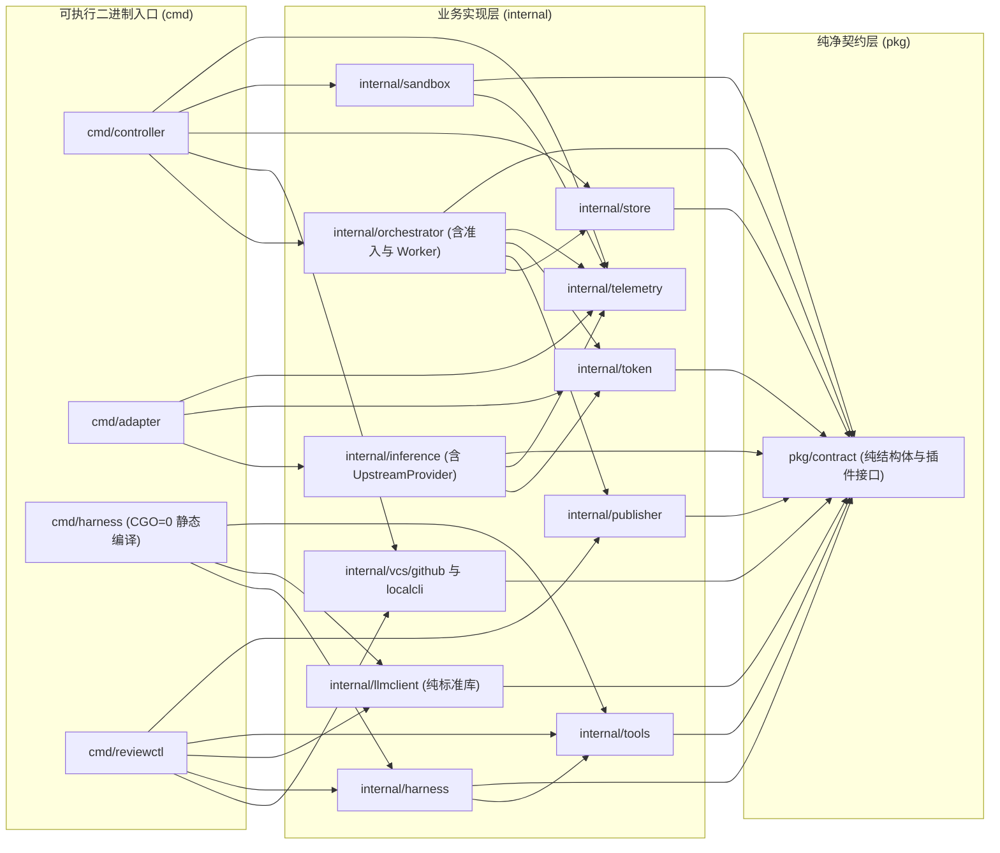
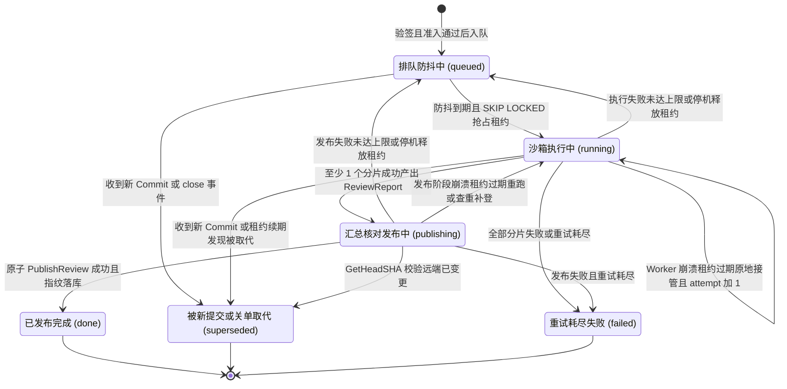
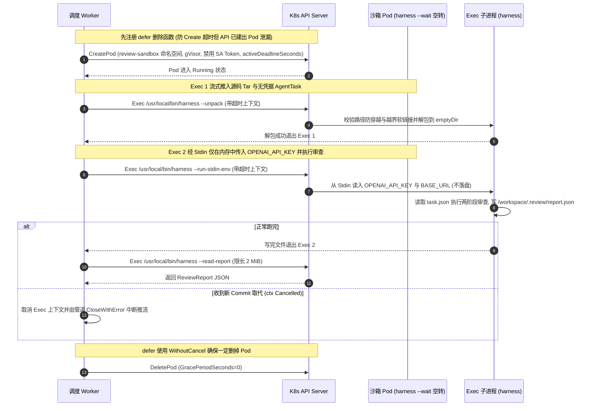
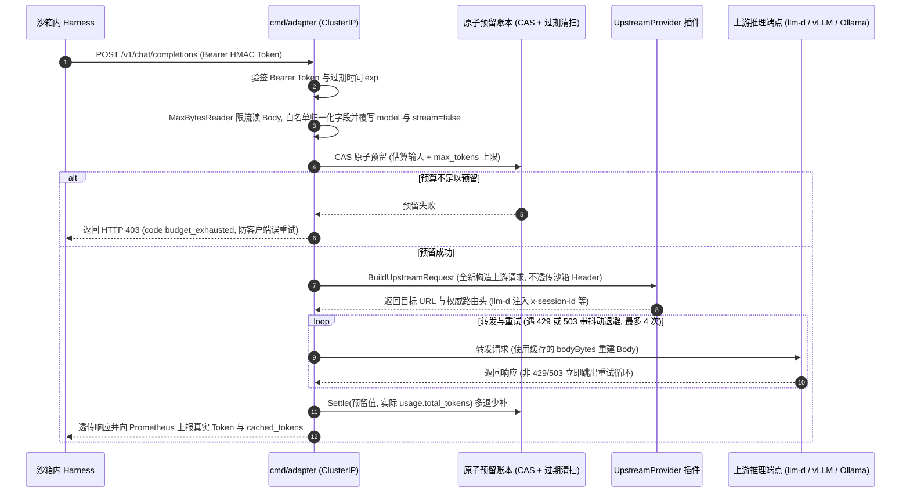
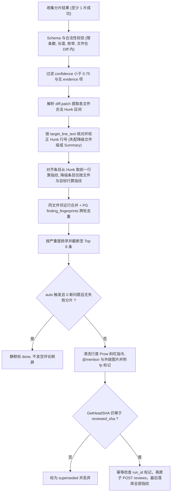
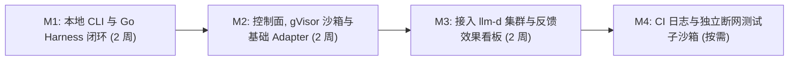

# review-agent-infra Go 全栈实现方案与开发计划

> 本文档对应 [高层架构设计（HLD）](hld.md) 的工程落地规格，定义全栈 Golang 的仓库布局、包依赖边界、核心 `interface`、PostgreSQL 并发状态机、K8s gVisor Exec 沙箱、`cmd/harness` 与 `cmd/adapter` 关键实现逻辑及 M1~M4 开发计划。

---

## 1. Go-First 全栈选型与包依赖架构

全系统采用 **单一 Go Module（`github.com/zetxqx/review-agent-infra`）** 产出 4 个独立二进制，既能以单一语言统一研发维护，又能把沙箱内二进制做到零 Python 运行时依赖：

| 二进制入口 | 运行位置 | 核心职责 | 关键工程考量 |
| :--- | :--- | :--- | :--- |
| **`cmd/controller`** | 受信任控制面 Pod | Webhook 接入与准入限流、PG 状态机、防抖取消、K8s 沙箱调度、去噪发布与反馈轮询 | 单体低内存二进制，原生用 `k8s.io/client-go` 管理沙箱 Pod 与 Exec 流 |
| **`cmd/adapter`** | 沙箱外独立微代理 Pod（首期单副本） | 校验 HMAC-SHA256 短期令牌、CAS 预算预留结算、调用 `UpstreamProvider` 注路由 Header 与 `429/503` 重试 | `net/http` 独立暴露 ClusterIP，沙箱仅直连此端口，真凭据不入沙箱 |
| **`cmd/harness`** | 沙箱 Pod 内 | `--wait` 空转守候、`--unpack` 安全解包、`--run-stdin-env` 两阶段只读推理循环、`--read-report` 吐出结果 | `CGO_ENABLED=0` 静态单文件打入极简镜像；同时保留 `AgentTask.json` 文件契约以兼容未来换用 OpenHands |
| **`cmd/reviewctl`** | 开发者本地 / CI 测试 | 本地 `git diff` 审查（`localcli`）与历史 PR 离线回放评测 | 复用 `internal/harness`、`internal/llmclient`、`internal/publisher` 与 `internal/tools`，M1 即可跑通 |

### 1.1 仓库目录树与严格单向依赖

```text
review-agent-infra/
├── cmd/
│   ├── controller/           # 控制面服务入口
│   ├── adapter/              # Inference Adapter 代理服务入口
│   ├── harness/              # 沙箱静态执行器入口 (--wait / --unpack / --run-stdin-env / --read-report)
│   └── reviewctl/            # 本地 CLI 与离线回放工具
├── pkg/
│   └── contract/             # 全局共享数据结构与插件接口 (仅依赖标准库)
└── internal/
    ├── token/                # HMAC-SHA256 短期令牌签发与验签
    ├── telemetry/            # OpenTelemetry 与 Prometheus 指标注册 (预算/KV 指标由 adapter 上报)
    ├── llmclient/            # 纯标准库 OpenAI 兼容 HTTP 客户端 (实现 contract.InferenceClient)
    ├── tools/                # 离线只读工具集 (os.Root 守卫 + 安全 exec rg + go/parser 大纲 + 可选 scoped_test)
    ├── inference/            # Adapter 核心代理、CAS 预算账本、UpstreamProvider 插件 (llmd/vllm/ollama) 与重试
    ├── harness/              # 两阶段只读循环、前缀稳定拼装、JSON Schema 校验与纠错重试
    ├── vcs/
    │   ├── github/           # GitHub App 验签、Tarball/Diff/BaseRules 拉取、幂等 PublishReview、可选 FetchCheckLogs
    │   └── localcli/         # 本地 git diff 触发与终端打印
    ├── store/                # PostgreSQL 建表迁移、SKIP LOCKED 队列、防抖锁与指纹表
    ├── sandbox/              # K8s gVisor Pod Exec 调度器与本地 Docker Runner
    ├── publisher/            # Diff Hunk 解析、target_line_text 原文对齐、两级降级与 Prow 清洗
    └── orchestrator/         # 准入控制 (draft/bot/首次贡献者/限流)、调度 Worker 主循环、分片与汇总去噪
```

各二进制与包的依赖严格单向无环，确保 `cmd/harness` 不拉入 `client-go`、`telemetry` 或 PostgreSQL 驱动：



---

## 2. 核心契约与 5 大插件 Go 接口（`pkg/contract`）

`pkg/contract` 只引入 Go 标准库，定义跨二进制的统一数据结构与插件接口，确保替换任意一环时控制面 `internal/orchestrator` 无需修改：

```go
package contract

import (
	"context"
	"io"
	"time"
)

type ReviewEvent struct {
	EventID       string `json:"event_id"`        // Webhook delivery UUID
	EventKind     string `json:"event_kind"`      // review | close | feedback | ignore
	Source        string `json:"source"`          // github | gitlab | cli
	Repo          string `json:"repo"`            // e.g. "llm-d/llm-d-router"
	PRNumber      int    `json:"pr_number"`
	BaseSHA       string `json:"base_sha"`
	HeadSHA       string `json:"head_sha"`
	IsDraft       bool   `json:"is_draft"`
	IsBotAuthor   bool   `json:"is_bot_author"`
	IsFork        bool   `json:"is_fork"`
	Author        string `json:"author"`
	TriggeredBy   string `json:"triggered_by"`    // 触发本次事件的人（评论 /review 时与 PR Author 可能不同）
	IsMaintainer  bool   `json:"is_maintainer"`   // 由 VCS 插件按 author_association (OWNER/MEMBER/COLLABORATOR) 判定
	TriggerType   string `json:"trigger_type"`    // auto | manual_command
	ForceRerunSeq int64  `json:"force_rerun_seq"` // auto=0; 手动 /review 取触发评论 ID, 天然幂等
}

type ToolEndpoints struct {
	ScopedTest string `json:"scoped_test,omitempty"` // 可选: 独立断网测试 Runner 子沙箱 Pod 地址
}

type TaskBudget struct {
	MaxTurns         int   `json:"max_turns"`
	MaxContextTokens int   `json:"max_context_tokens"`
	MaxTotalTokens   int64 `json:"max_total_tokens"`
}

// AgentTask 会落盘到沙箱 emptyDir，严禁包含任何 OPENAI_API_KEY 或平台凭据
type AgentTask struct {
	RunID          string        `json:"run_id"`
	PRTitle        string        `json:"pr_title"`
	PRBody         string        `json:"pr_body"`
	BaseBranch     string        `json:"base_branch"`
	DiffFile       string        `json:"diff_file"`              // /workspace/.review/diff.patch
	CILogsFile     string        `json:"ci_logs_file,omitempty"` // 可选: 截断后的 CI 失败日志
	RepoRules      []string      `json:"repo_rules"`             // 由控制面从 base_sha 提取
	WorkspaceRODir string        `json:"workspace_ro_dir"`       // /workspace/src
	OutputFile     string        `json:"output_file"`            // /workspace/.review/report.json
	ToolEndpoints  ToolEndpoints `json:"tool_endpoints,omitempty"`
	Budget         TaskBudget    `json:"budget"`
}

type SandboxSpec struct {
	ShortRunID      string
	ShardIndex      int
	Attempt         int
	TarballPath     string        // 控制面已落盘并限长的临时快照归档路径（支持多片只读复用）
	DiffPatch       []byte        // 当前分片的带行号 Diff
	CILogs          []byte        // 可选: 截断后的 CI 日志
	TaskJSON        []byte        // 不含凭据的 AgentTask JSON
	AdapterURL      string        // 仅经 Exec Stdin 传入内存
	SignedTaskToken string        // 仅经 Exec Stdin 传入内存
	Timeout         time.Duration // 整体沙箱期限
}

type ReviewFinding struct {
	File           string  `json:"file"`
	Line           int     `json:"line"`
	Side           string  `json:"side"`             // RIGHT | LEFT
	TargetLineText string  `json:"target_line_text"` // 用于 Publisher 原文对齐
	Severity       string  `json:"severity"`         // critical | high | medium | low
	Confidence     float64 `json:"confidence"`
	Category       string  `json:"category"`         // correctness | concurrency | security | k8s | style
	Title          string  `json:"title"`
	Explanation    string  `json:"explanation"`
	Suggestion     string  `json:"suggestion"`
	Evidence       string  `json:"evidence"`
}

// RunMetrics 仅作本地 CLI 参考；服务端计费与缓存统计全部以 cmd/adapter 上报为准
type RunMetrics struct {
	Turns            int   `json:"turns"`
	PromptTokens     int64 `json:"prompt_tokens"`
	CachedTokens     int64 `json:"cached_tokens"`
	CompletionTokens int64 `json:"completion_tokens"`
	DurationMs       int64 `json:"duration_ms"`
}

type ReviewReport struct {
	Summary  string          `json:"summary"`
	Findings []ReviewFinding `json:"findings"`
	Metrics  RunMetrics      `json:"metrics"`
}

type InlineComment struct {
	Fingerprint string
	Category    string
	File        string
	Line        int
	Side        string
	Body        string
}

type PublishRequest struct {
	Repo         string
	PRNumber     int
	CommitID     string
	RunID        string
	Event        string // 固定 "COMMENT"
	Summary      string
	Inlines      []InlineComment
	FileComments []InlineComment
}

type PublishedComment struct {
	Fingerprint string
	Category    string
	CommentID   int64 // 降级并入 Summary 的问题为 0（落库为 NULL）
}

type PublishResult struct {
	ReviewID int64
	Comments []PublishedComment
}

// 1. VCS 触发与发布插件 (核心 6 方法)
type VCSPlugin interface {
	VerifyAndParseWebhook(ctx context.Context, headers map[string]string, body []byte) (*ReviewEvent, error)
	GetHeadSHA(ctx context.Context, repo string, prNumber int) (string, error)
	FetchDiffAndTarball(ctx context.Context, repo string, prNumber int, baseSHA, headSHA string) (diffPatch []byte, tarball io.ReadCloser, err error)
	FetchBaseRules(ctx context.Context, repo, baseSHA string, changedFiles []string) ([]string, error)
	PublishReview(ctx context.Context, req PublishRequest) (*PublishResult, error)
	PollFeedback(ctx context.Context, repo string, prNumber int, commentIDs []int64) ([]FeedbackSample, error)
}

// 可选扩展接口：由 orchestrator 按类型断言探测，按需拉取 CI 失败日志并截断
type CheckLogFetcher interface {
	FetchCheckLogs(ctx context.Context, repo string, prNumber int, headSHA string, maxBytes int) ([]byte, error)
}

// 2. 沙箱运行器插件
type SandboxRunner interface {
	Run(ctx context.Context, spec SandboxSpec) (*ReviewReport, error)
}

// 3. Agent 核心执行插件 (Harness)
type HarnessEngine interface {
	Execute(ctx context.Context, task AgentTask) (*ReviewReport, error)
}

// 4. 上下文与只读工具插件
type ToolRegistry interface {
	Definitions() []ToolSchema
	Dispatch(ctx context.Context, name string, rawArgs []byte) (string, error)
}

// 5a. Harness 内推理客户端 (由 internal/llmclient 实现)
type InferenceClient interface {
	ChatWithTools(ctx context.Context, req ChatRequest) (*ChatResponse, error)
}

// 5b. Adapter 上游推理端点插件 (切换 llmd-gateway / vllm-direct / ollama)
type UpstreamProvider interface {
	BuildUpstreamRequest(ctx context.Context, claims TaskClaims, normalizedBody []byte) (targetURL string, headers map[string]string, body []byte, err error)
}
```

---

## 3. PostgreSQL 状态机、并发抢占与指纹去重设计（`internal/store`）

### 3.1 任务状态机流转图



### 3.2 核心表结构（SQL DDL）

```sql
-- 1. Webhook 投递去重表（防止网络重传同一 delivery_id）
CREATE TABLE webhook_deliveries (
    delivery_id TEXT PRIMARY KEY,
    received_at TIMESTAMPTZ NOT NULL DEFAULT now()
);

-- 2. 审查任务主表
CREATE TABLE review_runs (
    id               UUID PRIMARY KEY,
    repo             TEXT   NOT NULL,
    pr_number        INT    NOT NULL,
    base_sha         TEXT   NOT NULL,
    head_sha         TEXT   NOT NULL,
    trigger_type     TEXT   NOT NULL, -- 'auto' | 'manual_command'
    force_rerun_seq  BIGINT NOT NULL DEFAULT 0, -- auto=0; 手动 /review 用评论 ID 保证重跑幂等
    status           TEXT   NOT NULL, -- 'queued'|'running'|'publishing'|'done'|'superseded'|'failed'
    debounce_until   TIMESTAMPTZ NOT NULL,
    attempt          INT    NOT NULL DEFAULT 0,
    max_retries      INT    NOT NULL DEFAULT 2,
    worker_id        TEXT,
    lease_expires_at TIMESTAMPTZ,
    error_reason     TEXT,
    created_at       TIMESTAMPTZ NOT NULL DEFAULT now(),
    updated_at       TIMESTAMPTZ NOT NULL DEFAULT now()
);

-- 部分唯一幂等索引：允许 force-push 回到历史 SHA 或关闭后重开再次审查，但同一时刻不会重复排队/完成两次
CREATE UNIQUE INDEX uq_active_or_done_run_idempotency
    ON review_runs (repo, pr_number, base_sha, head_sha, trigger_type, force_rerun_seq)
    WHERE status NOT IN ('superseded', 'failed');

-- 数据库硬约束：同一个 PR 同时最多只有 1 个任务处于 running 或 publishing
CREATE UNIQUE INDEX uq_active_pr_run
    ON review_runs (repo, pr_number)
    WHERE status IN ('running', 'publishing');

CREATE INDEX idx_runs_claimable
    ON review_runs (status, debounce_until, lease_expires_at);

-- 3. 跨轮指纹去重表（仅用 file + prev_line + target_line，不含 category；降级进 Summary 的条目 comment_id 为 NULL）
CREATE TABLE finding_fingerprints (
    repo         TEXT NOT NULL,
    pr_number    INT  NOT NULL,
    fingerprint  TEXT NOT NULL,
    first_run_id UUID NOT NULL REFERENCES review_runs(id),
    comment_id   BIGINT,
    created_at   TIMESTAMPTZ NOT NULL DEFAULT now(),
    PRIMARY KEY (repo, pr_number, fingerprint)
);

-- 4. 效果反馈闭环表（Webhook + 定时轮询 Reaction 汇总）
CREATE TABLE review_feedback (
    repo                    TEXT NOT NULL,
    pr_number               INT  NOT NULL,
    comment_id              BIGINT NOT NULL,
    run_id                  UUID NOT NULL REFERENCES review_runs(id),
    fingerprint             TEXT NOT NULL,
    category                TEXT NOT NULL,
    thumbs_up               INT  NOT NULL DEFAULT 0,
    thumbs_down             INT  NOT NULL DEFAULT 0,
    resolved_in_next_commit BOOLEAN NOT NULL DEFAULT FALSE,
    updated_at              TIMESTAMPTZ NOT NULL DEFAULT now(),
    PRIMARY KEY (repo, pr_number, comment_id)
);
```

### 3.3 并发入队、关闭取代、抢占接管与心跳续期（Go + SQL 伪代码）

```go
// SupersedeAll 处理 PR closed 事件：只取代进行中的任务，不插入新任务
func (s *PGStore) SupersedeAll(ctx context.Context, repo string, prNumber int, deliveryID string) error {
	tx, err := s.db.BeginTx(ctx, nil)
	if err != nil {
		return err
	}
	defer tx.Rollback()

	if deliveryID != "" {
		res, err := tx.ExecContext(ctx, `INSERT INTO webhook_deliveries (delivery_id) VALUES ($1) ON CONFLICT DO NOTHING`, deliveryID)
		if err != nil {
			return err
		}
		if n, _ := res.RowsAffected(); n == 0 {
			return tx.Commit()
		}
	}
	if _, err := tx.ExecContext(ctx, `SELECT pg_advisory_xact_lock(hashtext($1), $2)`, repo, prNumber); err != nil {
		return err
	}
	if _, err := tx.ExecContext(ctx, `
		UPDATE review_runs SET status = 'superseded', updated_at = now()
		WHERE repo = $1 AND pr_number = $2 AND status IN ('queued', 'running', 'publishing')
	`, repo, prNumber); err != nil {
		return err
	}
	return tx.Commit()
}

// EnqueueOrSupersede 在单事务内完成：投递去重 + 取代旧任务 + 插入防抖新任务
func (s *PGStore) EnqueueOrSupersede(ctx context.Context, ev contract.ReviewEvent, debounce time.Duration) (uuid.UUID, bool, error) {
	tx, err := s.db.BeginTx(ctx, nil)
	if err != nil {
		return uuid.Nil, false, err
	}
	defer tx.Rollback()

	if ev.EventID != "" {
		res, err := tx.ExecContext(ctx, `INSERT INTO webhook_deliveries (delivery_id) VALUES ($1) ON CONFLICT DO NOTHING`, ev.EventID)
		if err != nil {
			return uuid.Nil, false, err
		}
		if n, _ := res.RowsAffected(); n == 0 {
			return uuid.Nil, false, tx.Commit()
		}
	}

	if _, err := tx.ExecContext(ctx, `SELECT pg_advisory_xact_lock(hashtext($1), $2)`, ev.Repo, ev.PRNumber); err != nil {
		return uuid.Nil, false, err
	}

	// 释放旧的 queued / running / publishing（解除 uq_active_pr_run 占位）
	if _, err := tx.ExecContext(ctx, `
		UPDATE review_runs SET status = 'superseded', updated_at = now()
		WHERE repo = $1 AND pr_number = $2
		  AND status IN ('queued', 'running', 'publishing')
		  AND NOT (base_sha = $3 AND head_sha = $4 AND trigger_type = $5 AND force_rerun_seq = $6)
	`, ev.Repo, ev.PRNumber, ev.BaseSHA, ev.HeadSHA, ev.TriggerType, ev.ForceRerunSeq); err != nil {
		return uuid.Nil, false, err
	}

	runID := uuid.New()
	res, err := tx.ExecContext(ctx, `
		INSERT INTO review_runs (id, repo, pr_number, base_sha, head_sha, trigger_type, force_rerun_seq, status, debounce_until)
		VALUES ($1, $2, $3, $4, $5, $6, $7, 'queued', now() + ($8 * interval '1 second'))
		ON CONFLICT (repo, pr_number, base_sha, head_sha, trigger_type, force_rerun_seq)
		WHERE status NOT IN ('superseded', 'failed') DO NOTHING
	`, runID, ev.Repo, ev.PRNumber, ev.BaseSHA, ev.HeadSHA, ev.TriggerType, ev.ForceRerunSeq, int64(debounce.Seconds()))
	if err != nil {
		return uuid.Nil, false, err
	}
	inserted, _ := res.RowsAffected()
	return runID, inserted > 0, tx.Commit()
}

// ClaimNextRun 抢占防抖到期的 queued，或回收崩溃超时（running / publishing 且租约过期）的孤儿任务
// 若无可抢占任务返回 sql.ErrNoRows，绝不返回 (nil, nil)
func (s *PGStore) ClaimNextRun(ctx context.Context, workerID string, leaseTTL time.Duration) (*RunRecord, error) {
	for {
		tx, err := s.db.BeginTx(ctx, nil)
		if err != nil {
			return nil, err
		}

		var rec RunRecord
		err = tx.QueryRowContext(ctx, `
			SELECT id, repo, pr_number, base_sha, head_sha, trigger_type, status, attempt, max_retries
			FROM review_runs r
			WHERE (
				r.status = 'queued'
				AND r.debounce_until <= now()
				AND NOT EXISTS (
					SELECT 1 FROM review_runs a
					WHERE a.repo = r.repo AND a.pr_number = r.pr_number AND a.status IN ('running', 'publishing')
				)
			) OR (
				r.status IN ('running', 'publishing') AND r.lease_expires_at < now()
			)
			ORDER BY r.created_at ASC
			FOR UPDATE OF r SKIP LOCKED
			LIMIT 1
		`).Scan(&rec.ID, &rec.Repo, &rec.PRNumber, &rec.BaseSHA, &rec.HeadSHA, &rec.TriggerType, &rec.Status, &rec.Attempt, &rec.MaxRetries)
		if err != nil {
			tx.Rollback()
			return nil, err
		}

		if (rec.Status == "running" || rec.Status == "publishing") && rec.Attempt >= rec.MaxRetries {
			_, updErr := tx.ExecContext(ctx, `UPDATE review_runs SET status = 'failed', error_reason = 'lease expired max retries', updated_at = now() WHERE id = $1`, rec.ID)
			if updErr != nil {
				tx.Rollback()
				return nil, updErr
			}
			if cErr := tx.Commit(); cErr != nil {
				return nil, cErr
			}
			continue // 本条已置 failed，继续抢占下一条有效任务
		}

		nextAttempt := rec.Attempt
		if rec.Status == "running" || rec.Status == "publishing" {
			nextAttempt++
		}
		_, err = tx.ExecContext(ctx, `
			UPDATE review_runs
			SET status = 'running', attempt = $2, worker_id = $3, lease_expires_at = now() + ($4 * interval '1 second'), updated_at = now()
			WHERE id = $1
		`, rec.ID, nextAttempt, workerID, int64(leaseTTL.Seconds()))
		if err != nil {
			tx.Rollback()
			return nil, err
		}
		if err := tx.Commit(); err != nil {
			return nil, err
		}
		rec.Attempt = nextAttempt
		return &rec, nil
	}
}

// RenewLease 在 running 与 publishing 两阶段都保持续期；返回 false 说明已被 superseded
func (s *PGStore) RenewLease(ctx context.Context, runID uuid.UUID, workerID string, leaseTTL time.Duration) (bool, error) {
	res, err := s.db.ExecContext(ctx, `
		UPDATE review_runs
		SET lease_expires_at = now() + ($3 * interval '1 second'), updated_at = now()
		WHERE id = $1 AND worker_id = $2 AND status IN ('running', 'publishing')
	`, runID, workerID, int64(leaseTTL.Seconds()))
	if err != nil {
		return false, err
	}
	n, _ := res.RowsAffected()
	return n == 1, nil
}
```

---

## 4. `internal/orchestrator` 准入控制与 Worker 主流程（含防泄漏与重试）

### 4.1 准入控制策略（HLD §3.1 落地归属）

所有 Webhook 事件先经过 `orchestrator.AdmissionCheck`（不塞进 Harness 或 Store）：
1. **事件分类路由**：`EventKind == "ignore"` 直接返回 200；`EventKind == "close"` 调用 `store.SupersedeAll`；`EventKind == "feedback"` 写入 `review_feedback`。
2. **手动命令鉴权**：若 `ev.TriggerType == "manual_command"` 但 `!ev.IsMaintainer`（非 OWNER / MEMBER / COLLABORATOR），**直接拒绝**，防止外部贡献者在自己的 PR 下评论 `/review` 绕过门禁。
3. **Draft 与 Bot 过滤**：`ev.IsDraft || ev.IsBotAuthor` 直接跳过不入队。
4. **外部 Fork 防滥用与限流**：
   * 基于内存令牌桶 + PG 近期记录做**按仓库/作者滑动窗口限流**（超限丢弃并打指标）。
   * 若 `ev.IsFork && ev.TriggerType == "auto"`，校验作者是否在仓库协作者/历史已合入白名单内；**首次外部贡献者自动跳过**，仅保留已授权维护者评论 `/review` 触发。

### 4.2 Worker `processRun` 与租约心跳 Go 伪代码

```go
func (o *Orchestrator) keepLeaseAlive(runCtx context.Context, runCancel context.CancelFunc, runID uuid.UUID, workerID string, leaseTTL time.Duration) {
	ticker := time.NewTicker(leaseTTL / 3)
	defer ticker.Stop()
	lastSuccess := time.Now()

	for {
		select {
		case <-runCtx.Done():
			return
		case <-ticker.C:
			dbCtx, cancel := context.WithTimeout(runCtx, 5*time.Second)
			alive, err := o.store.RenewLease(dbCtx, runID, workerID, leaseTTL)
			cancel()
			if err != nil {
				// 数据库持续不可达超过 leaseTTL 时主动自杀防脑裂
				if time.Since(lastSuccess) > leaseTTL {
					runCancel()
					return
				}
				continue
			}
			if !alive {
				runCancel() // 已被新 Commit 取代为 superseded
				return
			}
			lastSuccess = time.Now()
		}
	}
}

func (o *Orchestrator) processRun(parentCtx context.Context, rec *store.RunRecord) {
	runCtx, runCancel := context.WithCancel(parentCtx)
	defer runCancel()

	// 1. 启动租约心跳协程（覆盖 running 与 publishing 全程）
	go o.keepLeaseAlive(runCtx, runCancel, rec.ID, o.workerID, o.leaseTTL)

	// 2. 拉取三点 Diff、将快照流落盘到受限临时目录（供多分片与重跑只读复用）
	tarPath, cleanupTar, diffPatch, baseRules, ciLogs, err := o.fetchInputsToTemp(runCtx, rec)
	if cleanupTar != nil {
		defer cleanupTar()
	}
	if err != nil {
		o.handleRunFailure(parentCtx, runCtx, rec, err)
		return
	}

	// 3. 按单次 max_context_tokens 的约 1/3 估算切分分片；全过滤后无分片（如只改 go.sum）则静默标 done
	shards := o.splitDiffIntoShards(diffPatch, o.cfg.MaxContextTokens/3)
	if len(shards) == 0 {
		_ = o.store.MarkDoneIfActive(parentCtx, rec.ID, o.workerID)
		return
	}

	// errgroup 仅用 SetLimit 限并发，协程内部始终 return nil（错误写入 ShardOutput.Err），避免单片失败连坐取消全部分片
	results := make([]ShardOutput, len(shards))
	var eg errgroup.Group
	eg.SetLimit(o.cfg.MaxConcurrentShards)
	for i, sh := range shards {
		eg.Go(func() error {
			rep, runErr := o.sandbox.Run(runCtx, o.buildShardSpec(rec, i, sh, tarPath, baseRules, ciLogs))
			results[i] = ShardOutput{ShardName: sh.Name, Report: rep, Err: runErr}
			return nil
		})
	}
	_ = eg.Wait()

	// 4. 汇总去噪、原文对齐与发布（running -> publishing -> done）
	if err := o.PrepareAndPublish(runCtx, rec, results, diffPatch); err != nil {
		o.handleRunFailure(parentCtx, runCtx, rec, err)
	}
}

func (o *Orchestrator) handleRunFailure(parentCtx, runCtx context.Context, rec *store.RunRecord, runErr error) {
	// 优雅停机（SIGTERM 导致 parentCtx 取消）：用 WithoutCancel 主动释放租约回 queued，不耗 attempt
	// 注意：ReleaseLeaseToQueued 与 RecordErrorOrRequeue 的 SQL 均必须带 WHERE id = $1 AND worker_id = $2 AND status IN ('running', 'publishing')，防把已被取代的任务拉回队列
	if parentCtx.Err() != nil {
		relCtx, cancel := context.WithTimeout(context.WithoutCancel(parentCtx), 5*time.Second)
		defer cancel()
		_ = o.store.ReleaseLeaseToQueued(relCtx, rec.ID, o.workerID)
		return
	}
	if runCtx.Err() != nil {
		return // 因被 superseded 而取消，状态已由 Enqueue/SupersedeAll 更新
	}
	// RecordErrorOrRequeue 同样严格校验 worker_id 与 status IN ('running', 'publishing')
	finalFailed, err := o.store.RecordErrorOrRequeue(parentCtx, rec.ID, o.workerID, runErr.Error(), 15*time.Second)
	if err != nil || !finalFailed {
		return
	}
	// HLD 默认策略：自动触发静默告警；仅人工 /review 显式触发最终失败时回一行简短提示
	if rec.TriggerType == "manual_command" {
		_, _ = o.vcs.PublishReview(parentCtx, contract.PublishRequest{
			Repo: rec.Repo, PRNumber: rec.PRNumber, CommitID: rec.HeadSHA, RunID: rec.ID.String(),
			Event:   "COMMENT",
			Summary: fmt.Sprintf("手动代码审查执行失败（run_id: `%s`），请检查控制面日志。", rec.ID),
		})
	}
}
```

---

## 5. `K8sSandboxRunner` 与 `client-go` Exec 沙箱实现（`internal/sandbox`）

### 5.1 命名空间隔离、RBAC 最小权限与 Exec 生命周期

* **推荐双命名空间部署与 NetworkPolicy 选择器**：控制器部署在 `review-system` 命名空间，沙箱 Pod 统一创建在独立的 `review-sandbox` 命名空间（便于整体套用 `NetworkPolicy` 禁 DNS 与内外网）。控制器 ServiceAccount 的 RBAC **仅授予 `review-sandbox` 命名空间的 `pods`（`create`/`get`/`list`/`delete`）与 `pods/exec`（`create`）权限**。沙箱内通过 `OPENAI_BASE_URL` 直连 Adapter ClusterIP，但 `NetworkPolicy` 放行规则**必须使用 `namespaceSelector` + `podSelector` 精准选中 Adapter Pod**（不要用 `ipBlock` 写 Service ClusterIP，Kubernetes 不保证 `ipBlock` 对虚 IP 生效）。
* **`OwnerReference` 与回收策略**：Kubernetes 禁止跨命名空间的 `OwnerReference`，因此在独立 `review-sandbox` 命名空间下**不设置 `OwnerReference`**，依赖 `ActiveDeadlineSeconds` + `defer` 删除 + 控制面每 5 分钟运行的 **Orphan Pod Reaper** 回收；若测试环境采用同命名空间单命名空间部署，则将 `OwnerReference` 指向控制器的 **Pod**（而非 Deployment），实现控制面重建自动连带清理。

注意 Kubernetes `PodExecOptions` 本身不提供环境变量传递字段；控制面在创建 Pod 之前先注册 `defer` 删除，主容器运行 `/usr/local/bin/harness --wait` 空转守候，再通过 `harness` 的 3 个子命令完成沙箱生命周期：



### 5.2 `K8sSandboxRunner.Run()` Go 伪代码

```go
func (r *K8sSandboxRunner) Run(ctx context.Context, spec contract.SandboxSpec) (*contract.ReviewReport, error) {
	ctx, totalCancel := context.WithTimeout(ctx, spec.Timeout)
	defer totalCancel()

	// Pod 名包含分片序号与尝试次数，防止多分片并发撞名
	podName := fmt.Sprintf("review-sbx-%s-s%d-a%d", spec.ShortRunID, spec.ShardIndex, spec.Attempt)
	pod := r.buildHardenedPod(podName, spec) // 独立命名空间 review-sandbox, RuntimeClass="gvisor", AutomountSA=false, ActiveDeadlineSeconds

	// 必须在 Create 之前注册 defer：即使 Create 因网络超时报错，远端可能已创建出 Pod
	defer func() {
		delCtx, cancel := context.WithTimeout(context.WithoutCancel(ctx), 15*time.Second)
		defer cancel()
		err := r.clientset.CoreV1().Pods(r.namespace).Delete(delCtx, podName, metav1.DeleteOptions{
			GracePeriodSeconds: ptr.To(int64(0)),
		})
		if err != nil && !apierrors.IsNotFound(err) {
			r.logger.Error(err, "delete sandbox pod failed", "pod", podName)
		}
	}()

	if _, err := r.clientset.CoreV1().Pods(r.namespace).Create(ctx, pod, metav1.CreateOptions{}); err != nil {
		return nil, fmt.Errorf("create sandbox pod: %w", err)
	}

	waitCtx, waitCancel := context.WithTimeout(ctx, 60*time.Second)
	defer waitCancel()
	if err := r.waitPodRunning(waitCtx, podName); err != nil {
		return nil, err
	}

	// Exec 1: 从控制器本地 TarballPath 安全流式构建合成 tar（用 errCh 回收写端错误，避免半截 tar 漏判）
	pr, pw := io.Pipe()
	defer pr.Close()
	tarErrCh := make(chan error, 1)
	go func() {
		err := streamCompositeTar(pw, spec.TarballPath, spec.DiffPatch, spec.CILogs, spec.TaskJSON)
		_ = pw.CloseWithError(err)
		tarErrCh <- err
	}()
	unpackCtx, unpackCancel := context.WithTimeout(ctx, 45*time.Second)
	defer unpackCancel()
	if err := r.execStream(unpackCtx, podName, []string{"/usr/local/bin/harness", "--unpack"}, pr, nil); err != nil {
		_ = pr.CloseWithError(err)
		<-tarErrCh
		return nil, fmt.Errorf("unpack sandbox input: %w", err)
	}
	// 先显式关读端，防止 --unpack 未读完 stdin 就以 0 退出导致写协程卡死在 <-tarErrCh
	_ = pr.Close()
	if tarErr := <-tarErrCh; tarErr != nil {
		return nil, fmt.Errorf("stream composite tar: %w", tarErr)
	}

	// Exec 2: 仅通过 Stdin 向 harness 进程内存传入短期令牌，绝不写入 emptyDir
	secretJSON := mustMarshal(map[string]string{
		"openai_base_url": spec.AdapterURL,
		"openai_api_key":  spec.SignedTaskToken,
	})
	if err := r.execStream(ctx, podName, []string{"/usr/local/bin/harness", "--run-stdin-env"}, bytes.NewReader(secretJSON), nil); err != nil {
		return nil, fmt.Errorf("run harness: %w", err)
	}

	// Exec 3: 主进程仍在 --wait 空转，限长 2 MiB 读回报告文件（防恶意超大 JSON 撑爆控制面）
	readCtx, readCancel := context.WithTimeout(ctx, 20*time.Second)
	defer readCancel()
	var outBuf cappedBuffer // 内部限制 maxBytes = 2 << 20
	if err := r.execStream(readCtx, podName, []string{"/usr/local/bin/harness", "--read-report"}, nil, &outBuf); err != nil {
		return nil, fmt.Errorf("read report: %w", err)
	}

	var report contract.ReviewReport
	if err := json.Unmarshal(outBuf.Bytes(), &report); err != nil {
		return nil, fmt.Errorf("decode report.json: %w", err)
	}
	return &report, nil
}
```

> **孤儿 Pod 清理**：`ActiveDeadlineSeconds` 到期后 Pod 只是变成 `Failed` 状态而不会被自动删除对象；因此控制器内必须常驻一个每 5 分钟扫一次 `app=review-sandbox` 标签的 **Orphan Pod Reaper** 清理超时或控制器重启遗留的 Pod。

---

## 6. 沙箱内 Go `harness` 两阶段只读循环与工具层（`cmd/harness` + `internal/harness` + `internal/tools`）

### 6.1 `CGO_ENABLED=0` 静态构建取舍与安全工具执行

* **零 Cgo 工具实现**：主流 `tree-sitter` Go 绑定依赖 Cgo；为了保障 `cmd/harness` 能够 `CGO_ENABLED=0` 静态单文件编译，M1 阶段 Go 语言代码大纲提取直接使用标准库 **`go/parser` + `go/ast`**，多语言支持后续按需引入纯 Go/WASM 解析或独立静态辅助工具。`ripgrep`（`rg`）以静态 musl 二进制形式随 `harness` 一同打入极简镜像。
* **防软链接/路径逃逸**：使用 Go 标准库 **`os.OpenRoot(workspaceRoot)`**（`*os.Root`）打开工作区根目录，由运行时直接阻止 `..` 与逃出工作区的软链接读取。
* **防 `rg` 参数注入**：调用外部 `rg` 二进制时，用 `-e` 与 `--` 死锁参数边界，防止模型传入的搜索词被解析为 `--pre` 等危险参数：

```go
func (t *ToolBox) SearchCode(ctx context.Context, pattern, relSubDir string) (string, error) {
	// 校验相对子目录不逃逸（配合 os.Root.Stat 验证存在且在目录内）
	if _, err := t.wsRoot.Stat(relSubDir); err != nil {
		return "", fmt.Errorf("invalid search scope: %w", err)
	}
	target := filepath.Join(t.wsPath, filepath.Clean("/"+relSubDir))
	// 必须加 --no-ignore，防止恶意 PR 用 .gitignore / .ignore 隐藏代码
	// 固定 -e 与 --，绝不允许模型参数被解释为 rg 选项（如 --pre）
	cmd := exec.CommandContext(ctx, "rg", "--no-config", "--no-ignore", "-n", "--max-count=50", "--color=never", "-e", pattern, "--", target)
	out, err := cmd.CombinedOutput()
	if err != nil && cmd.ProcessState != nil && cmd.ProcessState.ExitCode() == 1 {
		return "no matches found", nil
	}
	return string(out), err
}
```

### 6.2 前缀稳定两阶段循环（`internal/harness` Go 伪代码）

为了避免滑动裁剪中间历史破坏 `llm-d` 的 KV Prefix Cache，且防止最后一轮再吐出工具调用导致白跑失败：**`harness` 自己累计跟踪估算 Token 与轮次，一旦到达 `MaxTurns`、上下文逼近 `85% MaxContextTokens` 或剩余总预算不足，直接以 `ToolChoice: "none"` 进入收尾总结轮**：

```go
func (e *TwoStageEngine) Execute(ctx context.Context, task contract.AgentTask) (*contract.ReviewReport, error) {
	// 前 2 条为不可变前缀：System Prompt (含 base 规则) + PR Diff / 截断 CI 日志
	messages := []contract.ChatMessage{
		{Role: "system", Content: buildSystemPrompt(task.RepoRules)},
		{Role: "user", Content: buildInitialUserPrompt(task.PRTitle, task.PRBody, task.DiffFile, task.CILogsFile)},
	}
	toolSchemas := e.tools.Definitions()

	var estTotalUsed int64
	for turn := 1; turn <= task.Budget.MaxTurns; turn++ {
		if err := ctx.Err(); err != nil {
			return nil, err
		}

		// 若到达最后一轮、上下文超 85%、或剩余总预算逼近上限，强制进入禁工具收尾轮，避免前功尽弃
		forceFinalize := turn == task.Budget.MaxTurns ||
			estimateTokens(messages) >= int(float64(task.Budget.MaxContextTokens)*0.85) ||
			estTotalUsed >= int64(float64(task.Budget.MaxTotalTokens)*0.85)

		req := contract.ChatRequest{
			Messages:         messages,
			Tools:            toolSchemas,
			ToolChoice:       "auto",
			RequireJSONReply: forceFinalize,
		}
		if forceFinalize {
			req.ToolChoice = "none"
			req.Messages = append(messages, contract.ChatMessage{
				Role: "user", Content: "请停止调用工具，立即基于已查证证据按 ReviewReport JSON Schema 输出最终结果。",
			})
		}

		resp, err := e.infer.ChatWithTools(ctx, req)
		if err != nil {
			return nil, err
		}
		estTotalUsed += resp.Usage.TotalTokens

		if len(resp.ToolCalls) > 0 && !forceFinalize {
			messages = append(messages, resp.AssistantMessage)
			for _, tc := range resp.ToolCalls {
				toolOut, execErr := e.dispatchTool(ctx, task, tc)
				if execErr != nil {
					toolOut = "tool error: " + execErr.Error()
				}
				messages = append(messages, contract.ChatMessage{
					Role: "tool", ToolCallID: tc.ID, Content: truncateToolOutput(toolOut, 8192),
				})
			}
			continue
		}

		// 独立完成 Schema 校验及 1 次纠错重试（即使在最后一轮也不被 MaxTurns 循环截断）
		return e.validateOrRetryOnce(ctx, req.Messages, toolSchemas, resp)
	}
	return nil, errors.New("exceeded max_turns without valid report")
}

func (e *TwoStageEngine) validateOrRetryOnce(ctx context.Context, history []contract.ChatMessage, toolSchemas []contract.ToolSchema, resp *contract.ChatResponse) (*contract.ReviewReport, error) {
	report, valErr := parseAndValidateReport(resp.Content)
	if valErr == nil {
		return report, nil
	}
	// 纠错请求必须带上与前缀一致的 Tools（搭配 ToolChoice: "none"），保证 OpenAI 兼容性并复用 Prefix Cache
	retryReq := contract.ChatRequest{
		Messages: append(history, resp.AssistantMessage, contract.ChatMessage{
			Role:    "user",
			Content: fmt.Sprintf("JSON 格式校验失败（%v），请严格按 ReviewReport Schema 重新输出纯 JSON。", valErr),
		}),
		Tools:            toolSchemas,
		ToolChoice:       "none",
		RequireJSONReply: true,
	}
	retryResp, err := e.infer.ChatWithTools(ctx, retryReq)
	if err != nil {
		return nil, err
	}
	return parseAndValidateReport(retryResp.Content)
}
```

---

## 7. Go `Inference Adapter` 微代理实现（`cmd/adapter` + `internal/inference`）

> **已知限制说明**：首期（M2~M3）`cmd/adapter` **运行单副本**以保证内存原子预算账本绝对一致（后续多副本可接 Redis 共享或按 `run_id` 一致性哈希分片）；且默认**强制 `stream=false`** 同步读取精确 `usage`（若未来对接强制要求 SSE 流式的第三方框架，需改为注入 `stream_options.include_usage=true` 并拦截尾帧结算）。

### 7.1 验签、预留结算、插件注入与重试时序图



### 7.2 `cmd/adapter` 原子预留结算与白名单代理 Go 伪代码

```go
// TryReserve 使用 atomic CAS 原子预留预算，杜绝并发请求同时通过预检导致超支
func (l *SessionLedger) TryReserve(estimate, maxTotal int64) bool {
	for {
		cur := l.reservedOrUsed.Load()
		if cur+estimate > maxTotal {
			return false
		}
		if l.reservedOrUsed.CompareAndSwap(cur, cur+estimate) {
			return true
		}
	}
}

func (l *SessionLedger) Settle(reserved, actual int64) {
	l.reservedOrUsed.Add(actual - reserved) // 失败退还预留(actual=0)；2xx 缺失 usage 时按保守预留扣减(actual=estCost)
}

func (p *AdapterProxy) ServeHTTP(w http.ResponseWriter, r *http.Request) {
	claims, err := p.verifier.VerifyBearer(r.Header.Get("Authorization"))
	if err != nil {
		http.Error(w, "unauthorized task token", http.StatusUnauthorized)
		return
	}

	r.Body = http.MaxBytesReader(w, r.Body, p.maxBodyBytes)
	rawBody, err := io.ReadAll(r.Body)
	if err != nil {
		http.Error(w, "request body too large", http.StatusRequestEntityTooLarge)
		return
	}
	// 白名单提取允许字段（messages/tools/tool_choice/response_format/temperature），强制覆写 model、卡住 max_tokens、强设 stream=false
	bodyBytes, estCost, err := p.sanitizePayload(rawBody, p.configuredModel, claims.MaxContextTokens)
	if err != nil {
		http.Error(w, "invalid request payload", http.StatusBadRequest)
		return
	}

	ledger := p.getOrCreateLedger(claims.JTI, claims.ExpiresAt) // 后台协程定期清理过期条目
	if !ledger.TryReserve(estCost, claims.MaxTotalTokens) {
		w.Header().Set("Content-Type", "application/json")
		w.WriteHeader(http.StatusForbidden) // 返回 403 而非 429，防止 OpenAI SDK 与限流退避混淆
		_, _ = w.Write([]byte(`{"error":{"code":"budget_exhausted","message":"task token budget exceeded"}}`))
		return
	}
	// 默认按预留值 estCost 计费：若上游 2xx 但缺失 usage 字段，仍按保守预留扣减，防绕过预算；4xx/5xx 失败时退还预留
	actualTokens := estCost
	defer func() { ledger.Settle(estCost, actualTokens) }()

	// 由可插拔 UpstreamProvider 决定目标地址与 Header（llmd-gateway / vllm-direct / ollama）
	upURL, upHeaders, finalBody, err := p.upstream.BuildUpstreamRequest(r.Context(), claims, bodyBytes)
	if err != nil {
		actualTokens = 0
		http.Error(w, "build upstream failed", http.StatusInternalServerError)
		return
	}

	var resp *http.Response
	var respBytes []byte
	for attempt := 0; attempt <= 4; attempt++ {
		// 全新构造请求，不复制沙箱侧任何 Header
		upReq, err := http.NewRequestWithContext(r.Context(), http.MethodPost, upURL, bytes.NewReader(finalBody))
		if err != nil {
			actualTokens = 0
			http.Error(w, "upstream request error", http.StatusInternalServerError)
			return
		}
		for k, v := range upHeaders {
			upReq.Header.Set(k, v)
		}

		resp, err = p.httpClient.Do(upReq)
		if err == nil && resp.StatusCode != http.StatusTooManyRequests && resp.StatusCode != http.StatusServiceUnavailable {
			respBytes, err = io.ReadAll(resp.Body)
			resp.Body.Close()
			if err != nil {
				actualTokens = 0
				http.Error(w, "read upstream response failed", http.StatusBadGateway)
				return
			}
			break
		}
		if resp != nil {
			resp.Body.Close()
		}
		if attempt == 4 || r.Context().Err() != nil {
			actualTokens = 0
			http.Error(w, "upstream inference unavailable after retries", http.StatusServiceUnavailable)
			return
		}
		if sleepErr := sleepWithJitter(r.Context(), backoffDuration(attempt, resp)); sleepErr != nil {
			actualTokens = 0
			return
		}
	}
	if resp == nil {
		actualTokens = 0
		http.Error(w, "empty upstream response", http.StatusBadGateway)
		return
	}

	if resp.StatusCode >= 200 && resp.StatusCode < 300 {
		total, cached := parseUsage(respBytes)
		if total > 0 {
			actualTokens = total
			p.metrics.ObserveTokens(claims.Repo, actualTokens, cached)
		} else {
			p.metrics.ObserveTokens(claims.Repo, actualTokens, 0) // 缺 usage 时按保守预留值计费
		}
	} else {
		actualTokens = 0
	}
	copySelectedHeaders(w.Header(), resp.Header, "Content-Type", "x-llm-d-flow-queue-duration-ms")
	w.WriteHeader(resp.StatusCode)
	_, _ = w.Write(respBytes)
}
```

---

## 8. 控制面去噪流水线与 Publisher 精准对齐清洗（`internal/orchestrator` + `internal/publisher`）

### 8.1 去噪与对齐发布流程图（先合法校验与原文对齐，再算指纹去重）



### 8.2 去噪、验证与幂等发布 Go 伪代码

```go
func (o *Orchestrator) PrepareAndPublish(ctx context.Context, run *store.RunRecord, shards []ShardOutput, diffPatch []byte) error {
	hunks := publisher.ParseUnifiedDiff(diffPatch) // 可选复用 reviewdog diff 解析库
	diffFiles := hunks.ChangedFileSet()

	var validFindings []contract.ReviewFinding
	var failedShards []string
	for _, s := range shards {
		if s.Err != nil {
			failedShards = append(failedShards, s.ShardName)
			continue
		}
		if err := publisher.ValidateReport(s.Report, diffFiles); err != nil { // 校验条数/字段长度/枚举/文件在 Diff 内
			failedShards = append(failedShards, s.ShardName)
			continue
		}
		validFindings = append(validFindings, s.Report.Findings...)
	}
	if len(failedShards) == len(shards) {
		return errors.New("all review shards failed or produced invalid reports")
	}

	// 1. 状态转 publishing
	if ok, err := o.store.MarkPublishing(ctx, run.ID, o.workerID); err != nil {
		return err
	} else if !ok {
		return nil
	}

	// 2. 先过滤再与 Hunk 对齐（对齐项直接从 Hunk 取前一行，覆盖 RIGHT 与 deleted LEFT；未对齐降级项仅按 file+target_line 算指纹）
	confident := filterByConfidenceAndEvidence(validFindings, 0.75)
	aligned := publisher.AlignAndComputeFingerprints(confident, hunks, o.cfg.SupportsFileComments)
	unseen, err := o.dedupWithPG(ctx, run.Repo, run.PRNumber, aligned)
	if err != nil {
		return err
	}
	finalItems := topNAndCluster(unseen, 8)

	// 3. 自动触发且 0 条有效结果、无分片失败时直接静默结束，不刷屏
	if run.TriggerType == "auto" && len(finalItems) == 0 && len(failedShards) == 0 {
		return o.store.MarkDoneIfActive(ctx, run.ID, o.workerID)
	}

	// 4. 不可信文本清洗（每条评论内置 <!-- fp:<fingerprint> --> 供崩溃重放解析映射）+ 实时查 HeadSHA CAS
	summary, inlines, fileCmts := publisher.BuildCleanOutputs(finalItems, failedShards, run.ID, run.HeadSHA)
	liveSHA, err := o.vcs.GetHeadSHA(ctx, run.Repo, run.PRNumber)
	if err != nil {
		return err
	}
	if liveSHA != run.HeadSHA {
		return o.store.MarkSuperseded(ctx, run.ID)
	}

	// 5. PublishReview 内部先扫描 <!-- review-run:<runID> --> 与各 <!-- fp:... --> 防崩溃重发，并返回实际已发评论列表
	pubRes, err := o.vcs.PublishReview(ctx, contract.PublishRequest{
		Repo: run.Repo, PRNumber: run.PRNumber, CommitID: run.HeadSHA, RunID: run.ID.String(),
		Event: "COMMENT", Summary: summary, Inlines: inlines, FileComments: fileCmts,
	})
	if err != nil {
		return err
	}

	// 6. 评论已发出后，指纹必须使用 WithoutCancel 无条件落库（Summary 降级项 comment_id 存 NULL；仅 comment_id>0 写入 review_feedback）
	saveCtx, saveCancel := context.WithTimeout(context.WithoutCancel(ctx), 10*time.Second)
	defer saveCancel()
	if err := o.store.SavePublishedFingerprints(saveCtx, run.Repo, run.PRNumber, run.ID, pubRes); err != nil {
		return err
	}
	return o.store.MarkDoneIfActive(saveCtx, run.ID, o.workerID)
}
```

---

## 9. 分阶段开发里程碑与验收标准（M1 ~ M4）



| 里程碑 | 交付内容 | 核心验收标准（可测量） |
| :--- | :--- | :--- |
| **M1：本地 CLI 与静态 Harness 闭环** | `pkg/contract`、`internal/llmclient`、`internal/tools`、`internal/harness`、`internal/publisher`、`cmd/harness`、`cmd/reviewctl` | `CGO_ENABLED=0` 静态编译通过；`os.OpenRoot` 与 `rg -e ... --` 防注入单测通过；Schema 校验+纠错重试与 Hunk 原文对齐单测 100% 通过；对 `llm-d-router` 历史 PR 本地回放跑通 |
| **M2：控制面调度、gVisor 沙箱与基础 Adapter** | `internal/store`（SQL 迁移 + 部分唯一索引 + `SKIP LOCKED`）、`internal/vcs/github`、`internal/sandbox`、`internal/orchestrator`（含准入限流）、`cmd/controller`、基础版 `cmd/adapter`（`internal/token` + `vllm-direct` + 预算原子预留） | 并发连续 Force-Push 集成测试验证旧 Pod 秒级取消、Reaper 与 `defer` 无孤儿 Pod 残留；`NetworkPolicy`（`namespaceSelector + podSelector` 选中 Adapter Pod）验证沙箱禁 DNS、禁其他内外网，仅能访问 Adapter Pod；内部灰度仓库试跑并实测文件级评论兼容性 |
| **M3：`llm-d` 集群接入与反馈闭环** | `UpstreamProvider` 的 `llmd-gateway` 插件、EPP 配置联动、`429/503` 重试调优、`internal/telemetry`、Reaction 定时轮询 | 对接 `llm-d` Gateway，验证多轮工具调用在 `session-affinity-scorer` 下稳定命中同 Pod 并从 `cmd/adapter` 准确上报 `cached_tokens`；模拟 `429/503` 与预算耗尽返回 `403` 验证通过；Grafana 看板展示采纳率与延迟 |
| **M4：可选 CI 日志与独立断网单测扩展** | `CheckLogFetcher.FetchCheckLogs`、独立 `Egress: DenyAll` 测试 Runner 子沙箱 Pod 与 `run_scoped_test` 扩展 | 开启扩展后，验证测试 Runner 子沙箱 Pod 完全断网且无法窃取 Harness 容器内存中的 `OPENAI_API_KEY`，控制面可结合截断 CI 日志与局部单测结果完成复核 |
